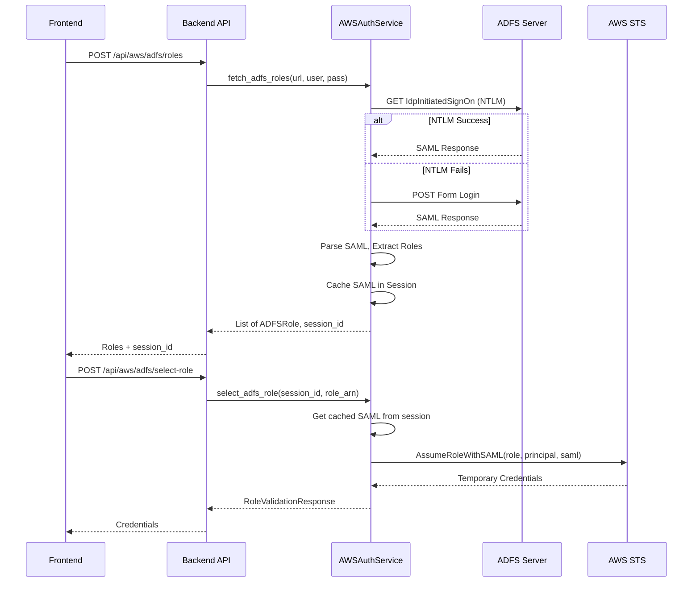

# Design Document: ADFS Pure Python Authentication

## Overview

This design replaces the subprocess-based `aws-adfs.exe` approach with a pure Python implementation for ADFS/SAML authentication. The new implementation uses standard Python libraries (`requests`, `requests-ntlm`, `beautifulsoup4`, `boto3`) to handle the complete ADFS authentication flow without requiring any external executables.

## Architecture



## Components and Interfaces

### AWSAuthService Class

The main service class handling all AWS authentication methods. The following methods are affected:

#### fetch_adfs_roles(adfs_url, username, password, region) -> Tuple[List[ADFSRole], str]

Pure Python implementation that:
1. Validates ADFS endpoint reachability
2. Validates URL is actually an ADFS server
3. Authenticates using NTLM (primary) or form-based (fallback)
4. Parses SAML response to extract AWS roles
5. Caches SAML response in session storage
6. Returns list of roles and session ID

#### select_adfs_role(session_id, role_arn, region) -> RoleValidationResponse

Pure Python implementation that:
1. Retrieves cached SAML response from session
2. Finds matching role's principal_arn
3. Calls AWS STS AssumeRoleWithSAML
4. Returns temporary credentials

#### _validate_adfs_saml(adfs_url, username, password, region) -> RoleValidationResponse

Pure Python implementation that:
1. Validates ADFS endpoint
2. Authenticates and verifies roles exist
3. Returns validation result

### Dependencies

Required Python packages (already in requirements.txt):
- `requests>=2.31.0` - HTTP client
- `requests-ntlm>=1.2.0` - NTLM authentication
- `beautifulsoup4>=4.12.3` - HTML parsing
- `lxml>=5.1.0` - XML parsing (optional, faster)
- `boto3>=1.34.0` - AWS SDK

### Removed Components

The following will be removed:
- `_get_aws_adfs_executable()` method
- All subprocess imports and calls related to aws-adfs
- All code searching for aws-adfs.exe paths

## Data Models

### Session Storage Structure

```python
_saml_sessions: Dict[str, Dict] = {
    "session_id": {
        "adfs_url": str,
        "username": str,
        "password": str,  # Needed for re-auth if SAML expires
        "region": str,
        "roles": List[Dict],  # Serialized ADFSRole objects
        "saml_response": str,  # Base64-encoded SAML assertion
        "created_at": datetime,
        "expires_at": datetime,  # 30 minute timeout
    }
}
```

### ADFSRole Model

```python
class ADFSRole:
    role_arn: str        # arn:aws:iam::123456789012:role/RoleName
    principal_arn: str   # arn:aws:iam::123456789012:saml-provider/ADFS
    account_id: str      # 123456789012
    role_name: str       # RoleName
    account_alias: Optional[str]
```

## Correctness Properties

*A property is a characteristic or behavior that should hold true across all valid executions of a system-essentially, a formal statement about what the system should do. Properties serve as the bridge between human-readable specifications and machine-verifiable correctness guarantees.*

### Property 1: SAML Parsing Completeness

*For any* valid SAML response containing AWS role attributes, parsing SHALL extract all roles with correct role_arn, principal_arn, account_id, and role_name fields.

**Validates: Requirements 2.3, 2.4**

### Property 2: Session SAML Caching

*For any* successful call to fetch_adfs_roles, the returned session_id SHALL map to a session containing the original SAML response.

**Validates: Requirements 2.5, 3.1**

### Property 3: Credential Completeness

*For any* successful call to select_adfs_role, the response SHALL contain non-empty access_key_id, secret_access_key, and session_token.

**Validates: Requirements 3.3**

### Property 4: Diagnostic Completeness

*For any* authentication failure, the diagnostic information SHALL contain endpoint_url, error_code, and error_message fields.

**Validates: Requirements 2.6, 5.1, 5.2**

### Property 5: ADFS Endpoint Validation

*For any* URL that is not an ADFS server, the validation SHALL return an error with error_code "NOT_ADFS_ENDPOINT".

**Validates: Requirements 4.2, 5.3**

## Error Handling

### Error Codes

| Error Code | Description | Troubleshooting |
|------------|-------------|-----------------|
| ENDPOINT_UNREACHABLE | Cannot connect to ADFS server | Check network, VPN |
| NOT_ADFS_ENDPOINT | URL is not an ADFS server | Verify ADFS URL |
| INVALID_CREDENTIALS | Wrong username/password | Check credentials |
| NO_SAML_RESPONSE | ADFS didn't return SAML | Check ADFS config |
| NO_ROLES_FOUND | No AWS roles in SAML | Contact admin |
| SESSION_NOT_FOUND | Session expired/invalid | Fetch roles again |
| SESSION_EXPIRED | Session timed out | Fetch roles again |
| SAML_EXPIRED | SAML assertion expired | Fetch roles again |
| ACCESS_DENIED | STS rejected the request | Check role trust policy |

## Testing Strategy

### Unit Tests

1. **SAML Parsing Tests**
   - Parse valid SAML with single role
   - Parse valid SAML with multiple roles
   - Handle malformed SAML gracefully
   - Handle SAML with no roles

2. **Session Management Tests**
   - Session creation and retrieval
   - Session expiration handling
   - Invalid session ID handling

3. **Error Detection Tests**
   - Non-ADFS endpoint detection
   - Invalid credentials detection
   - Network error handling

### Property-Based Tests

Using `hypothesis` library for property-based testing:

1. **SAML Parsing Property Test**
   - Generate random valid SAML responses
   - Verify all roles are extracted correctly

2. **Credential Completeness Property Test**
   - For any successful STS response, verify all credential fields present

### Integration Tests

1. **End-to-end ADFS flow** (requires test ADFS server)
   - Fetch roles → Select role → Verify credentials work

### Code Verification

1. **No subprocess usage**
   - Grep codebase for `subprocess` in aws_auth_service.py
   - Verify no aws-adfs.exe references exist
