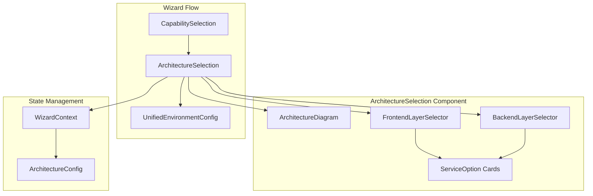

# Design Document: AWS Architecture Selection

## Overview

This design introduces an AWS Architecture Selection step in the deployment wizard that provides a graphical interface for users to select deployment targets for frontend and backend application layers. The component displays a visual architecture diagram with selectable service options, integrating seamlessly with the existing wizard flow and state management.

The feature follows the established patterns in the codebase: React functional components with TypeScript, Tailwind CSS for styling, and the WizardContext for state management.

## Architecture



## Components and Interfaces

### New Types (types/architecture.ts)

```typescript
/**
 * Supported frontend deployment services
 */
export enum FrontendService {
  S3_CLOUDFRONT = 's3_cloudfront',
  AMPLIFY = 'amplify',
}

/**
 * Supported backend deployment services
 */
export enum BackendService {
  ECS = 'ecs',
  EKS = 'eks',
  EC2 = 'ec2',
}

/**
 * Service availability status
 */
export type ServiceAvailability = 'available' | 'coming_soon' | 'deprecated';

/**
 * Cost tier indicator
 */
export type CostTier = 'low' | 'medium' | 'high';

/**
 * Service option metadata
 */
export interface ServiceOptionMeta {
  id: string;
  name: string;
  description: string;
  icon: string;
  availability: ServiceAvailability;
  costTier: CostTier;
  features: string[];
}

/**
 * Architecture configuration stored in wizard state
 */
export interface ArchitectureConfig {
  frontendService: FrontendService;
  backendService: BackendService;
}

/**
 * Frontend service options with metadata
 */
export const FRONTEND_SERVICE_OPTIONS: Record<FrontendService, ServiceOptionMeta> = {
  [FrontendService.S3_CLOUDFRONT]: {
    id: 's3_cloudfront',
    name: 'S3 + CloudFront',
    description: 'Static hosting with global CDN distribution. Best for static sites and SPAs.',
    icon: 'cloudfront',
    availability: 'available',
    costTier: 'low',
    features: ['Global CDN', 'HTTPS', 'Custom domains', 'Cache optimization'],
  },
  [FrontendService.AMPLIFY]: {
    id: 'amplify',
    name: 'AWS Amplify',
    description: 'Full-stack hosting with CI/CD. Ideal for rapid development.',
    icon: 'amplify',
    availability: 'coming_soon',
    costTier: 'medium',
    features: ['CI/CD built-in', 'Preview branches', 'Backend integration', 'Easy setup'],
  },
};

/**
 * Backend service options with metadata
 */
export const BACKEND_SERVICE_OPTIONS: Record<BackendService, ServiceOptionMeta> = {
  [BackendService.ECS]: {
    id: 'ecs',
    name: 'ECS (Fargate)',
    description: 'Serverless containers with automatic scaling. No infrastructure management.',
    icon: 'ecs',
    availability: 'available',
    costTier: 'medium',
    features: ['Serverless', 'Auto-scaling', 'Load balancing', 'Service discovery'],
  },
  [BackendService.EKS]: {
    id: 'eks',
    name: 'EKS (Kubernetes)',
    description: 'Managed Kubernetes for complex microservices architectures.',
    icon: 'eks',
    availability: 'coming_soon',
    costTier: 'high',
    features: ['Kubernetes native', 'Multi-cloud portable', 'Advanced networking', 'Helm support'],
  },
  [BackendService.EC2]: {
    id: 'ec2',
    name: 'EC2 (Plain Node)',
    description: 'Traditional VM-based deployment with full control.',
    icon: 'ec2',
    availability: 'coming_soon',
    costTier: 'low',
    features: ['Full control', 'Custom AMIs', 'Spot instances', 'Reserved capacity'],
  },
};
```

### Updated WizardState (types/wizard.ts)

```typescript
// Add to existing WizardState interface
export interface WizardState {
  // ... existing fields
  architectureConfig: ArchitectureConfig | null;
}

// Add to WizardContextType
export interface WizardContextType {
  // ... existing methods
  setArchitectureConfig: (config: ArchitectureConfig) => void;
}
```

### Updated WizardStep Enum

```typescript
export enum WizardStep {
  WELCOME = 'welcome',
  CAPABILITY_SELECTION = 'capability_selection',
  ARCHITECTURE_SELECTION = 'architecture_selection',  // NEW
  UNIFIED_ENVIRONMENT_CONFIG = 'unified_environment_config',
  AWS_CONFIGURATION = 'aws_configuration',
  PERMISSION_VERIFICATION = 'permission_verification',
  STRATEGY_SELECTION = 'strategy_selection',
  DEPLOYMENT_EXECUTION = 'deployment_execution',
  DELETION_EXECUTION = 'deletion_execution',
  POST_VERIFICATION = 'post_verification',
  RESULTS = 'results',
}
```

### ArchitectureSelection Component

```typescript
interface ArchitectureSelectionProps {
  // No props needed - uses WizardContext
}

// Component renders:
// 1. Header with title and description
// 2. Architecture diagram showing layers
// 3. Frontend service selector
// 4. Backend service selector
// 5. Navigation buttons (Back/Continue)
```

### ServiceOptionCard Component

```typescript
interface ServiceOptionCardProps {
  option: ServiceOptionMeta;
  isSelected: boolean;
  onSelect: () => void;
}

// Renders a selectable card with:
// - Service icon
// - Service name
// - Description
// - Cost tier indicator
// - Coming soon badge (if applicable)
// - Selection highlight
```

## Data Models

### Default Architecture Configuration

```typescript
const DEFAULT_ARCHITECTURE_CONFIG: ArchitectureConfig = {
  frontendService: FrontendService.S3_CLOUDFRONT,
  backendService: BackendService.ECS,
};
```

### Service Icons Mapping

The component will use inline SVG icons for AWS services. Icons will be stored as React components in a separate file for reusability.

```typescript
// utils/awsIcons.tsx
export const CloudFrontIcon: React.FC<IconProps> = ({ className }) => (
  <svg className={className} viewBox="0 0 24 24">
    {/* CloudFront icon path */}
  </svg>
);

export const ECSIcon: React.FC<IconProps> = ({ className }) => (
  <svg className={className} viewBox="0 0 24 24">
    {/* ECS icon path */}
  </svg>
);
// ... etc
```

## Correctness Properties

*A property is a characteristic or behavior that should hold true across all valid executions of a system-essentially, a formal statement about what the system should do. Properties serve as the bridge between human-readable specifications and machine-verifiable correctness guarantees.*

### Property 1: Default Selection Invariant

*For any* initial render of the ArchitectureSelection component (with no prior architectureConfig in context), the component state SHALL have frontendService equal to S3_CLOUDFRONT and backendService equal to ECS.

**Validates: Requirements 2.6, 3.7**

### Property 2: Selection State Consistency

*For any* user selection action on an available (non-disabled) service option, the WizardContext architectureConfig SHALL immediately reflect the selected value for that layer while preserving the other layer's selection.

**Validates: Requirements 4.1**

### Property 3: State Restoration Round-Trip

*For any* valid ArchitectureConfig stored in WizardContext, navigating away from the ArchitectureSelection step and returning SHALL restore the exact same frontendService and backendService values.

**Validates: Requirements 4.2**

### Property 4: Validation Gate Property

*For any* component state where either frontendService or backendService is null, undefined, or not a valid enum value, the Continue button SHALL be disabled and a validation message SHALL be displayed.

**Validates: Requirements 5.2, 5.5**

### Property 5: Disabled Service Non-Selectability

*For any* ServiceOption with availability equal to 'coming_soon', any click or selection action on that option SHALL NOT modify the current architectureConfig state.

**Validates: Requirements 2.3, 3.3, 3.4**

## Error Handling

### Invalid State Recovery

If the component detects an invalid architectureConfig (e.g., null values for required fields), it will:
1. Log a warning to console
2. Reset to default configuration
3. Continue rendering normally

### Context Unavailability

If WizardContext is unavailable (component rendered outside provider):
1. The useWizard hook will throw an error
2. Error boundary should catch and display fallback UI

## Testing Strategy

### Unit Tests

Unit tests will verify specific component behaviors:

1. **Rendering tests**: Verify all service options render correctly
2. **Selection tests**: Verify clicking options updates state
3. **Disabled state tests**: Verify coming soon options are not selectable
4. **Navigation tests**: Verify Back/Continue buttons work correctly
5. **Validation tests**: Verify Continue is disabled when selections are invalid

### Property-Based Tests

Property tests will use fast-check to verify universal properties:

1. **Default selection property**: Generate random initial states, verify defaults are applied
2. **State consistency property**: Generate random selection sequences, verify state matches
3. **Round-trip property**: Generate configs, store/restore, verify equality
4. **Validation property**: Generate partial configs, verify button state
5. **Disabled selection property**: Generate click events on disabled options, verify no state change

### Test Configuration

- Testing framework: Vitest (already configured in project)
- Property testing library: fast-check
- Minimum 100 iterations per property test
- Tests tagged with: **Feature: aws-architecture-selection, Property N: {property_text}**

### Test File Structure

```
frontend/src/components/
├── ArchitectureSelection.tsx
├── ArchitectureSelection.test.tsx      # Unit tests
├── ArchitectureSelection.property.test.tsx  # Property tests
├── ServiceOptionCard.tsx
└── ServiceOptionCard.test.tsx
```
