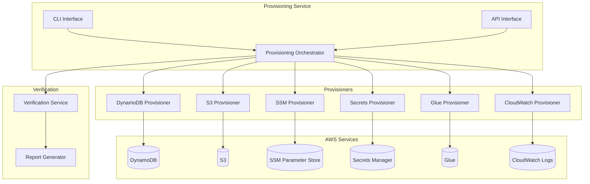

# Design Document: Call Processing Infrastructure Provisioning

## Overview

This design describes the infrastructure provisioning system for the call-processing capability. The system creates and configures all required AWS resources following the `call-processing-{env}-{resource}` naming convention. It is implemented as a Python-based provisioning service that can be invoked via CLI or API, supporting idempotent operations with comprehensive verification.

## Architecture



## Components and Interfaces

### 1. Provisioning Orchestrator

The central coordinator that manages the provisioning workflow.

```python
class ProvisioningOrchestrator:
    """Orchestrates the provisioning of all call-processing infrastructure."""
    
    def __init__(self, environment: str, region: str, dry_run: bool = False):
        """
        Initialize the orchestrator.
        
        Args:
            environment: Target environment (dev, stage, test, prod)
            region: AWS region
            dry_run: If True, validate without creating resources
        """
        pass
    
    def provision_all(self) -> ProvisioningReport:
        """
        Provision all infrastructure resources.
        
        Returns:
            ProvisioningReport with status of all resources
        """
        pass
    
    def provision_dynamodb(self) -> List[ResourceStatus]:
        """Provision DynamoDB tables only."""
        pass
    
    def provision_s3(self) -> List[ResourceStatus]:
        """Provision S3 buckets only."""
        pass
    
    def provision_ssm(self) -> List[ResourceStatus]:
        """Provision SSM parameters only."""
        pass
    
    def provision_secrets(self) -> List[ResourceStatus]:
        """Provision Secrets Manager secrets only."""
        pass
    
    def provision_glue(self) -> List[ResourceStatus]:
        """Provision Glue database and tables only."""
        pass
    
    def provision_cloudwatch(self) -> List[ResourceStatus]:
        """Provision CloudWatch log groups only."""
        pass
    
    def verify_all(self) -> VerificationReport:
        """Verify all provisioned resources."""
        pass
```

### 2. DynamoDB Provisioner

```python
class DynamoDBProvisioner:
    """Provisions DynamoDB tables for call-processing capability."""
    
    def __init__(self, environment: str, region: str):
        pass
    
    def create_transformation_system_table(self) -> ResourceStatus:
        """
        Create the transformation-system table.
        
        Table: call-processing-{env}-transformation-system
        Key Schema: PK (HASH), SK (RANGE)
        GSI: GSI1 (GSI1PK, GSI1SK)
        """
        pass
    
    def create_license_table(self) -> ResourceStatus:
        """
        Create the license table.
        
        Table: call-processing-{env}-license
        Key Schema: PK (HASH), SK (RANGE)
        GSIs: status-index, holder-index, license-index
        """
        pass
    
    def create_wxcc_task_tracking_table(self) -> ResourceStatus:
        """
        Create the WXCC task tracking table.
        
        Table: call-processing-{env}-wxcc-task-tracking
        Key Schema: task_id (HASH)
        """
        pass
    
    def table_exists(self, table_name: str) -> bool:
        """Check if a table already exists."""
        pass
    
    def wait_for_table_active(self, table_name: str, timeout: int = 300) -> bool:
        """Wait for table to become ACTIVE."""
        pass
```

### 3. S3 Provisioner

```python
class S3Provisioner:
    """Provisions S3 buckets for call-processing capability."""
    
    def __init__(self, environment: str, region: str):
        pass
    
    def create_call_data_bucket(self) -> ResourceStatus:
        """
        Create the call-data bucket with folder structure.
        
        Bucket: call-processing-{env}-call-data
        Folders: call-data/, call-detail/, recordings/, transcripts/, athena-results/
        """
        pass
    
    def create_wxcc_simulator_bucket(self) -> ResourceStatus:
        """
        Create the WXCC simulator bucket with folder structure.
        
        Bucket: call-processing-{env}-wxcc-simulator
        Folders: wxcc-simulator/tasks/, wxcc-simulator/recordings/, wxcc-simulator/sample-recordings/
        """
        pass
    
    def create_journey_logs_bucket(self) -> ResourceStatus:
        """
        Create the journey logs bucket.
        
        Bucket: call-processing-{env}-journey-logs
        """
        pass
    
    def create_journey_reports_bucket(self) -> ResourceStatus:
        """
        Create the journey reports bucket.
        
        Bucket: call-processing-{env}-journey-reports
        """
        pass
    
    def bucket_exists(self, bucket_name: str) -> bool:
        """Check if a bucket already exists."""
        pass
    
    def create_folder_structure(self, bucket_name: str, folders: List[str]) -> None:
        """Create folder structure in bucket using empty objects."""
        pass
```

### 4. SSM Parameter Provisioner

```python
class SSMProvisioner:
    """Provisions SSM Parameter Store parameters for call-processing capability."""
    
    def __init__(self, environment: str, region: str):
        pass
    
    def create_all_parameters(self) -> List[ResourceStatus]:
        """Create all SSM parameters for the environment."""
        pass
    
    def create_parameter(self, path: str, value: str, description: str, 
                         param_type: str = "String") -> ResourceStatus:
        """
        Create or update a single SSM parameter.
        
        Args:
            path: Parameter path (e.g., /call-processing/{env}/aws/region)
            value: Parameter value
            description: Parameter description
            param_type: String or SecureString
        """
        pass
    
    def get_aws_parameters(self) -> Dict[str, str]:
        """Get AWS configuration parameters with defaults."""
        pass
    
    def get_server_parameters(self) -> Dict[str, str]:
        """Get server configuration parameters with defaults."""
        pass
    
    def get_cognito_parameters(self) -> Dict[str, str]:
        """Get Cognito configuration parameters with defaults."""
        pass
    
    def get_wxcc_parameters(self) -> Dict[str, str]:
        """Get WXCC configuration parameters with defaults."""
        pass
    
    def get_s3_parameters(self) -> Dict[str, str]:
        """Get S3 configuration parameters with defaults."""
        pass
    
    def get_dynamodb_parameters(self) -> Dict[str, str]:
        """Get DynamoDB configuration parameters with defaults."""
        pass
    
    def get_glue_parameters(self) -> Dict[str, str]:
        """Get Glue configuration parameters with defaults."""
        pass
    
    def get_cloudwatch_parameters(self) -> Dict[str, str]:
        """Get CloudWatch configuration parameters with defaults."""
        pass
```

### 5. Secrets Manager Provisioner

```python
class SecretsProvisioner:
    """Provisions Secrets Manager secrets for call-processing capability."""
    
    def __init__(self, environment: str, region: str):
        pass
    
    def create_all_secrets(self) -> List[ResourceStatus]:
        """Create all secrets for the environment."""
        pass
    
    def create_secret(self, name: str, secret_value: Dict[str, str], 
                      description: str) -> ResourceStatus:
        """
        Create a secret if it doesn't exist.
        
        Args:
            name: Secret name (e.g., call-processing/{env}/api-keys)
            secret_value: Dictionary of key-value pairs
            description: Secret description
        """
        pass
    
    def secret_exists(self, name: str) -> bool:
        """Check if a secret already exists."""
        pass
    
    def get_placeholder_secrets(self) -> Dict[str, Dict[str, str]]:
        """Get all secrets with placeholder values."""
        pass
```

### 6. Glue Provisioner

```python
class GlueProvisioner:
    """Provisions Glue database and tables for call-processing capability."""
    
    def __init__(self, environment: str, region: str):
        pass
    
    def create_database(self) -> ResourceStatus:
        """
        Create the analytics database.
        
        Database: call-processing-{env}-analytics
        """
        pass
    
    def create_wxcc_calls_table(self) -> ResourceStatus:
        """
        Create the wxcc_calls table.
        
        Table: wxcc_calls
        Location: s3://call-processing-{env}-call-data/call-data/
        Format: Parquet
        Partitions: year, month, day
        """
        pass
    
    def database_exists(self, database_name: str) -> bool:
        """Check if database exists."""
        pass
    
    def table_exists(self, database_name: str, table_name: str) -> bool:
        """Check if table exists."""
        pass
```

### 7. CloudWatch Provisioner

```python
class CloudWatchProvisioner:
    """Provisions CloudWatch log groups for call-processing capability."""
    
    def __init__(self, environment: str, region: str):
        pass
    
    def create_log_group(self) -> ResourceStatus:
        """
        Create the log group with appropriate retention.
        
        Log Group: /aws/call-processing/{env}
        Retention: 30 days (dev/test), 90 days (stage), 365 days (prod)
        """
        pass
    
    def log_group_exists(self, log_group_name: str) -> bool:
        """Check if log group exists."""
        pass
    
    def get_retention_days(self) -> int:
        """Get retention days based on environment."""
        pass
```

### 8. Verification Service

```python
class VerificationService:
    """Verifies all provisioned resources exist and are accessible."""
    
    def __init__(self, environment: str, region: str):
        pass
    
    def verify_all(self) -> VerificationReport:
        """Verify all resources and generate report."""
        pass
    
    def verify_dynamodb_tables(self) -> List[VerificationResult]:
        """Verify all DynamoDB tables exist and are ACTIVE."""
        pass
    
    def verify_s3_buckets(self) -> List[VerificationResult]:
        """Verify all S3 buckets exist and are accessible."""
        pass
    
    def verify_ssm_parameters(self) -> List[VerificationResult]:
        """Verify all SSM parameters exist."""
        pass
    
    def verify_secrets(self) -> List[VerificationResult]:
        """Verify all secrets exist."""
        pass
    
    def verify_glue_resources(self) -> List[VerificationResult]:
        """Verify Glue database and table exist."""
        pass
    
    def verify_cloudwatch(self) -> List[VerificationResult]:
        """Verify CloudWatch log group exists."""
        pass
```

## Data Models

```python
from dataclasses import dataclass
from enum import Enum
from typing import List, Optional
from datetime import datetime

class ResourceType(Enum):
    DYNAMODB_TABLE = "dynamodb_table"
    S3_BUCKET = "s3_bucket"
    SSM_PARAMETER = "ssm_parameter"
    SECRET = "secret"
    GLUE_DATABASE = "glue_database"
    GLUE_TABLE = "glue_table"
    CLOUDWATCH_LOG_GROUP = "cloudwatch_log_group"

class ResourceStatusType(Enum):
    CREATED = "created"
    ALREADY_EXISTS = "already_exists"
    UPDATED = "updated"
    FAILED = "failed"
    SKIPPED = "skipped"

class VerificationStatusType(Enum):
    VERIFIED = "verified"
    NOT_FOUND = "not_found"
    INACCESSIBLE = "inaccessible"
    INVALID_STATE = "invalid_state"

@dataclass
class ResourceStatus:
    """Status of a single resource provisioning operation."""
    resource_type: ResourceType
    resource_name: str
    status: ResourceStatusType
    message: str
    created_at: Optional[datetime] = None
    error: Optional[str] = None

@dataclass
class VerificationResult:
    """Result of verifying a single resource."""
    resource_type: ResourceType
    resource_name: str
    status: VerificationStatusType
    details: str
    error: Optional[str] = None

@dataclass
class ProvisioningReport:
    """Complete report of provisioning operation."""
    environment: str
    region: str
    started_at: datetime
    completed_at: datetime
    dry_run: bool
    resources: List[ResourceStatus]
    success_count: int
    already_existed_count: int
    failed_count: int
    overall_success: bool

@dataclass
class VerificationReport:
    """Complete report of verification operation."""
    environment: str
    region: str
    verified_at: datetime
    results: List[VerificationResult]
    verified_count: int
    failed_count: int
    overall_success: bool

@dataclass
class EnvironmentConfig:
    """Environment-specific configuration."""
    environment: str
    region: str
    dynamodb_billing_mode: str  # PAY_PER_REQUEST or PROVISIONED
    dynamodb_read_capacity: Optional[int]
    dynamodb_write_capacity: Optional[int]
    s3_versioning_enabled: bool
    s3_encryption_enabled: bool
    cloudwatch_retention_days: int
    log_level: str
```

## Environment-Specific Defaults

```python
ENVIRONMENT_CONFIGS = {
    "dev": EnvironmentConfig(
        environment="dev",
        region="ap-southeast-1",
        dynamodb_billing_mode="PAY_PER_REQUEST",
        dynamodb_read_capacity=None,
        dynamodb_write_capacity=None,
        s3_versioning_enabled=False,
        s3_encryption_enabled=True,
        cloudwatch_retention_days=30,
        log_level="DEBUG"
    ),
    "test": EnvironmentConfig(
        environment="test",
        region="ap-southeast-1",
        dynamodb_billing_mode="PAY_PER_REQUEST",
        dynamodb_read_capacity=None,
        dynamodb_write_capacity=None,
        s3_versioning_enabled=False,
        s3_encryption_enabled=True,
        cloudwatch_retention_days=30,
        log_level="DEBUG"
    ),
    "stage": EnvironmentConfig(
        environment="stage",
        region="ap-southeast-1",
        dynamodb_billing_mode="PAY_PER_REQUEST",
        dynamodb_read_capacity=None,
        dynamodb_write_capacity=None,
        s3_versioning_enabled=True,
        s3_encryption_enabled=True,
        cloudwatch_retention_days=90,
        log_level="INFO"
    ),
    "prod": EnvironmentConfig(
        environment="prod",
        region="ap-southeast-1",
        dynamodb_billing_mode="PAY_PER_REQUEST",
        dynamodb_read_capacity=None,
        dynamodb_write_capacity=None,
        s3_versioning_enabled=True,
        s3_encryption_enabled=True,
        cloudwatch_retention_days=365,
        log_level="INFO"
    )
}
```

## Resource Naming

All resources follow the naming convention from the infrastructure requirements:

```python
class ResourceNaming:
    """Generates resource names following the naming convention."""
    
    def __init__(self, environment: str):
        self.env = environment
        self.capability = "call-processing"
    
    # DynamoDB Tables
    def transformation_system_table(self) -> str:
        return f"{self.capability}-{self.env}-transformation-system"
    
    def license_table(self) -> str:
        return f"{self.capability}-{self.env}-license"
    
    def wxcc_task_tracking_table(self) -> str:
        return f"{self.capability}-{self.env}-wxcc-task-tracking"
    
    # S3 Buckets
    def call_data_bucket(self) -> str:
        return f"{self.capability}-{self.env}-call-data"
    
    def wxcc_simulator_bucket(self) -> str:
        return f"{self.capability}-{self.env}-wxcc-simulator"
    
    def journey_logs_bucket(self) -> str:
        return f"{self.capability}-{self.env}-journey-logs"
    
    def journey_reports_bucket(self) -> str:
        return f"{self.capability}-{self.env}-journey-reports"
    
    # SSM Parameters
    def ssm_parameter(self, category: str, name: str) -> str:
        return f"/{self.capability}/{self.env}/{category}/{name}"
    
    # Secrets
    def secret(self, name: str) -> str:
        return f"{self.capability}/{self.env}/{name}"
    
    # Glue
    def glue_database(self) -> str:
        return f"{self.capability}-{self.env}-analytics"
    
    # CloudWatch
    def log_group(self) -> str:
        return f"/aws/{self.capability}/{self.env}"
```


## Correctness Properties

*A property is a characteristic or behavior that should hold true across all valid executions of a system—essentially, a formal statement about what the system should do. Properties serve as the bridge between human-readable specifications and machine-verifiable correctness guarantees.*

### Property 1: DynamoDB Table Creation Completeness

*For any* valid environment (dev, stage, test, prod), when DynamoDB provisioning completes successfully, all three required tables (transformation-system, license, wxcc-task-tracking) SHALL exist with correct key schemas and GSIs, and all tables SHALL be in ACTIVE status.

**Validates: Requirements 1.1, 1.2, 1.3, 1.5**

### Property 2: S3 Bucket Creation Completeness

*For any* valid environment, when S3 provisioning completes successfully, all four required buckets (call-data, wxcc-simulator, journey-logs, journey-reports) SHALL exist and be accessible, with the call-data and wxcc-simulator buckets containing their required folder structures.

**Validates: Requirements 2.1, 2.2, 2.3, 2.4, 2.5, 2.6**

### Property 3: SSM Parameter Creation Completeness

*For any* valid environment, when SSM provisioning completes successfully, all required parameters across all categories (aws, server, cognito, wxcc, s3, dynamodb, glue, cloudwatch) SHALL exist with correct paths following the `/call-processing/{env}/{category}/{name}` convention.

**Validates: Requirements 3.1, 3.2, 3.3, 3.4, 3.5, 3.6, 3.7, 3.8**

### Property 4: Secrets Creation Completeness

*For any* valid environment, when secrets provisioning completes successfully, all six required secrets (api-keys, wxcc, openai, license, anthropic, github) SHALL exist following the `call-processing/{env}/{name}` convention, with placeholder values indicating they need to be updated.

**Validates: Requirements 4.1, 4.2, 4.3, 4.4, 4.5, 4.6, 4.8**

### Property 5: Glue Resource Creation Completeness

*For any* valid environment, when Glue provisioning completes successfully, the analytics database SHALL exist, and the wxcc_calls table SHALL exist with correct schema, S3 location pointing to the call-data bucket, and year/month/day partitioning configured.

**Validates: Requirements 5.1, 5.2, 5.3, 5.4**

### Property 6: CloudWatch Log Group Creation with Correct Retention

*For any* valid environment, when CloudWatch provisioning completes successfully, the log group SHALL exist with retention policy matching the environment (30 days for dev/test, 90 days for stage, 365 days for prod).

**Validates: Requirements 6.1, 6.2**

### Property 7: Provisioning Idempotency

*For any* valid environment and any provisioning operation, running provisioning twice in succession SHALL result in:
1. The same end state (all resources exist)
2. No errors on the second run
3. The second run's report showing all resources as "already_exists"

**Validates: Requirements 1.4, 2.7, 4.7, 5.5, 6.3, 9.1, 9.2, 9.3, 9.4**

### Property 8: SSM Parameter Update Behavior

*For any* existing SSM parameter, when provisioning is run with a different expected value, the parameter SHALL be updated to the new value and the status SHALL be reported as "updated".

**Validates: Requirements 3.9**

### Property 9: Verification Report Completeness

*For any* provisioned environment, the verification report SHALL contain entries for all resource types (DynamoDB tables, S3 buckets, SSM parameters, secrets, Glue resources, CloudWatch log groups) with accurate status (verified, not_found, inaccessible, invalid_state).

**Validates: Requirements 7.1, 7.2, 7.3, 7.4, 7.5, 7.6, 7.7, 7.8**

### Property 10: Naming Convention Consistency

*For any* valid environment, all created resources SHALL follow the naming convention:
- AWS resources: `call-processing-{env}-{resource-name}`
- SSM parameters: `/call-processing/{env}/{category}/{name}`
- Secrets: `call-processing/{env}/{name}`
- CloudWatch: `/aws/call-processing/{env}`

**Validates: Requirements 8.3**

### Property 11: Dry-Run Mode Safety

*For any* valid environment, when provisioning is run in dry-run mode, no resources SHALL be created, modified, or deleted, and the operation SHALL return a report of what would have been created.

**Validates: Requirements 10.4**

### Property 12: API Provisioning Triggers Orchestrator

*For any* valid provisioning API request with environment and region, the API endpoint SHALL invoke the ProvisioningOrchestrator and return a complete provisioning report with status of all resource types.

**Validates: Requirements 11.2, 11.3, 11.4**

### Property 13: Deployment Service Provisions Before CloudFormation

*For any* deployment request, the deployment service SHALL call infrastructure provisioning before attempting CloudFormation stack deployment, and SHALL halt deployment if provisioning fails.

**Validates: Requirements 11.1, 11.6, 11.7**

### Property 14: Provisioning Progress Tracking

*For any* provisioning operation, the status endpoint SHALL return accurate progress information including: overall percentage, current stage, completed resources, pending resources, and any errors.

**Validates: Requirements 12.1, 12.2, 12.3, 12.4**

## Error Handling

### Error Categories

1. **AWS API Errors**: Handle boto3 exceptions with specific error codes
2. **Resource Conflicts**: Handle cases where resources exist with different configurations
3. **Permission Errors**: Handle IAM permission denied errors with clear messages
4. **Timeout Errors**: Handle cases where resources don't reach expected state in time
5. **Validation Errors**: Handle invalid environment names or configuration values

### Error Handling Strategy

```python
class ProvisioningError(Exception):
    """Base exception for provisioning errors."""
    def __init__(self, resource_type: ResourceType, resource_name: str, 
                 message: str, recoverable: bool = True):
        self.resource_type = resource_type
        self.resource_name = resource_name
        self.message = message
        self.recoverable = recoverable
        super().__init__(f"{resource_type.value} '{resource_name}': {message}")

class ResourceCreationError(ProvisioningError):
    """Error during resource creation."""
    pass

class ResourceVerificationError(ProvisioningError):
    """Error during resource verification."""
    pass

class PermissionError(ProvisioningError):
    """IAM permission denied error."""
    def __init__(self, resource_type: ResourceType, resource_name: str, 
                 required_permission: str):
        super().__init__(
            resource_type, resource_name,
            f"Permission denied. Required: {required_permission}",
            recoverable=False
        )

class TimeoutError(ProvisioningError):
    """Resource did not reach expected state in time."""
    pass
```

### Error Recovery

- **Recoverable errors**: Log and continue with next resource
- **Non-recoverable errors**: Halt provisioning and report failure
- **Partial success**: Report which resources succeeded and which failed

## API Integration

### Provisioning API Router

The provisioning service exposes REST API endpoints for integration with the deployment wizard.

```python
from fastapi import APIRouter, HTTPException, BackgroundTasks
from typing import Optional
from pydantic import BaseModel

router = APIRouter(prefix="/api/provisioning", tags=["provisioning"])

class ProvisioningRequest(BaseModel):
    """Request model for provisioning operations."""
    environment: str  # dev, stage, test, prod
    region: str = "ap-southeast-1"
    resource_types: Optional[List[str]] = None  # None = all types
    aws_session_id: Optional[str] = None  # For using wizard's AWS credentials

class ProvisioningStatusResponse(BaseModel):
    """Response model for provisioning status."""
    provisioning_id: str
    status: str  # pending, running, completed, failed
    progress: int  # 0-100
    current_stage: str
    resources_completed: List[dict]
    resources_pending: List[str]
    errors: List[str]
    report: Optional[dict] = None

@router.post("/provision")
async def start_provisioning(
    request: ProvisioningRequest,
    background_tasks: BackgroundTasks
) -> ProvisioningStatusResponse:
    """
    Start infrastructure provisioning for an environment.
    
    This endpoint triggers the ProvisioningOrchestrator to create:
    - DynamoDB tables
    - S3 buckets
    - SSM parameters
    - Secrets Manager secrets
    - Glue database and tables
    - CloudWatch log groups
    """
    pass

@router.post("/verify")
async def verify_provisioning(request: ProvisioningRequest) -> dict:
    """
    Verify all provisioned resources exist and are accessible.
    """
    pass

@router.post("/dry-run")
async def dry_run_provisioning(request: ProvisioningRequest) -> dict:
    """
    Perform a dry-run to show what would be provisioned.
    """
    pass

@router.get("/{provisioning_id}/status")
async def get_provisioning_status(provisioning_id: str) -> ProvisioningStatusResponse:
    """
    Get the current status of a provisioning operation.
    """
    pass
```

### Deployment Service Integration

The deployment service is updated to call the provisioning orchestrator before CloudFormation deployment.

```python
class DeploymentService:
    """Updated deployment service with infrastructure provisioning."""
    
    async def _execute_deployment(self, deployment_id: str):
        """Execute deployment with infrastructure provisioning."""
        deployment = self.deployments[deployment_id]
        request = deployment["request"]
        
        try:
            # STEP 1: Provision infrastructure resources
            deployment["current_stage"] = DeploymentStage.INFRASTRUCTURE_PROVISIONING
            deployment["progress"] = 10
            self.add_log(deployment_id, LogLevel.INFO, "▶ Provisioning infrastructure resources...")
            
            provisioning_result = await self._provision_infrastructure(deployment_id, request)
            
            if not provisioning_result.overall_success:
                raise Exception(f"Infrastructure provisioning failed: {provisioning_result.failed_count} resources failed")
            
            self.add_log(deployment_id, LogLevel.INFO, f"✓ Infrastructure provisioned: {provisioning_result.success_count} created, {provisioning_result.already_existed_count} already existed")
            
            # STEP 2: Continue with CloudFormation deployment
            deployment["progress"] = 20
            # ... existing CloudFormation deployment logic ...
            
        except Exception as e:
            deployment["status"] = DeploymentStatus.FAILED
            deployment["error"] = str(e)
            self.add_log(deployment_id, LogLevel.ERROR, f"❌ Deployment failed: {str(e)}")
    
    async def _provision_infrastructure(
        self, 
        deployment_id: str, 
        request: DeploymentRequest
    ) -> ProvisioningReport:
        """
        Provision infrastructure resources using the ProvisioningOrchestrator.
        
        Args:
            deployment_id: Current deployment ID for logging
            request: Deployment request with environment and region
            
        Returns:
            ProvisioningReport with status of all resources
        """
        from app.services.infra_provisioning.orchestrator import ProvisioningOrchestrator
        
        # Get AWS credentials from session if available
        endpoint_url = None
        if request.use_localstack:
            endpoint_url = "http://localhost:4566"
        
        orchestrator = ProvisioningOrchestrator(
            environment=request.environment,
            region=request.region,
            dry_run=False,
            endpoint_url=endpoint_url,
        )
        
        # Log progress for each resource type
        self.add_log(deployment_id, LogLevel.INFO, "  Creating DynamoDB tables...")
        orchestrator.provision_dynamodb()
        
        self.add_log(deployment_id, LogLevel.INFO, "  Creating S3 buckets...")
        orchestrator.provision_s3()
        
        self.add_log(deployment_id, LogLevel.INFO, "  Creating SSM parameters...")
        orchestrator.provision_ssm()
        
        self.add_log(deployment_id, LogLevel.INFO, "  Creating Secrets Manager secrets...")
        orchestrator.provision_secrets()
        
        self.add_log(deployment_id, LogLevel.INFO, "  Creating Glue database and tables...")
        orchestrator.provision_glue()
        
        self.add_log(deployment_id, LogLevel.INFO, "  Creating CloudWatch log groups...")
        orchestrator.provision_cloudwatch()
        
        # Verify all resources
        self.add_log(deployment_id, LogLevel.INFO, "  Verifying provisioned resources...")
        verification = orchestrator.verify_all()
        
        return orchestrator.provision_all()  # Return full report
```

### Deployment Stage Enum Update

```python
class DeploymentStage(str, Enum):
    """Deployment stages including infrastructure provisioning."""
    INITIALIZATION = "initialization"
    INFRASTRUCTURE_PROVISIONING = "infrastructure_provisioning"  # NEW
    FRONTEND_GLOBAL = "frontend_global"
    FRONTEND_COGNITO = "frontend_cognito"
    FRONTEND_REGIONAL = "frontend_regional"
    FRONTEND_UPLOAD = "frontend_upload"
    BACKEND_FOUNDATION = "backend_foundation"
    BACKEND_STORAGE = "backend_storage"
    BACKEND_NETWORK = "backend_network"
    BACKEND_SERVICE = "backend_service"
    COMPLETED = "completed"
```

## Testing Strategy

### Unit Tests

Unit tests verify specific examples and edge cases:

1. **Resource naming tests**: Verify naming convention produces correct names for each environment
2. **Configuration tests**: Verify environment-specific defaults are correct
3. **Error handling tests**: Verify specific error conditions are handled correctly
4. **Report generation tests**: Verify reports contain expected fields

### Property-Based Tests

Property-based tests verify universal properties across all inputs using the `hypothesis` library:

1. **Idempotency property test**: Generate random environments and verify double-provisioning produces same state
2. **Naming convention property test**: Generate random environments and verify all names follow convention
3. **Verification completeness test**: Generate random resource states and verify verification catches all issues
4. **Environment configuration test**: Generate random environments and verify correct defaults applied

### Integration Tests

Integration tests verify end-to-end behavior against LocalStack:

1. **Full provisioning test**: Provision all resources and verify they exist
2. **Idempotency integration test**: Run provisioning twice and verify behavior
3. **Verification integration test**: Provision resources and run verification
4. **Dry-run integration test**: Run dry-run and verify no resources created

### Test Configuration

```python
# pytest configuration for property-based tests
import hypothesis
from hypothesis import settings, Phase

# Configure hypothesis for minimum 100 iterations
settings.register_profile(
    "ci",
    max_examples=100,
    phases=[Phase.explicit, Phase.reuse, Phase.generate, Phase.shrink]
)

# Use LocalStack for integration tests
LOCALSTACK_ENDPOINT = "http://localhost:4566"
```

### Test Annotations

Each property test must reference its design document property:

```python
# Feature: call-processing-infra-provisioning, Property 7: Provisioning Idempotency
@given(environment=st.sampled_from(["dev", "stage", "test", "prod"]))
@settings(max_examples=100)
def test_provisioning_idempotency(environment: str):
    """
    **Validates: Requirements 1.4, 2.7, 4.7, 5.5, 6.3, 9.1, 9.2, 9.3, 9.4**
    """
    # First provisioning run
    report1 = orchestrator.provision_all()
    
    # Second provisioning run
    report2 = orchestrator.provision_all()
    
    # Verify idempotency
    assert report2.overall_success
    assert all(r.status == ResourceStatusType.ALREADY_EXISTS for r in report2.resources)
```
