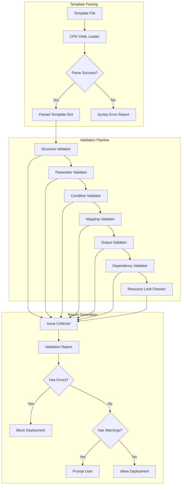

# Design Document: CloudFormation Template Reliability

## Overview

This design addresses CloudFormation template validation failures caused by YAML parsing errors with intrinsic functions (like `!Condition`, `!Ref`, `!Sub`) and provides comprehensive pre-deployment reliability checks. The solution involves:

1. Creating a custom YAML loader that handles all CloudFormation intrinsic functions
2. Enhancing template validation to check structure, parameters, conditions, mappings, and outputs
3. Adding dependency validation to detect circular dependencies and missing exports
4. Implementing resource limit pre-checks
5. Generating comprehensive validation reports with severity levels and remediation suggestions

## Architecture



## Components and Interfaces

### 1. CFN YAML Loader

A custom YAML loader that handles all CloudFormation intrinsic functions.

```python
# app/utils/cfn_yaml_loader.py

import yaml
from typing import Any, Dict

class CFNYAMLLoader(yaml.SafeLoader):
    """
    Custom YAML loader that handles CloudFormation intrinsic functions.
    
    Supports all CloudFormation intrinsic functions:
    - !Ref, !Sub, !GetAtt, !Join, !Select, !Split
    - !If, !Condition, !And, !Or, !Not, !Equals
    - !FindInMap, !ImportValue, !Base64, !Cidr, !GetAZs, !Transform
    """
    pass

# Intrinsic function tags to register
CFN_INTRINSIC_FUNCTIONS = [
    'Ref', 'Sub', 'GetAtt', 'Join', 'Select', 'Split',
    'If', 'Condition', 'And', 'Or', 'Not', 'Equals',
    'FindInMap', 'ImportValue', 'Base64', 'Cidr', 'GetAZs', 'Transform'
]

def cfn_constructor(loader: yaml.Loader, tag_suffix: str, node: yaml.Node) -> Dict[str, Any]:
    """Generic constructor for CloudFormation intrinsic functions."""
    pass

def load_cfn_yaml(content: str) -> Dict[str, Any]:
    """Load CloudFormation YAML with intrinsic function support."""
    pass

def load_cfn_yaml_file(file_path: str) -> Dict[str, Any]:
    """Load CloudFormation YAML file with intrinsic function support."""
    pass
```

### 2. Enhanced Template Validator

Extends the existing TemplateValidator with comprehensive validation.

```python
# app/services/template_validator.py (enhanced)

class TemplateValidator:
    """Enhanced CloudFormation template validator."""
    
    def validate_template_syntax(self, template_path: Path) -> SyntaxValidationResult:
        """
        Validate template YAML syntax using CFN YAML Loader.
        Returns line/column info for any syntax errors.
        """
        pass
    
    def validate_template_structure(self, template: Dict) -> StructureValidationResult:
        """
        Validate template structure:
        - Has Resources section
        - Resource types follow AWS::Service::Resource pattern
        - No duplicate logical IDs
        """
        pass
    
    def validate_parameters(
        self, 
        template: Dict, 
        provided_values: Dict[str, str]
    ) -> ParameterValidationResult:
        """
        Validate parameters:
        - Required parameters have values
        - Values match declared types
        - Values satisfy AllowedValues, AllowedPattern, Min/MaxValue
        """
        pass
    
    def validate_conditions(self, template: Dict) -> ConditionValidationResult:
        """
        Validate conditions:
        - All referenced conditions are defined
        - Condition functions are valid
        - Referenced parameters exist
        """
        pass
    
    def validate_mappings(self, template: Dict) -> MappingValidationResult:
        """
        Validate mappings:
        - All FindInMap references point to existing mappings
        - First and second level keys exist
        """
        pass
    
    def validate_outputs(self, template: Dict) -> OutputValidationResult:
        """
        Validate outputs:
        - All outputs have Value property
        - Referenced resources exist
        """
        pass
```

### 3. Dependency Validator

New component for cross-stack dependency validation.

```python
# app/services/dependency_validator.py

from dataclasses import dataclass
from typing import Dict, List, Set, Tuple

@dataclass
class DependencyGraph:
    """Represents stack dependencies."""
    nodes: Set[str]  # Stack names
    edges: Dict[str, Set[str]]  # stack -> set of dependencies
    
    def has_cycle(self) -> Tuple[bool, List[str]]:
        """Check for circular dependencies, return cycle if found."""
        pass
    
    def get_deployment_order(self) -> List[str]:
        """Get topologically sorted deployment order."""
        pass

class DependencyValidator:
    """Validates cross-stack dependencies."""
    
    def extract_imports(self, template: Dict) -> List[str]:
        """Extract all !ImportValue references from template."""
        pass
    
    def extract_exports(self, template: Dict) -> List[str]:
        """Extract all Export names from template outputs."""
        pass
    
    def build_dependency_graph(
        self, 
        templates: Dict[str, Dict]
    ) -> DependencyGraph:
        """Build dependency graph from multiple templates."""
        pass
    
    def validate_dependencies(
        self,
        templates: Dict[str, Dict],
        existing_exports: Set[str]
    ) -> DependencyValidationResult:
        """
        Validate all dependencies:
        - No circular dependencies
        - All imports have corresponding exports
        """
        pass
```

### 4. Resource Limit Checker

Component for checking CloudFormation resource limits.

```python
# app/services/resource_limit_checker.py

@dataclass
class ResourceLimitWarning:
    """Warning about approaching resource limits."""
    resource_type: str
    current_count: int
    limit: int
    severity: str  # 'warning' or 'error'
    message: str

class ResourceLimitChecker:
    """Checks for CloudFormation resource limits."""
    
    # Known limits
    STACK_RESOURCE_LIMIT = 500
    OUTPUTS_LIMIT = 200
    PARAMETERS_LIMIT = 200
    MAPPINGS_LIMIT = 200
    
    # Limit-prone resource types
    LIMIT_PRONE_RESOURCES = [
        'AWS::IAM::Role',
        'AWS::IAM::Policy',
        'AWS::Lambda::Function',
        'AWS::S3::Bucket',
        'AWS::DynamoDB::Table'
    ]
    
    def count_resources(self, template: Dict) -> Dict[str, int]:
        """Count resources by type in template."""
        pass
    
    def check_limits(
        self, 
        templates: Dict[str, Dict]
    ) -> List[ResourceLimitWarning]:
        """Check all templates for limit concerns."""
        pass
```

### 5. Pre-Deployment Checker (Orchestrator)

Orchestrates all validation checks and generates comprehensive report.

```python
# app/services/pre_deployment_checker.py

@dataclass
class ValidationIssue:
    """Represents a validation issue."""
    severity: str  # 'error', 'warning', 'info'
    category: str  # 'syntax', 'structure', 'parameter', 'condition', 'mapping', 'output', 'dependency', 'limit'
    message: str
    location: Optional[str]  # file:line:column or resource path
    remediation: str

@dataclass
class ValidationReport:
    """Comprehensive validation report."""
    success: bool
    errors: List[ValidationIssue]
    warnings: List[ValidationIssue]
    info: List[ValidationIssue]
    summary: str
    
    def to_dict(self) -> Dict[str, Any]:
        """Convert to dictionary for JSON serialization."""
        pass
    
    def format_for_ui(self) -> str:
        """Format report for UI display."""
        pass

class PreDeploymentChecker:
    """Orchestrates all pre-deployment validation checks."""
    
    def __init__(self):
        self.template_validator = TemplateValidator()
        self.dependency_validator = DependencyValidator()
        self.resource_limit_checker = ResourceLimitChecker()
    
    def validate_deployment(
        self,
        templates: Dict[str, Path],
        parameters: Dict[str, Dict[str, str]],
        existing_exports: Optional[Set[str]] = None
    ) -> ValidationReport:
        """
        Run all validation checks and generate comprehensive report.
        
        Args:
            templates: Map of stack name to template path
            parameters: Map of stack name to parameter values
            existing_exports: Optional set of existing CloudFormation exports
            
        Returns:
            ValidationReport with all issues categorized by severity
        """
        pass
    
    def should_block_deployment(self, report: ValidationReport) -> bool:
        """Determine if deployment should be blocked based on report."""
        return len(report.errors) > 0
    
    def should_prompt_user(self, report: ValidationReport) -> bool:
        """Determine if user confirmation is needed."""
        return len(report.warnings) > 0 and len(report.errors) == 0
```

## Data Models

### Validation Results

```python
@dataclass
class SyntaxValidationResult:
    success: bool
    errors: List[SyntaxError]

@dataclass
class SyntaxError:
    line: int
    column: int
    message: str
    context: str  # Surrounding lines for context

@dataclass
class StructureValidationResult:
    success: bool
    has_resources: bool
    invalid_resource_types: List[str]
    duplicate_logical_ids: List[str]

@dataclass
class ParameterValidationResult:
    success: bool
    missing_required: List[str]
    type_mismatches: List[ParameterTypeMismatch]
    constraint_violations: List[ConstraintViolation]

@dataclass
class ParameterTypeMismatch:
    parameter_name: str
    expected_type: str
    actual_value: str

@dataclass
class ConstraintViolation:
    parameter_name: str
    constraint_type: str  # 'AllowedValues', 'AllowedPattern', 'MinValue', 'MaxValue'
    constraint_value: Any
    actual_value: str

@dataclass
class ConditionValidationResult:
    success: bool
    undefined_conditions: List[str]
    invalid_functions: List[str]
    undefined_parameters: List[str]

@dataclass
class MappingValidationResult:
    success: bool
    invalid_references: List[MappingReference]

@dataclass
class MappingReference:
    location: str  # Resource or output where FindInMap is used
    mapping_name: str
    first_key: str
    second_key: str
    missing_key: str  # Which key is missing

@dataclass
class OutputValidationResult:
    success: bool
    missing_values: List[str]
    invalid_references: List[str]
    duplicate_exports: List[str]

@dataclass
class DependencyValidationResult:
    success: bool
    circular_dependencies: List[List[str]]  # List of cycles
    missing_exports: List[MissingExport]

@dataclass
class MissingExport:
    import_name: str
    importing_stack: str
    suggested_source: Optional[str]
```

## Correctness Properties

*A property is a characteristic or behavior that should hold true across all valid executions of a system—essentially, a formal statement about what the system should do. Properties serve as the bridge between human-readable specifications and machine-verifiable correctness guarantees.*

### Property 1: CFN YAML Parsing Handles All Intrinsic Functions

*For any* CloudFormation template containing intrinsic functions (`!Ref`, `!Sub`, `!GetAtt`, `!Condition`, `!If`, `!Join`, `!Select`, `!Split`, `!FindInMap`, `!ImportValue`, `!Base64`, `!Cidr`, `!GetAZs`, `!Transform`, `!And`, `!Or`, `!Not`, `!Equals`), the CFN_YAML_Loader SHALL parse the template without errors and preserve the intrinsic function structure.

**Validates: Requirements 1.1, 1.2, 1.3, 1.4, 1.5**

### Property 2: Template Structure Validation Detects Invalid Templates

*For any* CloudFormation template, the Template_Validator SHALL correctly identify whether it contains a Resources section and whether all resource types follow the `AWS::Service::Resource` naming pattern, reporting all violations with location information.

**Validates: Requirements 2.2, 2.3, 2.4, 2.5**

### Property 3: Parameter Validation Catches All Constraint Violations

*For any* CloudFormation template with parameters and any set of provided parameter values, the Parameter_Validator SHALL identify all missing required parameters, type mismatches, and constraint violations (AllowedValues, AllowedPattern, MinValue, MaxValue), reporting all violations in a single result.

**Validates: Requirements 3.1, 3.2, 3.3, 3.4, 3.5, 3.6**

### Property 4: Dependency Graph Correctly Models Stack Relationships

*For any* set of CloudFormation templates with `!ImportValue` and `Export` declarations, the Dependency_Validator SHALL build a correct dependency graph and detect all circular dependencies, reporting the cycle path.

**Validates: Requirements 4.1, 4.3, 4.4**

### Property 5: Resource Limit Checker Warns About Limit Concerns

*For any* set of CloudFormation templates, the Resource_Limit_Checker SHALL accurately count resources by type and generate warnings when counts approach or exceed CloudFormation limits (500 resources per stack).

**Validates: Requirements 5.1, 5.2, 5.3, 5.4**

### Property 6: Condition Validation Detects Undefined References

*For any* CloudFormation template with conditions, the Template_Validator SHALL identify all references to undefined conditions and all condition functions that reference undefined parameters.

**Validates: Requirements 6.1, 6.2, 6.4**

### Property 7: Mapping Validation Detects Invalid FindInMap References

*For any* CloudFormation template with mappings and `!FindInMap` references, the Template_Validator SHALL identify all references to non-existent mappings or missing first/second level keys.

**Validates: Requirements 7.1, 7.2**

### Property 8: Output Validation Detects Invalid Outputs

*For any* CloudFormation template with outputs, the Template_Validator SHALL identify all outputs missing a Value property, all outputs referencing non-existent resources, and all duplicate export names across a deployment.

**Validates: Requirements 8.1, 8.2, 8.3**

### Property 9: Validation Report Correctly Categorizes and Reports Issues

*For any* validation run, the Pre_Deployment_Checker SHALL generate a report that categorizes all issues by severity (error, warning, info), includes remediation suggestions for each issue, blocks deployment when errors exist, and allows deployment with warnings only after user confirmation.

**Validates: Requirements 9.1, 9.2, 9.3, 9.5, 9.6**

## Error Handling

### YAML Parsing Errors

When YAML parsing fails:
1. Capture line and column information from the YAML parser
2. Extract surrounding context (2-3 lines before/after)
3. Provide clear error message with location
4. Suggest common fixes (missing quotes, indentation issues)

```python
class CFNParseError(Exception):
    def __init__(self, message: str, line: int, column: int, context: str):
        self.line = line
        self.column = column
        self.context = context
        super().__init__(f"Line {line}, Column {column}: {message}\n{context}")
```

### Unknown YAML Tags

When an unknown YAML tag is encountered:
1. Log a warning with the tag name and location
2. Continue parsing by treating it as a generic mapping
3. Include in validation report as an info-level issue

### Validation Failures

When validation fails:
1. Collect all issues (don't stop at first error)
2. Categorize by severity
3. Provide remediation suggestions
4. Format for both logging and UI display

## Testing Strategy

### Unit Tests

Unit tests will cover specific examples and edge cases:

- CFN YAML Loader parses templates with each intrinsic function type
- Template validator correctly identifies missing Resources section
- Parameter validator catches type mismatches and constraint violations
- Dependency validator detects circular dependencies
- Resource limit checker warns at appropriate thresholds
- Validation report correctly categorizes issues

### Property-Based Tests

Property-based tests will use `hypothesis` library to verify universal properties:

- **Property 1**: Generate random templates with various intrinsic functions, verify parsing succeeds
- **Property 2**: Generate templates with valid/invalid structure, verify correct detection
- **Property 3**: Generate parameters with various constraints and values, verify all violations caught
- **Property 4**: Generate dependency graphs with/without cycles, verify correct detection
- **Property 5**: Generate templates with varying resource counts, verify warnings at correct thresholds
- **Property 6**: Generate templates with condition references, verify undefined ones caught
- **Property 7**: Generate templates with FindInMap references, verify invalid ones caught
- **Property 8**: Generate templates with outputs, verify invalid ones caught
- **Property 9**: Generate validation scenarios, verify report correctness

Each property test will run minimum 100 iterations and be tagged with:
```python
# Feature: cloudformation-template-reliability, Property N: [property description]
```

### Integration Tests

- End-to-end validation of real CloudFormation templates from deploy/templates/
- Validation of templates with known issues to verify error reporting
- Integration with deployment orchestrator to verify blocking behavior
