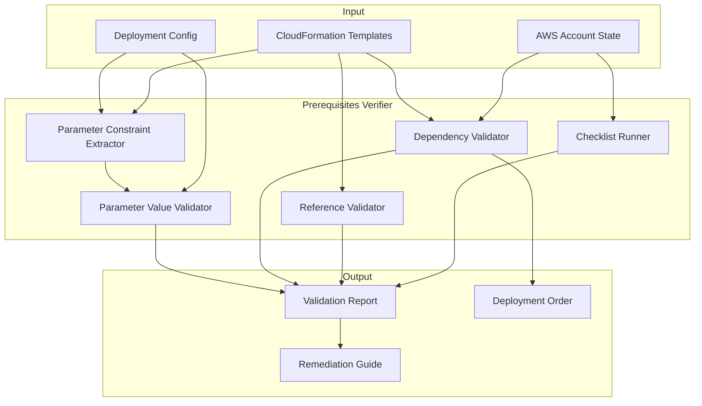

# Design Document: Deployment Prerequisites Verification

## Overview

This design describes a comprehensive pre-deployment verification system that validates all prerequisites before CloudFormation deployments. The system extracts parameter constraints from templates, validates configuration values, checks cross-stack dependencies, and generates actionable remediation reports.

The key insight from the current failure is that the comprehensive template validation is catching constraint violations but also generating false positives for valid `!Ref` references to resources within the same template. This design addresses both issues.

## Architecture



## Components and Interfaces

### 1. ParameterConstraintExtractor

Extracts parameter constraints from CloudFormation templates.

```python
@dataclass
class ParameterConstraint:
    """Represents a CloudFormation parameter constraint."""
    parameter_name: str
    constraint_type: str  # AllowedValues, MinLength, MaxLength, AllowedPattern, Type
    constraint_value: Any  # List for AllowedValues, int for lengths, str for pattern
    default_value: Optional[str] = None
    description: Optional[str] = None

class ParameterConstraintExtractor:
    def extract_constraints(self, template: Dict[str, Any]) -> List[ParameterConstraint]:
        """Extract all parameter constraints from a template."""
        pass
    
    def get_required_parameters(self, template: Dict[str, Any]) -> List[str]:
        """Get parameters that have no default value."""
        pass
```

### 2. ParameterValueValidator

Validates configuration values against extracted constraints.

```python
@dataclass
class ParameterValidationResult:
    """Result of validating a single parameter."""
    parameter_name: str
    is_valid: bool
    configured_value: Any
    constraint_type: Optional[str] = None
    constraint_value: Optional[Any] = None
    error_message: Optional[str] = None
    remediation: Optional[str] = None

class ParameterValueValidator:
    def validate_allowed_values(
        self, 
        value: Any, 
        allowed: List[Any]
    ) -> Tuple[bool, Optional[str]]:
        """Check if value is in allowed list."""
        pass
    
    def validate_min_length(
        self, 
        value: str, 
        min_length: int
    ) -> Tuple[bool, Optional[str]]:
        """Check if value meets minimum length."""
        pass
    
    def validate_max_length(
        self, 
        value: str, 
        max_length: int
    ) -> Tuple[bool, Optional[str]]:
        """Check if value does not exceed maximum length."""
        pass
    
    def validate_pattern(
        self, 
        value: str, 
        pattern: str
    ) -> Tuple[bool, Optional[str]]:
        """Check if value matches regex pattern."""
        pass
    
    def validate_parameter(
        self,
        value: Any,
        constraint: ParameterConstraint
    ) -> ParameterValidationResult:
        """Validate a parameter value against its constraint."""
        pass
```

### 3. ReferenceValidator

Validates !Ref and !GetAtt references within templates.

```python
@dataclass
class ReferenceValidationResult:
    """Result of validating a reference."""
    reference_type: str  # Ref, GetAtt, ImportValue
    reference_target: str
    location: str  # Path in template
    is_valid: bool
    error_message: Optional[str] = None
    is_resource_ref: bool = False  # True if !Ref to a resource in same template

class ReferenceValidator:
    def extract_resources(self, template: Dict[str, Any]) -> Set[str]:
        """Extract all resource logical IDs from template."""
        pass
    
    def extract_parameters(self, template: Dict[str, Any]) -> Set[str]:
        """Extract all parameter names from template."""
        pass
    
    def validate_ref(
        self,
        ref_target: str,
        resources: Set[str],
        parameters: Set[str],
        location: str
    ) -> ReferenceValidationResult:
        """Validate a !Ref reference."""
        pass
    
    def is_pseudo_parameter(self, name: str) -> bool:
        """Check if name is a CloudFormation pseudo-parameter."""
        # AWS::AccountId, AWS::Region, AWS::StackName, etc.
        pass
```

### 4. CrossStackDependencyChecker

Checks cross-stack dependencies and required outputs.

```python
@dataclass
class DependencyCheckResult:
    """Result of checking a cross-stack dependency."""
    import_name: str
    importing_stack: str
    source_stack: Optional[str]
    is_satisfied: bool
    error_message: Optional[str] = None
    remediation: Optional[str] = None

class CrossStackDependencyChecker:
    def __init__(self, cfn_client):
        self.cfn_client = cfn_client
    
    def get_existing_exports(self, region: str) -> Dict[str, str]:
        """Get all existing CloudFormation exports in the region."""
        pass
    
    def check_dependency(
        self,
        import_name: str,
        importing_stack: str,
        templates_being_deployed: Dict[str, Dict],
        existing_exports: Dict[str, str]
    ) -> DependencyCheckResult:
        """Check if a cross-stack dependency is satisfied."""
        pass
    
    def get_deployment_order(
        self,
        templates: Dict[str, Dict],
        existing_exports: Dict[str, str]
    ) -> List[str]:
        """Get the correct deployment order respecting dependencies."""
        pass
```

### 5. PreDeploymentChecklist

Runs a comprehensive pre-deployment checklist.

```python
@dataclass
class ChecklistItem:
    """A single checklist item."""
    name: str
    description: str
    passed: bool
    error_message: Optional[str] = None
    remediation: Optional[str] = None

class PreDeploymentChecklist:
    def check_aws_credentials(self, credentials: Dict) -> ChecklistItem:
        """Verify AWS credentials are valid."""
        pass
    
    def check_region_access(self, region: str) -> ChecklistItem:
        """Verify the target region is accessible."""
        pass
    
    def check_templates_exist(self, template_paths: List[Path]) -> ChecklistItem:
        """Verify all required templates exist."""
        pass
    
    def check_secrets_exist(
        self, 
        required_secrets: List[str],
        region: str
    ) -> ChecklistItem:
        """Verify required secrets exist in Secrets Manager."""
        pass
    
    def check_ssm_parameters(
        self,
        required_params: List[str],
        region: str
    ) -> ChecklistItem:
        """Verify SSM parameters are provisioned."""
        pass
    
    def run_checklist(self, config: Dict) -> List[ChecklistItem]:
        """Run all checklist items."""
        pass
```

### 6. ValidationReportGenerator

Generates comprehensive validation reports.

```python
@dataclass
class ValidationReport:
    """Complete validation report."""
    success: bool
    errors: List[ValidationIssue]
    warnings: List[ValidationIssue]
    info: List[ValidationIssue]
    checklist_results: List[ChecklistItem]
    deployment_order: List[str]
    summary: str
    
    def to_dict(self) -> Dict[str, Any]:
        """Convert to dictionary for JSON serialization."""
        pass
    
    def format_for_ui(self) -> str:
        """Format report for UI display."""
        pass
    
    def get_blocking_errors(self) -> List[ValidationIssue]:
        """Get errors that should block deployment."""
        pass

@dataclass
class ValidationIssue:
    """A single validation issue."""
    severity: str  # error, warning, info
    category: str  # parameter, dependency, reference, checklist
    stack_name: str
    message: str
    location: Optional[str] = None
    remediation: Optional[str] = None
    is_false_positive: bool = False
```

## Data Models

### Configuration Schema

```python
@dataclass
class DeploymentConfig:
    """Deployment configuration from YAML."""
    capability_name: str
    environment: str
    region: str
    parameters: Dict[str, Dict[str, Any]]  # stack_type -> param_name -> value
    
    @classmethod
    def from_yaml(cls, path: Path) -> 'DeploymentConfig':
        """Load configuration from YAML file."""
        pass
```

### Template Parameter Schema

```python
@dataclass
class TemplateParameter:
    """CloudFormation template parameter definition."""
    name: str
    type: str
    default: Optional[str] = None
    allowed_values: Optional[List[Any]] = None
    min_length: Optional[int] = None
    max_length: Optional[int] = None
    allowed_pattern: Optional[str] = None
    constraint_description: Optional[str] = None
    description: Optional[str] = None
```

## Correctness Properties

*A property is a characteristic or behavior that should hold true across all valid executions of a system-essentially, a formal statement about what the system should do. Properties serve as the bridge between human-readable specifications and machine-verifiable correctness guarantees.*

### Property 1: AllowedValues Constraint Validation

*For any* parameter with an AllowedValues constraint and any configured value, the validator SHALL return valid=true if and only if the value is in the allowed list.

**Validates: Requirements 1.2**

### Property 2: MinLength Constraint Validation

*For any* parameter with a MinLength constraint and any configured string value, the validator SHALL return valid=true if and only if len(value) >= min_length.

**Validates: Requirements 1.3**

### Property 3: MaxLength Constraint Validation

*For any* parameter with a MaxLength constraint and any configured string value, the validator SHALL return valid=true if and only if len(value) <= max_length.

**Validates: Requirements 1.4**

### Property 4: AllowedPattern Constraint Validation

*For any* parameter with an AllowedPattern constraint and any configured string value, the validator SHALL return valid=true if and only if the value matches the regex pattern.

**Validates: Requirements 1.5**

### Property 5: Resource Reference Validation (No False Positives)

*For any* template containing !Ref to a resource defined in the same template, the reference validator SHALL return is_valid=true and is_resource_ref=true.

**Validates: Requirements 4.1, 4.4**

### Property 6: Parameter Reference Validation

*For any* template containing !Ref to a parameter defined in the same template, the reference validator SHALL return is_valid=true.

**Validates: Requirements 4.2**

### Property 7: Pseudo-Parameter Recognition

*For any* !Ref to a CloudFormation pseudo-parameter (AWS::AccountId, AWS::Region, AWS::StackName, AWS::StackId, AWS::NotificationARNs, AWS::NoValue, AWS::Partition, AWS::URLSuffix), the reference validator SHALL return is_valid=true.

**Validates: Requirements 4.2**

### Property 8: Cross-Stack Dependency Detection

*For any* template containing !ImportValue, the dependency checker SHALL identify the import name and determine if the export exists in either the templates being deployed or existing CloudFormation exports.

**Validates: Requirements 2.1, 2.2, 2.3**

### Property 9: Validation Report Completeness

*For any* set of validation results, the report generator SHALL include all errors, warnings, and info items with their remediation guidance.

**Validates: Requirements 5.1, 5.2, 5.3**

### Property 10: Constraint Extraction Completeness

*For any* CloudFormation template with parameter constraints, the extractor SHALL extract all constraint types (AllowedValues, MinLength, MaxLength, AllowedPattern, Type).

**Validates: Requirements 1.1**

## Error Handling

### Parameter Validation Errors

| Error Type | Cause | Remediation |
|------------|-------|-------------|
| AllowedValues violation | Value not in allowed list | Update config to use one of: [allowed values] |
| MinLength violation | Value too short | Provide a value with at least N characters |
| MaxLength violation | Value too long | Provide a value with at most N characters |
| Pattern violation | Value doesn't match regex | Provide a value matching pattern: [pattern] |
| Type mismatch | Wrong value type | Provide a value of type: [expected type] |

### Cross-Stack Dependency Errors

| Error Type | Cause | Remediation |
|------------|-------|-------------|
| Missing export | Required export doesn't exist | Deploy [source stack] first |
| Empty output parameter | Stack output not yet available | Deploy [source stack] and use its outputs |
| Circular dependency | Stacks depend on each other | Review stack design to break cycle |

### Reference Validation Errors

| Error Type | Cause | Remediation |
|------------|-------|-------------|
| Invalid resource ref | !Ref to non-existent resource | Check resource logical ID spelling |
| Invalid parameter ref | !Ref to non-existent parameter | Add parameter to template or fix spelling |
| Invalid GetAtt | !GetAtt to non-existent resource/attribute | Check resource and attribute names |

## Testing Strategy

### Unit Tests

- Test each constraint validator with valid and invalid values
- Test reference validator with various template structures
- Test dependency checker with mock CloudFormation responses
- Test report generator with various validation results

### Property-Based Tests

Using Hypothesis for Python:

1. **AllowedValues Property Test**: Generate random allowed lists and values, verify validation correctness
2. **MinLength Property Test**: Generate random strings and lengths, verify validation correctness
3. **MaxLength Property Test**: Generate random strings and lengths, verify validation correctness
4. **Pattern Property Test**: Generate random patterns and strings, verify validation correctness
5. **Resource Reference Property Test**: Generate templates with resources, verify !Ref validation
6. **Pseudo-Parameter Property Test**: Test all pseudo-parameters are recognized

### Integration Tests

- Test full validation flow with real CloudFormation templates
- Test against actual AWS account to verify export checking
- Test end-to-end deployment with validation enabled
