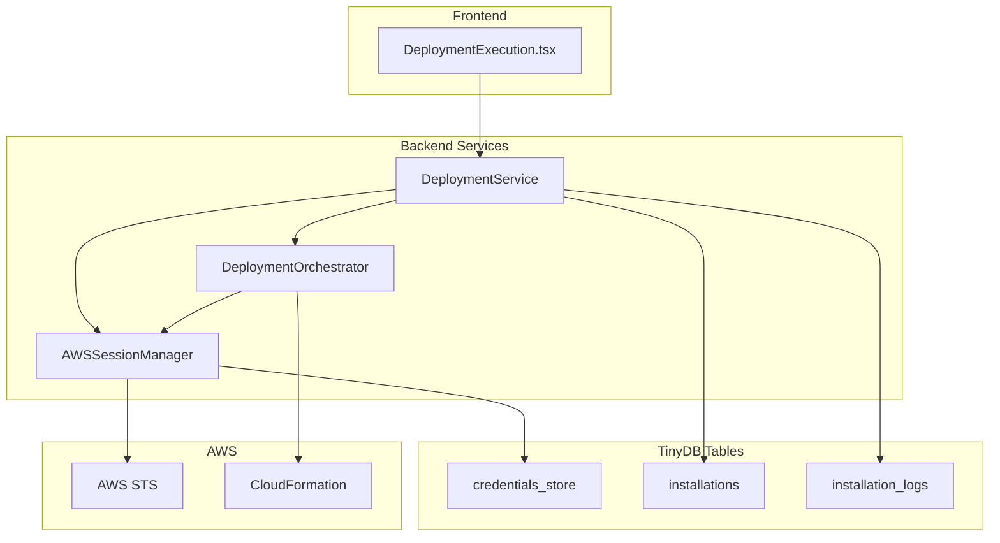

# Design Document: Deployment Session Persistence & Installation Tracking

## Overview

This feature enhances the deployment service with three key capabilities:

1. **Session Persistence**: Store AWS credentials in TinyDB to enable automatic re-authentication when sessions expire during long-running deployments (8+ minutes)
2. **Installation Tracking**: Assign unique Installation IDs to each deployment for comprehensive tracking and history
3. **Operation Logging**: Persist detailed logs of all stack operations with metadata for debugging and auditing

The design leverages the existing TinyDB infrastructure and integrates with the current `DeploymentOrchestrator` and `AWSSessionManager` components.

## Architecture



## Components and Interfaces

### 1. SecureCredentialStore

New service for encrypted credential storage in TinyDB.

```python
class SecureCredentialStore:
    """Encrypted credential storage using TinyDB"""
    
    def __init__(self, db_manager: TinyDBStateManager):
        self.table = db_manager.get_table("credentials_store")
        self._encryption_key = self._get_or_create_key()
    
    def store_credentials(
        self,
        installation_id: str,
        access_key_id: str,
        secret_access_key: str,
        session_token: Optional[str],
        region: str,
        account_id: str,
        expiration: Optional[datetime] = None
    ) -> bool:
        """Store encrypted credentials for an installation"""
        pass
    
    def get_credentials(self, installation_id: str) -> Optional[Dict]:
        """Retrieve and decrypt credentials for an installation"""
        pass
    
    def delete_credentials(self, installation_id: str) -> bool:
        """Delete credentials for an installation"""
        pass
    
    def cleanup_expired(self, retention_hours: int = 24) -> int:
        """Remove credentials older than retention period"""
        pass
```

### 2. InstallationTracker

New service for managing installation records and logs.

```python
class InstallationTracker:
    """Tracks deployment installations with logs and metadata"""
    
    def __init__(self, db_manager: TinyDBStateManager):
        self.installations_table = db_manager.get_table("installations")
        self.logs_table = db_manager.get_table("installation_logs")
    
    def create_installation(
        self,
        capability_name: str,
        capability_version: str,
        environment: str,
        region: str,
        account_id: str,
        strategy: str,
        deploy_frontend: bool,
        deploy_backend: bool
    ) -> str:
        """Create new installation record, returns installation_id"""
        pass
    
    def update_installation(
        self,
        installation_id: str,
        status: str,
        error: Optional[str] = None,
        frontend_url: Optional[str] = None,
        backend_url: Optional[str] = None
    ) -> bool:
        """Update installation status and outputs"""
        pass
    
    def log_stack_operation(
        self,
        installation_id: str,
        stack_name: str,
        stack_type: str,
        operation: str,  # create, update, skip, delete
        status: str,     # started, completed, failed
        region: str,
        details: Optional[Dict] = None
    ) -> bool:
        """Log a stack operation"""
        pass
    
    def get_installation(self, installation_id: str) -> Optional[Dict]:
        """Get installation with all logs"""
        pass
    
    def list_installations(
        self,
        capability_name: Optional[str] = None,
        environment: Optional[str] = None,
        status: Optional[str] = None,
        start_date: Optional[datetime] = None,
        end_date: Optional[datetime] = None,
        limit: int = 50
    ) -> List[Dict]:
        """List installations with filters"""
        pass
```

### 3. Enhanced AWSSessionManager

Extend existing session manager with persistence and refresh capabilities.

```python
class AWSSessionManager:
    """Enhanced session manager with persistence"""
    
    def __init__(self, credential_store: SecureCredentialStore):
        self.sessions: Dict[str, Dict] = {}
        self.credential_store = credential_store
    
    def create_session_with_persistence(
        self,
        installation_id: str,
        access_key_id: str,
        secret_access_key: str,
        session_token: Optional[str] = None,
        region: Optional[str] = None,
        account_id: Optional[str] = None
    ) -> str:
        """Create session and persist credentials"""
        pass
    
    def refresh_session(self, session_id: str) -> bool:
        """Attempt to refresh expired session using stored credentials"""
        pass
    
    def cleanup_installation_credentials(self, installation_id: str):
        """Remove credentials after deployment completes"""
        pass
```

## Data Models

### Installation Record

```python
@dataclass
class InstallationRecord:
    installation_id: str          # UUID
    capability_name: str
    capability_version: str
    environment: str
    region: str
    account_id: str
    strategy: str                 # CLEAN_DEPLOY or UPDATE_EXISTING
    deploy_frontend: bool
    deploy_backend: bool
    status: str                   # pending, running, completed, failed, cancelled
    started_at: datetime
    completed_at: Optional[datetime]
    duration_seconds: Optional[int]
    error: Optional[str]
    frontend_url: Optional[str]
    backend_url: Optional[str]
    cognito_config: Optional[Dict]
    stacks_summary: Dict[str, int]  # {created: 2, updated: 1, failed: 0, skipped: 1}
```

### Stack Operation Log

```python
@dataclass
class StackOperationLog:
    log_id: str                   # UUID
    installation_id: str          # Foreign key
    stack_name: str
    stack_type: str               # frontend-global, backend-service, etc.
    operation: str                # create, update, delete, skip
    status: str                   # started, in_progress, completed, failed
    region: str
    started_at: datetime
    completed_at: Optional[datetime]
    duration_seconds: Optional[int]
    error_message: Optional[str]
    stack_outputs: Optional[Dict]
    cfn_events: Optional[List[Dict]]  # CloudFormation events on failure
```

### Stored Credentials (Encrypted)

```python
@dataclass
class StoredCredentials:
    installation_id: str
    encrypted_access_key: str     # Fernet encrypted
    encrypted_secret_key: str     # Fernet encrypted
    encrypted_session_token: Optional[str]
    region: str
    account_id: str
    created_at: datetime
    expires_at: Optional[datetime]
    last_accessed_at: Optional[datetime]
```

## Correctness Properties

*A property is a characteristic or behavior that should hold true across all valid executions of a system-essentially, a formal statement about what the system should do. Properties serve as the bridge between human-readable specifications and machine-verifiable correctness guarantees.*

### Property 1: Credential Storage on Deployment Start
*For any* deployment initiation with valid credentials, the credentials SHALL be stored in TinyDB with the associated installation_id before any stack operations begin.
**Validates: Requirements 1.1**

### Property 2: Credential Refresh on Expiration
*For any* AWS API call that fails with ExpiredTokenException, the system SHALL attempt to refresh credentials using stored authentication information before failing the operation.
**Validates: Requirements 1.2**

### Property 3: Credential Cleanup on Completion
*For any* deployment that completes (success or failure), the stored credentials SHALL be deleted from TinyDB within the configured retention period.
**Validates: Requirements 1.3, 1.4, 6.2**

### Property 4: Installation ID Uniqueness and Association
*For any* deployment, a unique UUID installation_id SHALL be generated and associated with all logs and metadata, and queries by installation_id SHALL return exactly that deployment's data.
**Validates: Requirements 2.1, 2.2, 2.3**

### Property 5: Stack Operation Logging Completeness
*For any* stack operation, the log SHALL contain operation type, stack name, timestamp at start, and status with error details at completion.
**Validates: Requirements 3.1, 3.2, 3.5**

### Property 6: Stack Output Recording
*For any* successfully created or updated stack, the stack outputs and resource identifiers SHALL be recorded in the installation logs.
**Validates: Requirements 3.3, 3.4**

### Property 7: Deployment Metadata Completeness
*For any* deployment, the metadata SHALL include capability name, version, environment, region, account_id, strategy, duration, final status, and output URLs.
**Validates: Requirements 4.1, 4.2, 4.3, 4.4**

### Property 8: Query Filtering and Sorting
*For any* query to deployment history, results SHALL be filterable by capability name, environment, date range, and status, and SHALL be sorted by timestamp descending.
**Validates: Requirements 5.1, 5.2, 5.3**

### Property 9: Credential Encryption
*For any* stored credentials, the access_key, secret_key, and session_token fields SHALL be encrypted, and the encrypted values SHALL not contain the original plaintext.
**Validates: Requirements 6.1**

### Property 10: Startup Credential Cleanup
*For any* application startup, orphaned credentials older than the retention period SHALL be deleted from TinyDB.
**Validates: Requirements 6.3**

### Property 11: Audit Logging Without Credential Exposure
*For any* credential access operation, an audit log entry SHALL be created that does not contain the actual credential values.
**Validates: Requirements 6.4**

## Error Handling

### Credential Refresh Failures

```python
class CredentialRefreshError(Exception):
    """Raised when credential refresh fails"""
    pass

def handle_expired_credentials(installation_id: str, error: Exception):
    """
    1. Log the expiration event
    2. Attempt refresh using stored credentials
    3. If refresh fails, log detailed error
    4. Notify user with re-authentication instructions
    5. Mark deployment as failed with clear error message
    """
    pass
```

### Database Write Failures

```python
def handle_db_write_failure(operation: str, error: Exception):
    """
    1. Log the failure with full context
    2. Retry with exponential backoff (max 3 attempts)
    3. If all retries fail, continue deployment but warn user
    4. Store logs in memory as fallback
    """
    pass
```

## Testing Strategy

### Dual Testing Approach

This feature requires both unit tests and property-based tests:

- **Unit tests**: Verify specific examples, edge cases, and error conditions
- **Property-based tests**: Verify universal properties hold across all inputs

### Property-Based Testing Framework

Use `hypothesis` library for Python property-based testing.

```python
from hypothesis import given, strategies as st

# Example: Property 4 - Installation ID Uniqueness
@given(st.lists(st.text(min_size=1), min_size=2, max_size=10))
def test_installation_ids_are_unique(capability_names):
    """
    **Feature: deployment-session-persistence, Property 4: Installation ID Uniqueness**
    For any set of deployments, all installation IDs must be unique
    """
    tracker = InstallationTracker(get_test_db())
    ids = []
    for name in capability_names:
        install_id = tracker.create_installation(
            capability_name=name,
            capability_version="1.0.0",
            environment="dev",
            region="us-east-1",
            account_id="123456789012",
            strategy="UPDATE_EXISTING",
            deploy_frontend=True,
            deploy_backend=True
        )
        ids.append(install_id)
    
    assert len(ids) == len(set(ids)), "Installation IDs must be unique"
```

### Test Categories

1. **Credential Storage Tests**
   - Store and retrieve credentials
   - Encryption verification
   - Cleanup on completion
   - Retention period enforcement

2. **Installation Tracking Tests**
   - ID generation uniqueness
   - Metadata completeness
   - Log association
   - Query filtering

3. **Integration Tests**
   - Full deployment flow with persistence
   - Credential refresh simulation
   - Concurrent deployment handling

