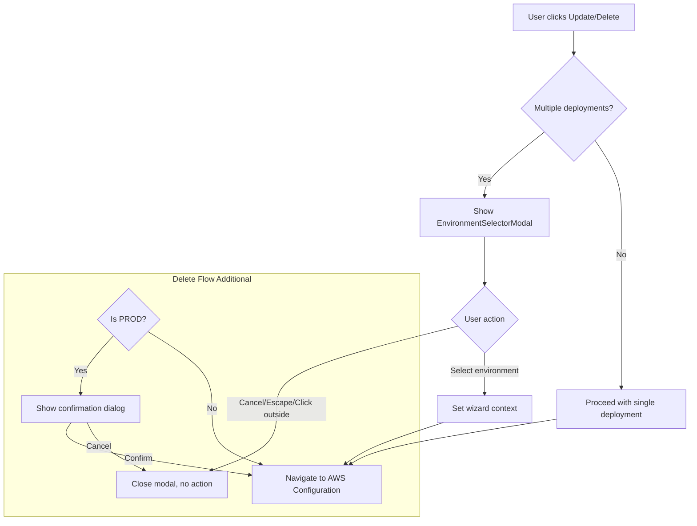

# Design Document: Environment-Specific Operations

## Overview

This design introduces an Environment Selector modal component that allows users to choose which specific deployment environment to update or delete when a capability has multiple active deployments. The solution modifies the existing `CapabilitySelection.tsx` component to conditionally show this selector before proceeding with operations.

## Architecture

The solution follows the existing React component architecture in the starhub-deployer frontend:

```
CapabilitySelection.tsx
├── InstalledCapabilityCard (existing)
│   ├── Update button → triggers handleUpdate()
│   └── Delete button → triggers handleDelete()
└── EnvironmentSelectorModal (new)
    ├── Modal overlay
    ├── Header (capability name + operation type)
    ├── Environment cards (sorted: PROD first, then alphabetical)
    └── Cancel button
```

### Flow Diagram



## Components and Interfaces

### EnvironmentSelectorModal Component

```typescript
interface EnvironmentSelectorModalProps {
  isOpen: boolean;
  onClose: () => void;
  onSelect: (deployment: DeploymentState) => void;
  capability: Capability;
  deployments: DeploymentState[];
  operationType: 'update' | 'delete';
}

const EnvironmentSelectorModal: React.FC<EnvironmentSelectorModalProps>
```

### State Management

New state variables in `CapabilitySelection`:

```typescript
// Modal visibility state
const [selectorModalOpen, setSelectorModalOpen] = useState(false);

// Current operation context
const [pendingOperation, setPendingOperation] = useState<{
  capability: Capability;
  deployments: DeploymentState[];
  operationType: 'update' | 'delete';
} | null>(null);
```

### Modified Handler Functions

```typescript
// Updated handleUpdate - checks deployment count
const handleUpdate = (capability: Capability, deployments: DeploymentState[]) => {
  if (deployments.length > 1) {
    setPendingOperation({ capability, deployments, operationType: 'update' });
    setSelectorModalOpen(true);
  } else {
    proceedWithOperation(capability, deployments[0], 'update');
  }
};

// Updated handleDelete - checks deployment count
const handleDelete = (capability: Capability, deployments: DeploymentState[]) => {
  if (deployments.length > 1) {
    setPendingOperation({ capability, deployments, operationType: 'delete' });
    setSelectorModalOpen(true);
  } else {
    proceedWithOperation(capability, deployments[0], 'delete');
  }
};

// New function to proceed after selection
const proceedWithOperation = (
  capability: Capability, 
  deployment: DeploymentState, 
  operationType: 'update' | 'delete'
) => {
  setCapability(capability);
  setEnvironment(deployment.environment);
  setAwsRegion(deployment.region);
  setDeleteMode(operationType === 'delete');
  setStep(WizardStep.AWS_CONFIGURATION);
};
```

## Data Models

### Existing DeploymentState (no changes needed)

```typescript
interface DeploymentState {
  capability_name: string;
  environment: string;
  region: string;
  last_deployment: string;
  stacks: Array<{
    stack_name: string;
    stack_type: string;
    region: string;
  }>;
  metadata?: {
    frontend_url?: string;
    backend_url?: string;
  };
}
```

### Environment Sorting Utility

```typescript
const sortDeployments = (deployments: DeploymentState[]): DeploymentState[] => {
  return [...deployments].sort((a, b) => {
    const aIsProd = a.environment.toLowerCase() === 'prod';
    const bIsProd = b.environment.toLowerCase() === 'prod';
    
    if (aIsProd && !bIsProd) return -1;
    if (!aIsProd && bIsProd) return 1;
    return a.environment.localeCompare(b.environment);
  });
};
```

## Correctness Properties

*A property is a characteristic or behavior that should hold true across all valid executions of a system—essentially, a formal statement about what the system should do. Properties serve as the bridge between human-readable specifications and machine-verifiable correctness guarantees.*

### Property 1: Modal Display for Multi-Deployment Capabilities

*For any* installed capability with more than one deployment, clicking either Update or Delete SHALL display the EnvironmentSelectorModal with all deployments listed.

**Validates: Requirements 1.1, 2.1**

### Property 2: Deployment Option Content Completeness

*For any* deployment displayed in the EnvironmentSelectorModal, the rendered card SHALL contain the environment name, region, and formatted deployment timestamp.

**Validates: Requirements 1.2, 3.3**

### Property 3: Environment Selection Sets Correct Wizard State

*For any* deployment selected from the EnvironmentSelectorModal, the wizard context SHALL be set with that deployment's environment, region, and the correct delete mode (true for delete, false for update).

**Validates: Requirements 1.3, 2.3**

### Property 4: Single Deployment Skips Modal

*For any* installed capability with exactly one deployment, clicking Update or Delete SHALL proceed directly to AWS Configuration without displaying the EnvironmentSelectorModal, using that deployment's environment and region.

**Validates: Requirements 1.4, 2.4**

### Property 5: Environment Type Visual Distinction

*For any* deployment card in the EnvironmentSelectorModal, production environments (environment === 'prod' case-insensitive) SHALL have distinct visual styling (red border/accent) compared to non-production environments (blue border/accent).

**Validates: Requirements 1.5, 4.2**

### Property 6: Production Delete Confirmation

*For any* delete operation targeting a production environment, the system SHALL require explicit confirmation before proceeding to AWS Configuration.

**Validates: Requirements 2.2, 2.5**

### Property 7: Modal Header Content

*For any* EnvironmentSelectorModal display, the header SHALL contain both the capability name and the operation type ("Update" or "Delete").

**Validates: Requirements 3.2**

### Property 8: Modal Dismissal Behavior

*For any* EnvironmentSelectorModal, clicking outside the modal, pressing Escape, or clicking Cancel SHALL close the modal without modifying wizard state or navigating away.

**Validates: Requirements 3.4, 3.5**

### Property 9: Environment Sorting Order

*For any* list of deployments displayed in the EnvironmentSelectorModal, production environments SHALL appear first, followed by other environments in alphabetical order.

**Validates: Requirements 3.6**

### Property 10: Selection Highlighting

*For any* deployment card that is hovered or focused in the EnvironmentSelectorModal, the card SHALL display a distinct highlight style to indicate interactivity.

**Validates: Requirements 4.1**

### Property 11: Operation-Specific Modal Styling

*For any* EnvironmentSelectorModal, the modal SHALL display with green/neutral accents for update operations and red/warning accents for delete operations.

**Validates: Requirements 4.3, 4.4**

## Error Handling

| Scenario | Handling |
|----------|----------|
| Empty deployments array | Should not occur (card only shown for installed capabilities), but modal should not open |
| Modal state desync | Reset modal state on close, clear pending operation |
| Escape key during confirmation | Close confirmation dialog, return to environment selector |

## Testing Strategy

### Unit Tests

Unit tests will verify specific examples and edge cases:

1. Modal renders correctly with sample deployments
2. Cancel button closes modal
3. Escape key closes modal
4. Click outside closes modal
5. PROD environment shows warning styling
6. Delete mode shows red accents
7. Update mode shows green accents

### Property-Based Tests

Property-based tests will use fast-check to verify universal properties across generated inputs:

- **Library**: fast-check (already used in project or to be added)
- **Minimum iterations**: 100 per property
- **Tag format**: `Feature: environment-specific-operations, Property N: {property_text}`

Property tests will generate:
- Random deployment arrays (varying lengths, environment names, regions)
- Random capability objects
- Random operation types

Each property from the Correctness Properties section will be implemented as a separate property-based test that validates the property holds for all generated inputs.

### Test File Location

Tests will be co-located with the component:
- `starhub-deployer/frontend/src/components/EnvironmentSelectorModal.test.tsx`
- `starhub-deployer/frontend/src/components/CapabilitySelection.test.tsx` (updates)
