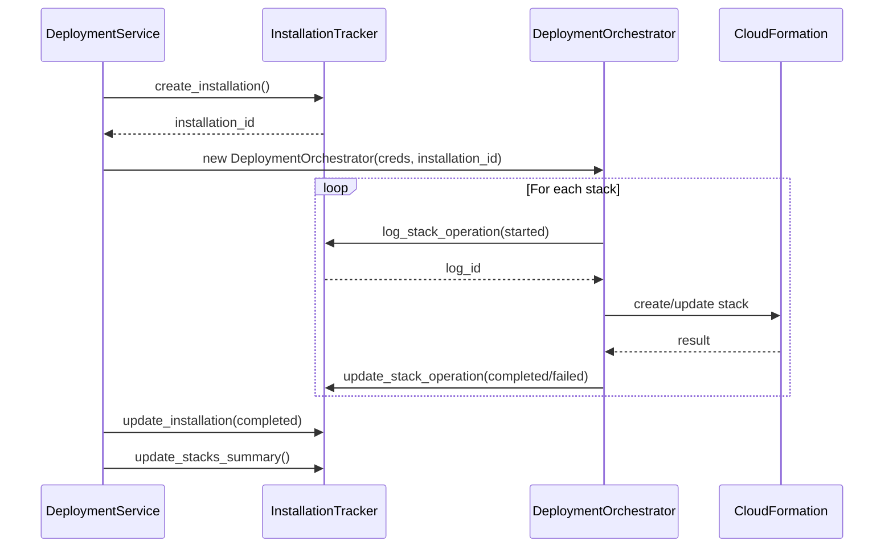

# Design Document: Installation History Stack Operations Fix

## Overview

This feature fixes a gap in the deployment session persistence implementation where stack operations are not being logged to the installation history. The primary issue is that the `installation_id` created during deployment initialization is not passed to the `DeploymentOrchestrator`, causing the `_log_stack_operation()` method to skip logging.

The fix involves:
1. Passing `installation_id` to `DeploymentOrchestrator` during instantiation
2. Adding installation log file persistence for debugging
3. Ensuring stacks_summary is calculated correctly from logged operations

## Architecture



## Components and Interfaces

### 1. DeploymentService Changes

Update `_execute_deployment_script()` to pass `installation_id` to orchestrator:

```python
# Current (broken):
orchestrator = DeploymentOrchestrator(client_creds)

# Fixed:
installation_id = deployment.get("installation_id")
orchestrator = DeploymentOrchestrator(client_creds, installation_id=installation_id)
```

### 2. Installation Log File Storage

Add log file persistence to capture deployment progress messages:

```python
class InstallationLogWriter:
    """Writes deployment logs to file for persistence"""
    
    def __init__(self, installation_id: str, logs_dir: Path):
        self.installation_id = installation_id
        self.log_file = logs_dir / f"{installation_id}.log"
    
    def write(self, level: str, message: str, timestamp: datetime):
        """Append log entry to file"""
        entry = f"[{timestamp.isoformat()}] [{level}] {message}\n"
        with open(self.log_file, 'a') as f:
            f.write(entry)
    
    def read(self) -> str:
        """Read entire log file content"""
        if self.log_file.exists():
            return self.log_file.read_text()
        return ""
```

### 3. API Response Enhancement

Update `InstallationDetail` to include log content:

```python
class InstallationDetail(BaseModel):
    # ... existing fields ...
    logs: List[dict] = []  # Stack operation logs
    installation_log: Optional[str] = None  # Full deployment log text
```

## Data Models

### Installation Log Entry (File Format)

```
[2025-12-22T09:43:27.123456] [INFO] 🚀 Starting deployment process...
[2025-12-22T09:43:27.234567] [INFO] Capability: Call Processing
[2025-12-22T09:43:28.345678] [INFO] ▶ Deploying frontend-global to us-east-1...
[2025-12-22T09:43:45.456789] [INFO] ✓ Stack deployed successfully
```

### Stack Operation Log (TinyDB)

Already defined in `StackOperationLog` model - no changes needed.

## Correctness Properties

*A property is a characteristic or behavior that should hold true across all valid executions of a system-essentially, a formal statement about what the system should do. Properties serve as the bridge between human-readable specifications and machine-verifiable correctness guarantees.*

### Property 1: Installation ID Propagation
*For any* deployment with a valid installation_id, the DeploymentOrchestrator SHALL receive and store the installation_id, enabling stack operation logging.
**Validates: Requirements 1.1**

### Property 2: Stack Operation Logging Completeness
*For any* stack operation during deployment, a log entry SHALL be created containing stack_name, stack_type, operation, status, and region.
**Validates: Requirements 1.2, 1.3**

### Property 3: Installation Log Persistence
*For any* log message added during deployment, the message SHALL be appended to the installation log file with timestamp and level.
**Validates: Requirements 2.1, 2.2, 2.4**

### Property 4: Stacks Summary Accuracy
*For any* completed deployment, the stacks_summary counts SHALL equal the count of logged operations grouped by status (created, updated, failed, skipped).
**Validates: Requirements 3.1, 3.3**

## Error Handling

### Log File Write Failures

```python
def handle_log_write_failure(installation_id: str, error: Exception):
    """
    1. Log warning to application logger
    2. Continue deployment (non-blocking)
    3. Store message in memory as fallback
    """
    logger.warning(f"Failed to write installation log: {error}")
```

### Missing Installation ID

```python
def _log_stack_operation(self, ...):
    if not self.installation_id:
        logger.debug("No installation_id - skipping stack operation log")
        return None
    # ... proceed with logging
```

## Testing Strategy

### Dual Testing Approach

- **Unit tests**: Verify specific code paths and error handling
- **Property-based tests**: Verify universal properties hold across all inputs

### Property-Based Testing Framework

Use `hypothesis` library for Python property-based testing. Configure each test to run minimum 100 iterations.

### Test Categories

1. **Installation ID Propagation Tests**
   - Verify orchestrator receives installation_id
   - Verify stack operations are logged when installation_id present
   - Verify graceful handling when installation_id missing

2. **Log File Tests**
   - Verify log file creation
   - Verify log entry format (timestamp, level, message)
   - Verify log file read/write operations

3. **Stacks Summary Tests**
   - Verify summary calculation from operations
   - Verify counts match logged operations
   - Verify handling of mixed operation statuses
