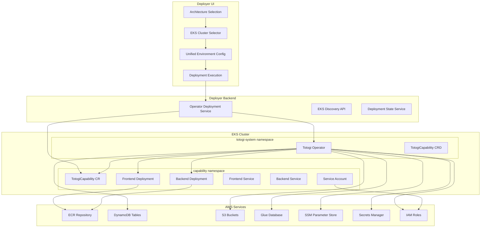

# Design Document: Pure EKS Deployment

## Overview

This design document describes the architecture and implementation for Pure AWS EKS Based deployment using a Kubernetes Operator pattern. The solution enables deployment of Totogi capabilities to EKS clusters where a custom Kubernetes Operator manages the provisioning of application components and AWS data services.

The design follows these key principles:
- **Operator Pattern**: A Kubernetes Operator manages the full lifecycle of capability deployments
- **Declarative Configuration**: Deployments are defined via Custom Resources (CRs)
- **Existing Patterns**: SSM Parameter Store and Secrets Manager follow existing naming conventions
- **Self-Healing**: The Operator continuously reconciles desired vs actual state

## Architecture



## Components and Interfaces

### 1. Frontend Components

#### 1.1 Architecture Selection Updates

**File**: `frontend/src/types/architecture.ts`

```typescript
// Add new frontend service option
export enum FrontendService {
  S3_CLOUDFRONT = 's3_cloudfront',
  AMPLIFY = 'amplify',
  EKS = 'eks',  // New: Pure EKS frontend
}

// Update backend service to enable EKS
export const BACKEND_SERVICE_OPTIONS: Record<BackendService, ServiceOptionMeta> = {
  [BackendService.EKS]: {
    id: 'eks',
    name: 'EKS (Kubernetes)',
    description: 'Managed Kubernetes with Operator-based deployment and self-healing.',
    icon: 'eks',
    availability: 'available',  // Changed from 'coming_soon'
    costTier: 'high',
    features: ['Kubernetes native', 'Operator managed', 'Self-healing', 'Declarative config'],
  },
  // ... existing options
};

// Add Pure EKS frontend option
export const FRONTEND_SERVICE_OPTIONS: Record<FrontendService, ServiceOptionMeta> = {
  [FrontendService.EKS]: {
    id: 'eks',
    name: 'Pure EKS',
    description: 'Frontend container deployed to EKS cluster alongside backend.',
    icon: 'eks',
    availability: 'available',
    costTier: 'high',
    features: ['Container-based', 'Same cluster as backend', 'Ingress routing', 'Unified deployment'],
  },
  // ... existing options
};
```

#### 1.2 EKS Cluster Selector Component

**File**: `frontend/src/components/EKSClusterSelector.tsx`

```typescript
interface EKSCluster {
  name: string;
  arn: string;
  version: string;
  status: 'ACTIVE' | 'CREATING' | 'DELETING' | 'FAILED' | 'UPDATING';
  endpoint: string;
  oidcProviderUrl: string | null;
  nodeCount: number;
  operatorInstalled: boolean;
  operatorVersion: string | null;
}

interface EKSClusterSelectorProps {
  region: string;
  awsSessionId: string;
  onClusterSelect: (cluster: EKSCluster) => void;
}

// Component displays:
// - List of EKS clusters with status, version, node count
// - Operator installation status indicator
// - Cluster health indicators
// - Namespace configuration section
```

#### 1.3 Wizard Context Updates

**File**: `frontend/src/types/wizard.ts`

```typescript
interface EKSConfig {
  clusterArn: string;
  clusterName: string;
  clusterEndpoint: string;
  oidcProviderUrl: string;
  namespace: string;
  createNamespace: boolean;
  operatorInstalled: boolean;
  operatorVersion: string | null;
}

interface WizardState {
  // ... existing fields
  eksConfig: EKSConfig | null;
}
```

### 2. Backend Services

#### 2.1 EKS Discovery API

**File**: `backend/app/routers/eks.py`

```python
@router.get("/clusters")
async def list_eks_clusters(
    region: str,
    aws_session_id: str
) -> List[EKSClusterInfo]:
    """List available EKS clusters in the region."""
    pass

@router.get("/clusters/{cluster_name}")
async def get_cluster_details(
    cluster_name: str,
    region: str,
    aws_session_id: str
) -> EKSClusterDetails:
    """Get detailed information about an EKS cluster."""
    pass

@router.get("/clusters/{cluster_name}/operator-status")
async def check_operator_status(
    cluster_name: str,
    region: str,
    aws_session_id: str
) -> OperatorStatus:
    """Check if Totogi Operator is installed and its version."""
    pass

@router.get("/clusters/{cluster_name}/namespaces")
async def list_namespaces(
    cluster_name: str,
    region: str,
    aws_session_id: str
) -> List[str]:
    """List namespaces in the cluster."""
    pass
```

#### 2.2 Operator Deployment Service

**File**: `backend/app/services/operator_deployment_service.py`

```python
class OperatorDeploymentService:
    """Service for deploying and managing the Totogi Operator."""
    
    def __init__(self, credentials: Dict[str, str], cluster_name: str, region: str):
        self.credentials = credentials
        self.cluster_name = cluster_name
        self.region = region
        self.eks_client = boto3.client('eks', region_name=region, **credentials)
        self.k8s_client = None  # Initialized after cluster connection
    
    async def deploy_operator(
        self,
        operator_image: str,
        callback: Optional[Callable] = None
    ) -> OperatorDeploymentResult:
        """
        Deploy the Totogi Operator to the EKS cluster.
        
        Steps:
        1. Create totogi-system namespace
        2. Create IAM role for operator with IRSA
        3. Create ServiceAccount with IAM role annotation
        4. Apply CRD definitions
        5. Deploy operator Deployment
        6. Wait for operator pod to be ready
        """
        pass
    
    async def create_capability_cr(
        self,
        capability_name: str,
        environment: str,
        config: TotogiCapabilitySpec,
        namespace: str,
        callback: Optional[Callable] = None
    ) -> str:
        """Create a TotogiCapability Custom Resource."""
        pass
    
    async def watch_cr_status(
        self,
        cr_name: str,
        namespace: str,
        callback: Optional[Callable] = None
    ) -> AsyncGenerator[CRStatusUpdate, None]:
        """Watch CR status updates for deployment progress."""
        pass
```

### 3. Kubernetes Operator

#### 3.1 Operator Structure

**Directory**: `kube-operator/`

```
kube-operator/
├── Dockerfile
├── requirements.txt
├── pyproject.toml
├── src/
│   ├── __init__.py
│   ├── main.py                    # Operator entry point
│   ├── controllers/
│   │   ├── __init__.py
│   │   └── capability_controller.py  # TotogiCapability reconciler
│   ├── resources/
│   │   ├── __init__.py
│   │   ├── dynamodb.py            # DynamoDB provisioner
│   │   ├── s3.py                  # S3 provisioner
│   │   ├── glue.py                # Glue provisioner
│   │   ├── ssm.py                 # SSM Parameter provisioner
│   │   ├── secrets.py             # Secrets Manager provisioner
│   │   ├── iam.py                 # IAM role provisioner
│   │   └── kubernetes.py          # K8s resource creator
│   ├── models/
│   │   ├── __init__.py
│   │   └── capability.py          # TotogiCapability model
│   └── utils/
│       ├── __init__.py
│       └── naming.py              # Resource naming utilities
├── manifests/
│   ├── crd.yaml                   # TotogiCapability CRD
│   ├── rbac.yaml                  # RBAC for operator
│   └── deployment.yaml            # Operator deployment template
└── tests/
    ├── __init__.py
    ├── test_capability_controller.py
    └── test_resource_provisioners.py
```

#### 3.2 TotogiCapability CRD

**File**: `kube-operator/manifests/crd.yaml`

```yaml
apiVersion: apiextensions.k8s.io/v1
kind: CustomResourceDefinition
metadata:
  name: totogicapabilities.totogi.com
spec:
  group: totogi.com
  versions:
    - name: v1
      served: true
      storage: true
      schema:
        openAPIV3Schema:
          type: object
          properties:
            spec:
              type: object
              required:
                - capabilityName
                - version
                - environment
                - region
              properties:
                capabilityName:
                  type: string
                version:
                  type: string
                environment:
                  type: string
                  enum: [dev, test, stage, prod]
                region:
                  type: string
                frontend:
                  type: object
                  properties:
                    image:
                      type: string
                    replicas:
                      type: integer
                      default: 2
                    resources:
                      type: object
                      properties:
                        cpu:
                          type: string
                          default: "500m"
                        memory:
                          type: string
                          default: "512Mi"
                backend:
                  type: object
                  properties:
                    image:
                      type: string
                    replicas:
                      type: integer
                      default: 2
                    resources:
                      type: object
                      properties:
                        cpu:
                          type: string
                          default: "1000m"
                        memory:
                          type: string
                          default: "1Gi"
                dataServices:
                  type: object
                  properties:
                    dynamodb:
                      type: object
                      properties:
                        enabled:
                          type: boolean
                          default: true
                    s3:
                      type: object
                      properties:
                        enabled:
                          type: boolean
                          default: true
                    glue:
                      type: object
                      properties:
                        enabled:
                          type: boolean
                          default: true
                deletionPolicy:
                  type: string
                  enum: [Delete, Retain]
                  default: Delete
            status:
              type: object
              properties:
                phase:
                  type: string
                  enum: [Pending, Provisioning, Deploying, Running, Failed, Deleting]
                message:
                  type: string
                frontendUrl:
                  type: string
                backendUrl:
                  type: string
                resources:
                  type: object
                  properties:
                    dynamodbTables:
                      type: array
                      items:
                        type: string
                    s3Buckets:
                      type: array
                      items:
                        type: string
                    glueDatabase:
                      type: string
                    ssmParameters:
                      type: array
                      items:
                        type: string
                    secrets:
                      type: array
                      items:
                        type: string
                    iamRoles:
                      type: array
                      items:
                        type: string
                lastReconcileTime:
                  type: string
                  format: date-time
      subresources:
        status: {}
  scope: Namespaced
  names:
    plural: totogicapabilities
    singular: totogicapability
    kind: TotogiCapability
    shortNames:
      - tc
```

#### 3.3 Capability Controller

**File**: `kube-operator/src/controllers/capability_controller.py`

```python
import kopf
import logging
from typing import Dict, Any, Optional

from ..resources.dynamodb import DynamoDBProvisioner
from ..resources.s3 import S3Provisioner
from ..resources.glue import GlueProvisioner
from ..resources.ssm import SSMProvisioner
from ..resources.secrets import SecretsProvisioner
from ..resources.iam import IAMProvisioner
from ..resources.kubernetes import KubernetesResourceCreator
from ..utils.naming import ResourceNaming

logger = logging.getLogger(__name__)


@kopf.on.create('totogi.com', 'v1', 'totogicapabilities')
async def create_capability(spec: Dict[str, Any], name: str, namespace: str, 
                           status: Dict[str, Any], patch: kopf.Patch, **kwargs):
    """Handle TotogiCapability creation."""
    
    capability_name = spec['capabilityName']
    environment = spec['environment']
    region = spec['region']
    
    naming = ResourceNaming(capability_name, environment)
    
    # Update status to Provisioning
    patch.status['phase'] = 'Provisioning'
    patch.status['message'] = 'Starting resource provisioning'
    
    try:
        # 1. Provision AWS Data Services
        resources = {}
        
        if spec.get('dataServices', {}).get('dynamodb', {}).get('enabled', True):
            dynamodb = DynamoDBProvisioner(region)
            tables = await dynamodb.provision_tables(naming)
            resources['dynamodbTables'] = tables
        
        if spec.get('dataServices', {}).get('s3', {}).get('enabled', True):
            s3 = S3Provisioner(region)
            buckets = await s3.provision_buckets(naming)
            resources['s3Buckets'] = buckets
        
        if spec.get('dataServices', {}).get('glue', {}).get('enabled', True):
            glue = GlueProvisioner(region)
            database = await glue.provision_database(naming)
            resources['glueDatabase'] = database
        
        # 2. Provision SSM Parameters
        ssm = SSMProvisioner(region)
        parameters = await ssm.provision_parameters(naming, resources)
        resources['ssmParameters'] = parameters
        
        # 3. Provision Secrets
        secrets = SecretsProvisioner(region)
        secret_names = await secrets.provision_secrets(naming)
        resources['secrets'] = secret_names
        
        # 4. Create IAM Role for application
        iam = IAMProvisioner(region)
        role_arn = await iam.create_application_role(naming, resources)
        resources['iamRoles'] = [role_arn]
        
        # Update status to Deploying
        patch.status['phase'] = 'Deploying'
        patch.status['message'] = 'Deploying Kubernetes resources'
        patch.status['resources'] = resources
        
        # 5. Deploy Kubernetes resources
        k8s = KubernetesResourceCreator(namespace)
        
        # Create ServiceAccount with IRSA
        await k8s.create_service_account(naming, role_arn)
        
        # Deploy backend
        backend_spec = spec.get('backend', {})
        backend_url = await k8s.deploy_backend(
            naming=naming,
            image=backend_spec.get('image'),
            replicas=backend_spec.get('replicas', 2),
            resources=backend_spec.get('resources', {}),
            environment=environment,
            region=region
        )
        
        # Deploy frontend
        frontend_spec = spec.get('frontend', {})
        frontend_url = await k8s.deploy_frontend(
            naming=naming,
            image=frontend_spec.get('image'),
            replicas=frontend_spec.get('replicas', 2),
            resources=frontend_spec.get('resources', {})
        )
        
        # Update final status
        patch.status['phase'] = 'Running'
        patch.status['message'] = 'Deployment complete'
        patch.status['frontendUrl'] = frontend_url
        patch.status['backendUrl'] = backend_url
        
        # Emit success event
        kopf.event(kwargs['body'], type='Normal', reason='DeploymentComplete',
                   message=f'Successfully deployed {capability_name} to {environment}')
        
    except Exception as e:
        logger.error(f"Failed to create capability: {e}")
        patch.status['phase'] = 'Failed'
        patch.status['message'] = str(e)
        kopf.event(kwargs['body'], type='Warning', reason='DeploymentFailed',
                   message=str(e))
        raise kopf.PermanentError(str(e))


@kopf.on.update('totogi.com', 'v1', 'totogicapabilities')
async def update_capability(spec: Dict[str, Any], name: str, namespace: str,
                           status: Dict[str, Any], patch: kopf.Patch, **kwargs):
    """Handle TotogiCapability updates - perform rolling update."""
    # Similar to create but updates existing resources
    pass


@kopf.on.delete('totogi.com', 'v1', 'totogicapabilities')
async def delete_capability(spec: Dict[str, Any], name: str, namespace: str,
                           status: Dict[str, Any], **kwargs):
    """Handle TotogiCapability deletion - cleanup all resources."""
    
    deletion_policy = spec.get('deletionPolicy', 'Delete')
    
    if deletion_policy == 'Retain':
        logger.info(f"Retaining AWS resources for {name}")
        return
    
    # Delete in reverse order
    # 1. Delete K8s resources (handled by owner references)
    # 2. Delete IAM roles
    # 3. Delete Secrets
    # 4. Delete SSM Parameters
    # 5. Delete Glue
    # 6. Delete S3 (empty first)
    # 7. Delete DynamoDB
    pass
```


## Data Models

### TotogiCapability Custom Resource

```yaml
apiVersion: totogi.com/v1
kind: TotogiCapability
metadata:
  name: call-processing-dev
  namespace: call-processing-dev
  finalizers:
    - totogi.com/cleanup
spec:
  capabilityName: call-processing
  version: "1.0.0"
  environment: dev
  region: ap-southeast-1
  frontend:
    image: 123456789.dkr.ecr.ap-southeast-1.amazonaws.com/call-processing-frontend:1.0.0-dev
    replicas: 2
    resources:
      cpu: "500m"
      memory: "512Mi"
  backend:
    image: 123456789.dkr.ecr.ap-southeast-1.amazonaws.com/call-processing-backend:1.0.0-dev
    replicas: 2
    resources:
      cpu: "1000m"
      memory: "1Gi"
  dataServices:
    dynamodb:
      enabled: true
    s3:
      enabled: true
    glue:
      enabled: true
  deletionPolicy: Delete
status:
  phase: Running
  message: Deployment complete
  frontendUrl: http://a1b2c3d4.elb.ap-southeast-1.amazonaws.com
  backendUrl: http://e5f6g7h8.elb.ap-southeast-1.amazonaws.com:8001
  resources:
    dynamodbTables:
      - call-processing-dev-transformation-system
      - call-processing-dev-license
      - call-processing-dev-wxcc-task-tracking
    s3Buckets:
      - call-processing-dev-call-data
      - call-processing-dev-wxcc-simulator
      - call-processing-dev-journey-logs
      - call-processing-dev-journey-reports
    glueDatabase: call_processing_dev_wxcc_calls_db
    ssmParameters:
      - /call-processing/dev/aws/region
      - /call-processing/dev/server/environment
      # ... more parameters
    secrets:
      - call-processing/dev/api-keys
      - call-processing/dev/openai
      # ... more secrets
    iamRoles:
      - arn:aws:iam::123456789:role/call-processing-dev-app-role
  lastReconcileTime: "2026-01-17T10:30:00Z"
```

### SSM Parameter Naming Convention

Following the existing pattern from `SSMProvisioner`:

| Category | Parameter Path | Description |
|----------|---------------|-------------|
| aws | `/{capability}/{env}/aws/region` | AWS region |
| server | `/{capability}/{env}/server/environment` | Environment name |
| server | `/{capability}/{env}/server/log-level` | Log level |
| server | `/{capability}/{env}/server/min-workers` | Min worker count |
| server | `/{capability}/{env}/server/max-workers` | Max worker count |
| server | `/{capability}/{env}/server/timeout` | Request timeout |
| cognito | `/{capability}/{env}/cognito/region` | Cognito region |
| cognito | `/{capability}/{env}/cognito/user-pool-id` | User pool ID |
| cognito | `/{capability}/{env}/cognito/app-client-id` | App client ID |
| wxcc | `/{capability}/{env}/wxcc/enabled` | WXCC enabled flag |
| wxcc | `/{capability}/{env}/wxcc/bucket` | WXCC S3 bucket |
| s3 | `/{capability}/{env}/s3/recordings-bucket` | Call data bucket |
| s3 | `/{capability}/{env}/s3/journey-logs-bucket` | Journey logs bucket |
| dynamodb | `/{capability}/{env}/dynamodb/transformation-table` | Transformation table |
| dynamodb | `/{capability}/{env}/dynamodb/license-table` | License table |
| glue | `/{capability}/{env}/glue/database` | Glue database name |
| glue | `/{capability}/{env}/glue/table` | Glue table name |
| cloudwatch | `/{capability}/{env}/cloudwatch/log-group` | Log group name |

### Secrets Manager Naming Convention

Following the existing pattern from `SecretsProvisioner`:

| Secret Name | Description |
|-------------|-------------|
| `{capability}/{env}/api-keys` | API keys for gateway |
| `{capability}/{env}/wxcc` | WXCC simulator tokens |
| `{capability}/{env}/openai` | OpenAI API keys |
| `{capability}/{env}/license` | License signing keys |
| `{capability}/{env}/anthropic` | Anthropic/Claude API keys |
| `{capability}/{env}/github` | GitHub tokens |

### EKS Configuration Model

```typescript
interface EKSConfig {
  clusterArn: string;           // arn:aws:eks:region:account:cluster/name
  clusterName: string;          // my-eks-cluster
  clusterEndpoint: string;      // https://xxx.eks.amazonaws.com
  oidcProviderUrl: string;      // oidc.eks.region.amazonaws.com/id/xxx
  namespace: string;            // call-processing-dev
  createNamespace: boolean;     // true
  operatorInstalled: boolean;   // true
  operatorVersion: string;      // 1.0.0
  
  // Deployment options
  frontendReplicas: number;     // 2
  backendReplicas: number;      // 2
  frontendResources: ResourceSpec;
  backendResources: ResourceSpec;
  ingressClass: string;         // nginx, alb
  enableHPA: boolean;           // true
  hpaMinReplicas: number;       // 2
  hpaMaxReplicas: number;       // 10
}

interface ResourceSpec {
  cpu: string;      // "500m"
  memory: string;   // "512Mi"
  cpuLimit: string; // "1000m"
  memoryLimit: string; // "1Gi"
}
```

## Correctness Properties

*A property is a characteristic or behavior that should hold true across all valid executions of a system-essentially, a formal statement about what the system should do. Properties serve as the bridge between human-readable specifications and machine-verifiable correctness guarantees.*

### Property 1: Pure EKS Architecture Coupling

*For any* architecture selection where "Pure EKS" is selected for the frontend, the backend selection SHALL automatically be set to EKS, ensuring both layers deploy to the same cluster.

**Validates: Requirements 1.5**

### Property 2: Cluster Selection Validation

*For any* EKS cluster selection, only clusters with status "ACTIVE" SHALL be selectable; clusters with any other status SHALL be rejected with an appropriate warning.

**Validates: Requirements 2.5, 2.6**

### Property 3: Cluster State Persistence

*For any* valid EKS cluster selection, the wizard context SHALL store the cluster ARN, name, endpoint, and OIDC provider URL, and these values SHALL be retrievable in subsequent wizard steps.

**Validates: Requirements 2.7**

### Property 4: Operator Deployment Idempotency

*For any* EKS cluster, deploying the Totogi Operator multiple times SHALL result in the same final state (operator running in totogi-system namespace with correct version), regardless of whether the operator was previously installed.

**Validates: Requirements 3.1, 3.9**

### Property 5: IRSA Configuration Correctness

*For any* operator or application deployment, the created ServiceAccount SHALL be annotated with a valid IAM role ARN, and the IAM role trust policy SHALL allow assumption only by that specific ServiceAccount in that specific namespace.

**Validates: Requirements 3.5, 3.6, 5.3, 5.4, 5.5**

### Property 6: TotogiCapability CR Schema Compliance

*For any* TotogiCapability Custom Resource created by the deployment service, the CR SHALL contain all required fields (capabilityName, version, environment, region) and the spec SHALL conform to the CRD schema.

**Validates: Requirements 4.1, 4.2, 12.3**

### Property 7: SSM Parameter Naming Convention

*For any* capability deployment to EKS, all SSM parameters created by the operator SHALL follow the naming pattern `/{capability-name}/{environment}/{category}/{resource}` where category is one of: aws, server, cognito, wxcc, s3, dynamodb, glue, cloudwatch.

**Validates: Requirements 4.6**

### Property 8: Secrets Manager Naming Convention

*For any* capability deployment to EKS, all Secrets Manager secrets created by the operator SHALL follow the naming pattern `{capability-name}/{environment}/{secret-type}` where secret-type is one of: api-keys, wxcc, openai, license, anthropic, github.

**Validates: Requirements 4.7**

### Property 9: Operator Reconciliation Loop

*For any* TotogiCapability CR, the operator SHALL continuously reconcile the desired state (CR spec) with the actual state (deployed resources), and any drift SHALL be corrected within the reconciliation interval.

**Validates: Requirements 4.3, 4.9, 4.10, 12.4**

### Property 10: Resource Cleanup on Deletion

*For any* TotogiCapability CR with deletionPolicy "Delete", when the CR is deleted, the operator SHALL remove all managed resources (Kubernetes resources, SSM parameters, Secrets Manager secrets, IAM roles, and optionally data services) and the finalizer SHALL only be removed after successful cleanup.

**Validates: Requirements 4.11, 12.6**

### Property 11: Namespace Naming Validation

*For any* namespace name entered by the user, the name SHALL be validated against Kubernetes naming rules (lowercase alphanumeric and hyphens, max 63 characters), and invalid names SHALL be rejected with a specific error message.

**Validates: Requirements 7.4, 7.5**

### Property 12: Namespace Default Value

*For any* EKS deployment configuration where the user has not specified a namespace, the default namespace name SHALL be `{capability-name}-{environment}`.

**Validates: Requirements 7.6**

### Property 13: Deployment State Persistence

*For any* completed EKS deployment, the deployment state service SHALL store a record containing: cluster ARN, namespace, TotogiCapability CR name, and all provisioned resource ARNs, and this record SHALL be retrievable for subsequent operations.

**Validates: Requirements 9.1, 9.6**

### Property 14: Existing Deployment Detection

*For any* deployment attempt to an EKS cluster/namespace combination, the stack detection service SHALL correctly identify existing TotogiCapability CRs and offer appropriate strategy options (Update Existing or Clean Deploy).

**Validates: Requirements 9.2, 9.3**

### Property 15: EKS Permission Verification

*For any* EKS architecture selection, the permission verification step SHALL check for all required EKS-specific permissions (eks:DescribeCluster, eks:ListClusters, eks:AccessKubernetesApi) and IAM permissions for IRSA role creation.

**Validates: Requirements 10.1, 10.2, 10.3, 10.6**

## Error Handling

### Operator Deployment Errors

| Error Condition | Handling Strategy |
|-----------------|-------------------|
| Cluster not accessible | Display error with kubectl configuration instructions |
| OIDC provider not configured | Display error with AWS console link to enable OIDC |
| Insufficient node capacity | Display warning with node scaling recommendations |
| CRD creation failed | Rollback namespace, display RBAC error details |
| Operator pod not starting | Display pod events and logs, suggest resource adjustments |

### Capability Deployment Errors

| Error Condition | Handling Strategy |
|-----------------|-------------------|
| Container image not found | Update CR status to Failed, emit warning event |
| DynamoDB table creation failed | Retry with exponential backoff, update CR status |
| S3 bucket name conflict | Generate unique suffix, retry creation |
| IAM role creation failed | Check permissions, display specific IAM error |
| SSM parameter limit reached | Display quota error, suggest cleanup |
| Secrets Manager quota exceeded | Display quota error, suggest cleanup |

### Recovery Strategies

1. **Transient Failures**: Operator uses exponential backoff with jitter for retries
2. **Permanent Failures**: CR status updated to Failed with detailed message
3. **Partial Deployments**: Finalizer ensures cleanup of partially created resources
4. **Operator Crash**: Kubernetes restarts operator, reconciliation resumes from CR state

## Testing Strategy

### Unit Tests

Unit tests verify specific examples and edge cases:

1. **Architecture Selection Tests**
   - Verify EKS option is available and selectable
   - Verify Pure EKS frontend auto-selects EKS backend
   - Verify cost tier indicators display correctly

2. **EKS Cluster Selector Tests**
   - Verify cluster list rendering with all required fields
   - Verify ACTIVE status validation
   - Verify namespace validation rules

3. **Operator Controller Tests**
   - Verify CR creation triggers reconciliation
   - Verify status updates at each phase
   - Verify finalizer is added on creation

4. **Resource Provisioner Tests**
   - Verify SSM parameter naming follows convention
   - Verify Secrets Manager naming follows convention
   - Verify IAM role trust policy is correct

### Property-Based Tests

Property-based tests verify universal properties across all inputs using the `hypothesis` library for Python and `fast-check` for TypeScript.

**Configuration**: Minimum 100 iterations per property test.

1. **Property Test: Architecture Coupling**
   - **Feature: pure-eks-deployment, Property 1: Pure EKS Architecture Coupling**
   - Generate random architecture selections, verify EKS coupling invariant

2. **Property Test: Cluster Selection Validation**
   - **Feature: pure-eks-deployment, Property 2: Cluster Selection Validation**
   - Generate clusters with various statuses, verify only ACTIVE are selectable

3. **Property Test: SSM Naming Convention**
   - **Feature: pure-eks-deployment, Property 7: SSM Parameter Naming Convention**
   - Generate random capability/environment combinations, verify all parameters follow pattern

4. **Property Test: Secrets Naming Convention**
   - **Feature: pure-eks-deployment, Property 8: Secrets Manager Naming Convention**
   - Generate random capability/environment combinations, verify all secrets follow pattern

5. **Property Test: Namespace Validation**
   - **Feature: pure-eks-deployment, Property 11: Namespace Naming Validation**
   - Generate random strings, verify validation correctly accepts/rejects per K8s rules

6. **Property Test: Namespace Default**
   - **Feature: pure-eks-deployment, Property 12: Namespace Default Value**
   - Generate random capability/environment pairs, verify default follows pattern

### Integration Tests

1. **End-to-End Deployment Test**
   - Deploy operator to test cluster
   - Create TotogiCapability CR
   - Verify all resources are created
   - Verify application is accessible
   - Delete CR and verify cleanup

2. **Update Workflow Test**
   - Deploy initial version
   - Update CR with new image version
   - Verify rolling update occurs
   - Verify no downtime

3. **Failure Recovery Test**
   - Simulate partial deployment failure
   - Verify operator retries
   - Verify cleanup on permanent failure
