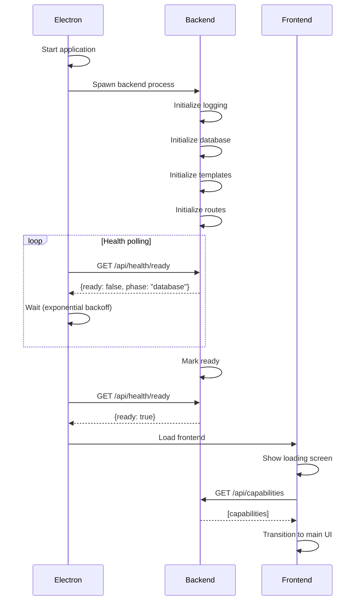
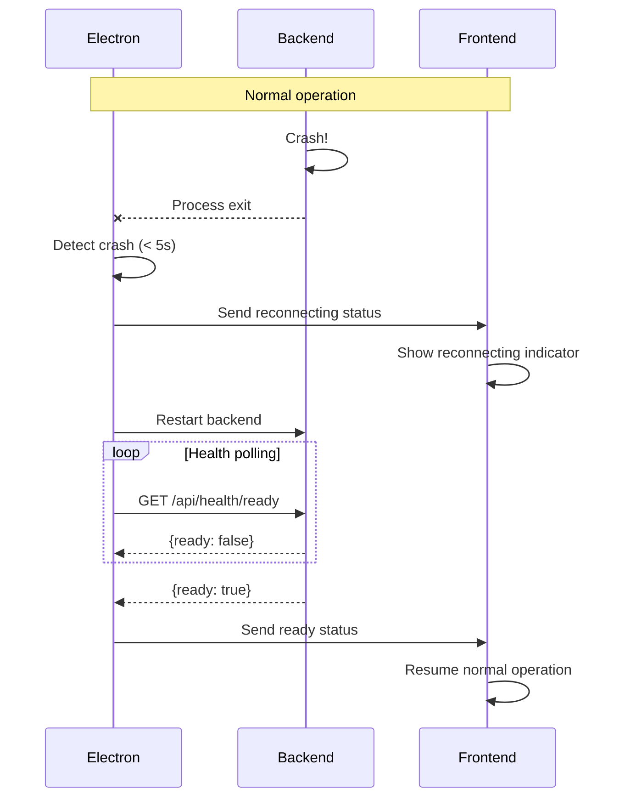

<!-- (renamed totogi-* -> nexus-* on 2026-06-13; original wording was design-snapshot) -->
# Design Document: Startup Health Check

## Overview

This design document describes the architecture and implementation approach for a robust startup health check system in the Nexus AI Capability Installer. The system ensures all services (Electron shell, Python backend, React frontend) are properly initialized before the user interface becomes interactive, eliminating the race condition that causes errors when fetching capabilities on startup.

## Architecture

The startup health check system follows a layered architecture with three main components:

```
┌─────────────────────────────────────────────────────────────────┐
│                      Electron Shell                              │
│  ┌─────────────────┐  ┌─────────────────┐  ┌─────────────────┐ │
│  │ Process Manager │  │ Health Poller   │  │ Recovery Manager│ │
│  └────────┬────────┘  └────────┬────────┘  └────────┬────────┘ │
│           │                    │                    │           │
└───────────┼────────────────────┼────────────────────┼───────────┘
            │                    │                    │
            ▼                    ▼                    ▼
┌─────────────────────────────────────────────────────────────────┐
│                      Backend Service                             │
│  ┌─────────────────┐  ┌─────────────────┐  ┌─────────────────┐ │
│  │ Startup Manager │  │ Health Endpoint │  │ Component Init  │ │
│  └────────┬────────┘  └────────┬────────┘  └────────┬────────┘ │
│           │                    │                    │           │
└───────────┼────────────────────┼────────────────────┼───────────┘
            │                    │                    │
            ▼                    ▼                    ▼
┌─────────────────────────────────────────────────────────────────┐
│                      Frontend UI                                 │
│  ┌─────────────────┐  ┌─────────────────┐  ┌─────────────────┐ │
│  │ Loading Screen  │  │ API Retry Layer │  │ Health Monitor  │ │
│  └─────────────────┘  └─────────────────┘  └─────────────────┘ │
└─────────────────────────────────────────────────────────────────┘
```

## Components and Interfaces

### 1. Backend Startup Manager

**File:** `backend/app/services/startup_manager.py`

```python
from dataclasses import dataclass, field
from enum import Enum
from typing import List, Optional, Callable, Dict, Any
from datetime import datetime
import logging

class InitializationPhase(Enum):
    PENDING = "pending"
    LOGGING = "logging"
    DATABASE = "database"
    TEMPLATES = "templates"
    ROUTES = "routes"
    READY = "ready"
    DEGRADED = "degraded"
    FAILED = "failed"

@dataclass
class ComponentStatus:
    name: str
    status: str  # "pending", "initializing", "ready", "failed", "degraded"
    started_at: Optional[datetime] = None
    completed_at: Optional[datetime] = None
    duration_ms: Optional[int] = None
    error: Optional[str] = None
    is_critical: bool = True

@dataclass
class StartupState:
    phase: InitializationPhase = InitializationPhase.PENDING
    started_at: Optional[datetime] = None
    ready_at: Optional[datetime] = None
    components: Dict[str, ComponentStatus] = field(default_factory=dict)
    is_ready: bool = False
    is_degraded: bool = False
    degraded_features: List[str] = field(default_factory=list)
    error: Optional[str] = None

class StartupManager:
    """Manages backend service initialization sequence."""
    
    def __init__(self, config: Optional[Dict[str, Any]] = None):
        self.state = StartupState()
        self.config = config or {}
        self.logger = logging.getLogger(__name__)
        self._callbacks: Dict[str, Callable] = {}
    
    def register_component(
        self, 
        name: str, 
        initializer: Callable, 
        is_critical: bool = True
    ) -> None:
        """Register a component for initialization."""
        pass
    
    async def initialize_all(self) -> StartupState:
        """Initialize all registered components in order."""
        pass
    
    def get_readiness(self) -> Dict[str, Any]:
        """Get current readiness status for health endpoint."""
        pass
    
    def mark_component_ready(self, name: str) -> None:
        """Mark a component as ready."""
        pass
    
    def mark_component_failed(self, name: str, error: str) -> None:
        """Mark a component as failed."""
        pass
```

### 2. Backend Health Endpoint

**File:** `backend/app/routers/health.py`

```python
from fastapi import APIRouter, Response
from pydantic import BaseModel
from typing import Optional, List, Dict, Any

class ReadinessResponse(BaseModel):
    ready: bool
    phase: str
    started_at: Optional[str]
    ready_at: Optional[str]
    startup_duration_ms: Optional[int]
    is_degraded: bool
    degraded_features: List[str]
    components: Dict[str, Any]
    reason: Optional[str]

class HealthResponse(BaseModel):
    status: str  # "healthy", "degraded", "unhealthy"
    service: str
    version: str
    uptime_seconds: int
    database: Dict[str, Any]
    response_time_ms: int

router = APIRouter(prefix="/api/health", tags=["health"])

@router.get("/ready", response_model=ReadinessResponse)
async def readiness_check(response: Response) -> ReadinessResponse:
    """
    Readiness probe for startup orchestration.
    Returns 200 when ready, 503 when still initializing.
    """
    pass

@router.get("/live")
async def liveness_check() -> Dict[str, bool]:
    """Liveness probe - returns 200 if process is running."""
    return {"alive": True}

@router.get("/", response_model=HealthResponse)
async def detailed_health() -> HealthResponse:
    """Detailed health check with metrics."""
    pass
```

### 3. Electron Health Poller

**File:** `electron/startup/health-poller.js`

```javascript
/**
 * Health poller for backend readiness checks
 */
class HealthPoller {
  constructor(options = {}) {
    this.baseUrl = options.baseUrl || 'http://localhost:8001';
    this.maxAttempts = options.maxAttempts || 300; // 30 seconds at 100ms
    this.initialDelay = options.initialDelay || 100;
    this.maxDelay = options.maxDelay || 2000;
    this.timeout = options.timeout || 5000;
  }

  /**
   * Poll until backend is ready or timeout
   * @returns {Promise<{ready: boolean, response?: object, error?: string}>}
   */
  async waitForReady() {}

  /**
   * Single health check attempt
   * @returns {Promise<{ready: boolean, response?: object}>}
   */
  async checkHealth() {}

  /**
   * Calculate delay with exponential backoff
   * @param {number} attempt - Current attempt number
   * @returns {number} - Delay in milliseconds
   */
  calculateDelay(attempt) {
    const delay = this.initialDelay * Math.pow(1.5, attempt);
    return Math.min(delay, this.maxDelay);
  }
}

module.exports = { HealthPoller };
```

### 4. Electron Startup Orchestrator

**File:** `electron/startup/orchestrator.js`

```javascript
const { HealthPoller } = require('./health-poller');
const { spawn } = require('child_process');

/**
 * Orchestrates the startup sequence
 */
class StartupOrchestrator {
  constructor(options = {}) {
    this.healthPoller = new HealthPoller(options.health);
    this.backendPath = options.backendPath;
    this.maxRestarts = options.maxRestarts || 3;
    this.restartCount = 0;
    this.backendProcess = null;
    this.onStatusChange = options.onStatusChange || (() => {});
  }

  /**
   * Start the full application
   * @returns {Promise<{success: boolean, error?: string}>}
   */
  async start() {}

  /**
   * Start the backend process
   * @returns {Promise<void>}
   */
  async startBackend() {}

  /**
   * Wait for backend to be ready
   * @returns {Promise<boolean>}
   */
  async waitForBackend() {}

  /**
   * Handle backend crash and attempt restart
   */
  async handleBackendCrash() {}

  /**
   * Get current startup status
   * @returns {{phase: string, progress: number, message: string}}
   */
  getStatus() {}
}

module.exports = { StartupOrchestrator };
```

### 5. Frontend Loading Screen Component

**File:** `frontend/src/components/LoadingScreen.tsx`

```typescript
interface LoadingScreenProps {
  status: StartupStatus;
  onRetry: () => void;
}

interface StartupStatus {
  phase: 'connecting' | 'initializing' | 'loading' | 'ready' | 'error';
  progress: number; // 0-100
  message: string;
  error?: string;
  canRetry: boolean;
}

const LoadingScreen: React.FC<LoadingScreenProps> = ({ status, onRetry }) => {
  // Render loading UI with progress indicator
  // Show error state with retry button if needed
};
```

### 6. Frontend API Retry Layer

**File:** `frontend/src/services/api-retry.ts`

```typescript
interface RetryConfig {
  maxRetries: number;
  initialDelay: number;
  maxDelay: number;
  retryableStatuses: number[];
}

class ApiRetryLayer {
  private config: RetryConfig;
  
  constructor(config?: Partial<RetryConfig>) {
    this.config = {
      maxRetries: 3,
      initialDelay: 1000,
      maxDelay: 4000,
      retryableStatuses: [0, 502, 503, 504],
      ...config
    };
  }

  /**
   * Execute request with automatic retry
   */
  async executeWithRetry<T>(
    request: () => Promise<T>,
    onRetry?: (attempt: number, error: Error) => void
  ): Promise<T> {}

  /**
   * Calculate delay for retry attempt
   */
  private calculateDelay(attempt: number): number {
    return Math.min(
      this.config.initialDelay * Math.pow(2, attempt),
      this.config.maxDelay
    );
  }
}
```

### 7. Frontend Health Monitor

**File:** `frontend/src/services/health-monitor.ts`

```typescript
interface HealthStatus {
  status: 'healthy' | 'degraded' | 'unhealthy' | 'unknown';
  lastCheck: Date;
  responseTime: number;
  degradedFeatures: string[];
}

class HealthMonitor {
  private status: HealthStatus;
  private pollInterval: number;
  private listeners: Set<(status: HealthStatus) => void>;

  constructor(pollInterval = 30000) {
    this.pollInterval = pollInterval;
    this.listeners = new Set();
  }

  /**
   * Start monitoring health
   */
  start(): void {}

  /**
   * Stop monitoring
   */
  stop(): void {}

  /**
   * Subscribe to health status changes
   */
  subscribe(listener: (status: HealthStatus) => void): () => void {}

  /**
   * Get current health status
   */
  getStatus(): HealthStatus {}
}
```

## Data Models

### Startup Configuration

```typescript
interface StartupConfig {
  backend: {
    startupTimeoutMs: number;      // Default: 30000
    healthCheckIntervalMs: number; // Default: 100
    maxRestartAttempts: number;    // Default: 3
  };
  frontend: {
    apiRetryAttempts: number;      // Default: 3
    apiRetryDelayMs: number;       // Default: 1000
    healthPollIntervalMs: number;  // Default: 30000
  };
}
```

### Health Check Response

```typescript
interface ReadinessResponse {
  ready: boolean;
  phase: string;
  started_at: string | null;
  ready_at: string | null;
  startup_duration_ms: number | null;
  is_degraded: boolean;
  degraded_features: string[];
  components: {
    [name: string]: {
      status: string;
      duration_ms: number | null;
      error: string | null;
    };
  };
  reason: string | null;
}
```

## Correctness Properties

*A property is a characteristic or behavior that should hold true across all valid executions of a system—essentially, a formal statement about what the system should do. Properties serve as the bridge between human-readable specifications and machine-verifiable correctness guarantees.*

### Property 1: Readiness Endpoint Consistency

*For any* backend startup sequence, the `/api/health/ready` endpoint SHALL return `ready: false` until all critical components are initialized, and `ready: true` only after successful initialization.

**Validates: Requirements 1.1, 1.2, 1.3**

### Property 2: Startup Sequence Ordering

*For any* backend initialization, components SHALL be initialized in the defined order (logging → database → templates → routes), and no component SHALL start before its dependencies are ready.

**Validates: Requirements 5.1, 5.3**

### Property 3: Exponential Backoff Correctness

*For any* sequence of health check polls, the delay between consecutive polls SHALL follow exponential backoff with delay(n) = min(initialDelay * 1.5^n, maxDelay).

**Validates: Requirements 2.3, 4.3**

### Property 4: Retry Exhaustion Behavior

*For any* API call that fails all retry attempts, the system SHALL display an error message and provide a manual retry option, never silently failing.

**Validates: Requirements 4.4, 4.5**

### Property 5: Degraded Mode Consistency

*For any* backend in degraded mode, the health endpoint SHALL report `is_degraded: true` with a non-empty `degraded_features` list, and the frontend SHALL display a warning banner.

**Validates: Requirements 6.3, 6.4, 6.5**

### Property 6: Timeout Enforcement

*For any* startup sequence, if the backend does not become ready within the configured timeout, the system SHALL display an error with diagnostic information and retry option.

**Validates: Requirements 2.4, 7.1, 7.3**

### Property 7: Service Recovery Detection

*For any* backend crash during operation, the Electron shell SHALL detect the failure within 5 seconds and initiate recovery procedures.

**Validates: Requirements 9.1, 9.2**

### Property 8: Health Response Time

*For any* health check request, the backend SHALL respond within 500ms to avoid blocking startup checks.

**Validates: Requirements 1.6**

### Property 9: Loading Screen State Transitions

*For any* startup sequence, the loading screen SHALL transition through states in order: connecting → initializing → loading → ready (or error), never skipping states or going backwards except on retry.

**Validates: Requirements 3.1, 3.2, 3.4**

### Property 10: Configuration Defaults

*For any* missing configuration value, the system SHALL use the documented default value and continue operation without error.

**Validates: Requirements 7.5, 7.6**

## Error Handling

### Backend Initialization Errors

| Error Type | Handling Strategy | User Impact |
|------------|-------------------|-------------|
| Database connection failure | Retry 3 times, then mark degraded | Warning banner, limited functionality |
| Template validation failure | Log warning, continue | Warning banner, manual validation required |
| Critical component failure | Mark failed, prevent ready state | Error screen with retry option |
| Non-critical component failure | Mark degraded, continue | Warning banner, feature disabled |

### Frontend API Errors

| Error Type | Handling Strategy | User Impact |
|------------|-------------------|-------------|
| Connection refused | Retry with backoff | Loading indicator |
| 503 Service Unavailable | Retry with backoff | Loading indicator |
| Timeout | Retry with backoff | Loading indicator |
| All retries exhausted | Show error with retry button | Error message |

### Electron Process Errors

| Error Type | Handling Strategy | User Impact |
|------------|-------------------|-------------|
| Backend spawn failure | Retry up to 3 times | Error screen |
| Backend crash | Auto-restart, preserve state | Brief reconnecting indicator |
| Health check timeout | Show error with diagnostics | Error screen with logs link |

## Testing Strategy

### Unit Tests

- Test `StartupManager` component registration and initialization order
- Test `HealthPoller` exponential backoff calculation
- Test `ApiRetryLayer` retry logic and delay calculation
- Test health endpoint response formatting
- Test loading screen state transitions

### Property-Based Tests

Each correctness property will be implemented as a property-based test using:
- **Python**: `hypothesis` library for backend tests
- **TypeScript**: `fast-check` library for frontend tests

Property tests will run minimum 100 iterations to ensure comprehensive coverage.

### Integration Tests

- Test full startup sequence from Electron to backend ready
- Test recovery from backend crash
- Test degraded mode behavior
- Test timeout handling

## Sequence Diagrams

### Normal Startup Sequence



### Backend Crash Recovery


