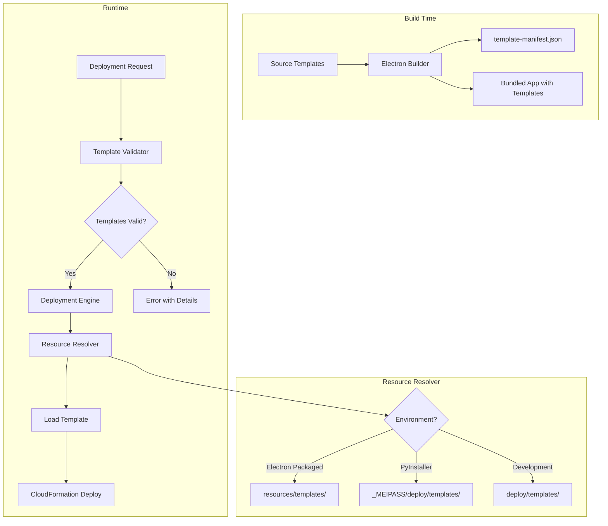

<!-- (renamed totogi-* -> nexus-* on 2026-06-13; original wording was design-snapshot) -->
# Design Document: Template Bundling Validation

## Overview

This design addresses the critical issue where CloudFormation templates are not properly bundled with the Nexus AI Installer, causing deployment failures with "Template not found" errors. The solution involves:

1. Updating the Electron build configuration to include templates in `extraResources`
2. Enhancing the backend's path resolution to handle Electron's resource paths
3. Adding pre-deployment template validation
4. Generating a template manifest for integrity verification

## Architecture



## Components and Interfaces

### 1. Electron Build Configuration Update

Update `electron/package.json` to include templates in `extraResources`:

```json
{
  "extraResources": [
    {
      "from": "../backend/dist/",
      "to": "backend/",
      "filter": ["nexus-installer-backend.exe"]
    },
    {
      "from": "../scripts/capabilities",
      "to": "capabilities"
    },
    {
      "from": "../deploy/templates",
      "to": "templates",
      "filter": ["**/*.yaml", "**/*.yml"]
    }
  ]
}
```

### 2. Resource Resolver Component

A new utility module that determines the correct template path based on the runtime environment.

```python
# app/utils/resource_resolver.py

class ResourceResolver:
    """Resolves paths to bundled resources across different runtime environments."""
    
    @staticmethod
    def get_templates_dir() -> Path:
        """
        Get the templates directory based on runtime environment.
        
        Priority order:
        1. Electron packaged app (ELECTRON_RESOURCES_PATH env var)
        2. PyInstaller bundle (sys._MEIPASS)
        3. Development mode (relative to project)
        4. Current working directory fallback
        """
        pass
    
    @staticmethod
    def get_template_path(template_name: str) -> Path:
        """Get absolute path to a specific template file."""
        pass
    
    @staticmethod
    def is_packaged() -> bool:
        """Check if running in a packaged environment."""
        pass
    
    @staticmethod
    def get_environment_info() -> Dict[str, Any]:
        """Get information about the current runtime environment."""
        pass
```

### 3. Template Validator Component

A service that validates template availability and integrity before deployment.

```python
# app/services/template_validator.py

class TemplateValidator:
    """Validates CloudFormation templates before deployment."""
    
    def __init__(self, resource_resolver: ResourceResolver):
        self.resolver = resource_resolver
    
    def validate_templates(self, capability_config: Dict) -> ValidationResult:
        """
        Validate all templates required for a capability deployment.
        
        Returns:
            ValidationResult with success status, missing templates, and integrity issues
        """
        pass
    
    def validate_template_integrity(self, template_path: Path) -> IntegrityResult:
        """
        Validate a single template's integrity.
        
        Checks:
        - Valid YAML syntax
        - Contains AWSTemplateFormatVersion or Resources section
        """
        pass
    
    def validate_against_manifest(self) -> ManifestValidationResult:
        """Compare available templates against the bundled manifest."""
        pass
```

### 4. Template Manifest Generator

A build-time script that generates a manifest of all bundled templates.

```python
# scripts/generate_template_manifest.py

def generate_manifest(templates_dir: Path, output_path: Path) -> None:
    """
    Generate template-manifest.json listing all templates.
    
    Manifest format:
    {
        "generated_at": "ISO timestamp",
        "templates": [
            {
                "relative_path": "backend/foundation-stack.yaml",
                "filename": "foundation-stack.yaml",
                "size_bytes": 12345,
                "sha256": "hash..."
            }
        ]
    }
    """
    pass
```

## Data Models

### ValidationResult

```python
@dataclass
class TemplateValidationResult:
    success: bool
    templates_checked: List[str]
    missing_templates: List[MissingTemplate]
    integrity_issues: List[IntegrityIssue]
    summary: str

@dataclass
class MissingTemplate:
    template_name: str
    expected_path: str
    remediation: str

@dataclass
class IntegrityIssue:
    template_path: str
    issue_type: str  # "invalid_yaml", "missing_cfn_section"
    details: str
```

### TemplateManifest

```python
@dataclass
class TemplateManifest:
    generated_at: str
    templates: List[TemplateEntry]

@dataclass
class TemplateEntry:
    relative_path: str
    filename: str
    size_bytes: int
    sha256: str
```

## Correctness Properties

*A property is a characteristic or behavior that should hold true across all valid executions of a system—essentially, a formal statement about what the system should do. Properties serve as the bridge between human-readable specifications and machine-verifiable correctness guarantees.*

### Property 1: Template Bundling Preserves Structure and Content

*For any* source template directory, after bundling, the packaged application SHALL contain all `.yaml` files with identical content and preserved directory structure (backend/, frontend/ subdirectories).

**Validates: Requirements 1.1, 1.2, 1.3**

### Property 2: Path Resolution Returns Correct Absolute Paths

*For any* template request in any runtime environment (Electron packaged, PyInstaller, development), the Resource_Resolver SHALL return an absolute path that correctly points to the template location for that environment.

**Validates: Requirements 2.1, 2.2, 2.3**

### Property 3: Template Validation Checks All Required Templates

*For any* deployment configuration specifying a capability, the Template_Validator SHALL check the existence of all templates referenced by that capability before allowing deployment to proceed.

**Validates: Requirements 3.1, 3.2, 3.4**

### Property 4: Missing Template Errors Include All Missing Files

*For any* deployment where multiple templates are missing, the validation error SHALL report all missing templates in a single message, not just the first one found.

**Validates: Requirements 3.3, 3.5**

### Property 5: Template Integrity Validation Checks YAML and CloudFormation Structure

*For any* template file, integrity validation SHALL verify it is valid YAML and contains either `AWSTemplateFormatVersion` or `Resources` section.

**Validates: Requirements 4.1, 4.2**

### Property 6: Manifest Contains Required Fields for All Templates

*For any* generated template manifest, each template entry SHALL include relative_path, filename, and size_bytes fields.

**Validates: Requirements 5.1, 5.2**

### Property 7: Manifest Validation Detects Missing Templates

*For any* application startup where templates are missing compared to the manifest, the Template_Validator SHALL warn about potentially incomplete installation.

**Validates: Requirements 5.3, 5.4**

## Error Handling

### Template Not Found

When a template is not found:
1. Log the expected path and actual search locations
2. Return a descriptive error with remediation steps
3. Suggest reinstalling the application if in packaged mode

```python
class TemplateNotFoundError(Exception):
    def __init__(self, template_name: str, searched_paths: List[str]):
        self.template_name = template_name
        self.searched_paths = searched_paths
        self.remediation = self._get_remediation()
        super().__init__(self._format_message())
    
    def _format_message(self) -> str:
        return (
            f"Template '{self.template_name}' not found.\n"
            f"Searched locations:\n"
            + "\n".join(f"  - {p}" for p in self.searched_paths)
            + f"\n\nRemediation: {self.remediation}"
        )
    
    def _get_remediation(self) -> str:
        if ResourceResolver.is_packaged():
            return "Please reinstall the application to restore missing templates."
        return "Ensure the deploy/templates directory exists and contains all required templates."
```

### Invalid Template

When a template fails integrity validation:
1. Log the specific validation error
2. Include the template path and line number if applicable
3. Suggest checking for file corruption

## Testing Strategy

### Unit Tests

Unit tests will cover specific examples and edge cases:

- Resource resolver returns correct paths for each environment type
- Template validator correctly identifies missing templates
- Manifest generator creates valid JSON with all required fields
- Error messages contain expected information

### Property-Based Tests

Property-based tests will use `hypothesis` library to verify universal properties:

- **Property 1**: Generate random directory structures, bundle them, verify structure preserved
- **Property 2**: Generate template names, verify paths are absolute and environment-appropriate
- **Property 3**: Generate capability configs with various template requirements, verify all checked
- **Property 4**: Generate scenarios with multiple missing templates, verify all reported
- **Property 5**: Generate valid/invalid YAML content, verify correct validation results
- **Property 6**: Generate manifests, verify all required fields present
- **Property 7**: Generate manifest/filesystem mismatches, verify warnings generated

Each property test will run minimum 100 iterations and be tagged with:
```python
# Feature: template-bundling-validation, Property N: [property description]
```

### Integration Tests

- End-to-end test of build process including template bundling
- Deployment test with validated templates
- Startup validation against manifest
