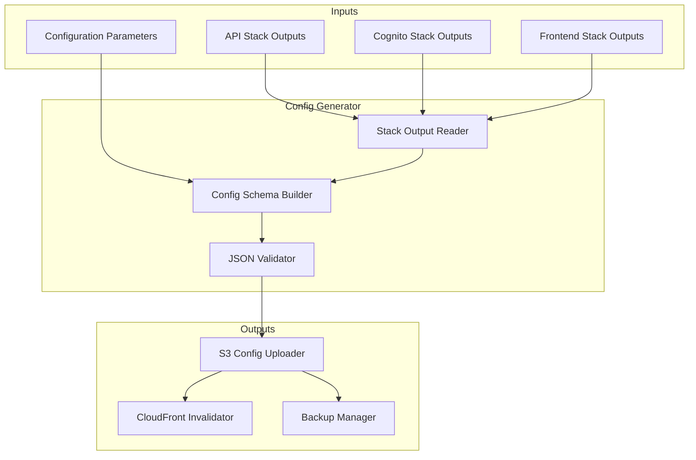

# Design Document: UI Config Automation

## Overview

This feature adds automated generation and deployment of the UI configuration file (`config.json`) to the starhub-deployer workflow. The system extracts API Gateway and Cognito configuration from CloudFormation stack outputs, generates a properly structured config.json file, and uploads it to the S3 bucket hosting the UI application.

The solution integrates with the existing `deploy-capability-layered.sh` script and can also be run as a standalone utility for updating configuration without full redeployment.

## Architecture



## Components and Interfaces

### 1. Stack Output Reader

Responsible for querying CloudFormation stacks and extracting required outputs.

```bash
# Interface: read_stack_outputs
# Input: stack_name, region
# Output: associative array of output key-value pairs

read_stack_outputs() {
    local stack_name="$1"
    local region="$2"
    
    # Query CloudFormation for stack outputs
    # Return outputs as key=value pairs
}

# Interface: get_api_config
# Input: api_stack_name, region
# Output: api_base_url

get_api_config() {
    local stack_name="$1"
    local region="$2"
    
    # Extract API Gateway URL from stack outputs
    # Returns: https://api-id.execute-api.region.amazonaws.com/stage
}

# Interface: get_cognito_config
# Input: cognito_stack_name, region
# Output: user_pool_id, client_id, domain

get_cognito_config() {
    local stack_name="$1"
    local region="$2"
    
    # Extract Cognito configuration from stack outputs
    # Returns: user_pool_id, client_id, cognito_domain
}
```

### 2. Config Schema Builder

Constructs the config.json structure from extracted values.

```bash
# Interface: build_config_json
# Input: api_url, cognito_config, frontend_domain, environment
# Output: JSON string

build_config_json() {
    local api_url="$1"
    local user_pool_id="$2"
    local client_id="$3"
    local cognito_domain="$4"
    local region="$5"
    local frontend_domain="$6"
    
    # Build and return JSON config string
}
```

### 3. S3 Config Uploader

Handles uploading config.json to S3 with proper headers.

```bash
# Interface: upload_config_to_s3
# Input: config_json, bucket_name, backup_enabled
# Output: s3_uri

upload_config_to_s3() {
    local config_json="$1"
    local bucket_name="$2"
    local backup_enabled="$3"
    
    # Backup existing config if enabled
    # Upload new config with proper headers
    # Return S3 URI
}
```

### 4. CloudFront Invalidator

Creates cache invalidation for config.json.

```bash
# Interface: invalidate_cloudfront_cache
# Input: distribution_id
# Output: invalidation_id

invalidate_cloudfront_cache() {
    local distribution_id="$1"
    
    # Create invalidation for /config.json
    # Return invalidation ID
}
```

## Data Models

### Config.json Schema

```json
{
  "version": "1.0.0",
  "api": {
    "baseUrl": "https://api.example.com",
    "timeout": 30000
  },
  "gateway": {
    "apiKey": "optional-api-key"
  },
  "dataSource": "api",
  "enableFallback": true,
  "cognito": {
    "region": "ap-southeast-1",
    "userPoolId": "ap-southeast-1_xxxxxxxx",
    "clientId": "xxxxxxxxxxxxxxxxxxxxxxxxxx",
    "domain": "auth.example.com",
    "redirectSignIn": "https://app.example.com/auth/callback",
    "redirectSignOut": "https://app.example.com"
  }
}
```

### Stack Output Mappings

| Stack Type | Output Key | Config Field |
|------------|------------|--------------|
| API/Backend Service | ApiEndpoint / ApiGatewayUrl | api.baseUrl |
| Cognito | UserPoolId | cognito.userPoolId |
| Cognito | UserPoolClientId | cognito.clientId |
| Cognito | UserPoolDomain | cognito.domain |
| Frontend Global | FrontendDomainName | cognito.redirectSignIn/Out base |
| Frontend Regional | CloudFrontDistributionId | (for invalidation) |
| Frontend Regional | S3BucketName | (upload target) |

### Configuration Parameters

```yaml
# Parameters accepted by the config generator
config_generator:
  # Stack identification
  capability_name: "my-app"        # Used to derive stack names
  environment: "prod"              # dev, stage, prod
  region: "ap-southeast-1"         # AWS region
  
  # Optional explicit stack names (override derived names)
  api_stack_name: ""               # Default: {capability}-{env}-backend-service
  cognito_stack_name: ""           # Default: {capability}-{env}-frontend-cognito
  frontend_stack_name: ""          # Default: {capability}-{env}-frontend-global
  
  # S3 configuration
  s3_bucket: ""                    # Default: from frontend stack output
  
  # Behavior flags
  dry_run: false
  no_backup: false
  skip_invalidation: false
  
  # Config overrides
  api_timeout: 30000
  enable_fallback: true
  data_source: "api"
```

## Correctness Properties

*A property is a characteristic or behavior that should hold true across all valid executions of a system—essentially, a formal statement about what the system should do. Properties serve as the bridge between human-readable specifications and machine-verifiable correctness guarantees.*

### Property 1: Stack Output Extraction Completeness

*For any* valid CloudFormation stack with the expected outputs, the Stack_Output_Reader SHALL extract all required values (API URL, User Pool ID, Client ID, Domain) without data loss or corruption.

**Validates: Requirements 1.1, 1.2, 2.1, 2.2**

### Property 2: Config Generation Schema Validity

*For any* valid set of extracted stack outputs, the Config_Schema_Builder SHALL produce a JSON string that:
- Is syntactically valid JSON
- Contains all required fields (api.baseUrl, cognito.userPoolId, cognito.clientId, cognito.domain, cognito.region)
- Has correctly formatted redirect URIs based on the frontend domain

**Validates: Requirements 3.1, 3.2, 3.3**

### Property 3: S3 Upload Header Correctness

*For any* successful S3 upload operation, the uploaded object SHALL have:
- Content-Type set to "application/json"
- Cache-Control set to "no-cache, no-store, must-revalidate"

**Validates: Requirements 4.1, 4.2, 4.3**

### Property 4: Stack Name Derivation Consistency

*For any* capability name and environment combination, the derived stack names SHALL follow the pattern `{capability-name}-{environment}-{stack-type}` consistently.

**Validates: Requirements 5.3**

### Property 5: Configuration Input Equivalence

*For any* valid configuration, providing parameters via command-line arguments SHALL produce the same config.json as providing equivalent parameters via YAML configuration file.

**Validates: Requirements 5.4**

### Property 6: CloudFront Invalidation Path Correctness

*For any* successful config.json upload with a valid CloudFront distribution ID, the invalidation request SHALL target exactly the path `/config.json`.

**Validates: Requirements 6.1, 6.2**

### Property 7: Dry-Run Mode Non-Modification

*For any* execution with the `--dry-run` flag, the system SHALL NOT:
- Upload any files to S3
- Create any CloudFront invalidations
- Modify any existing files

**Validates: Requirements 7.1, 7.2, 7.3**

### Property 8: Backup Creation with Timestamp

*For any* existing config.json in S3 when backup is enabled, the backup file SHALL be created with a name matching the pattern `config.json.backup.{ISO8601-timestamp}`.

**Validates: Requirements 8.1, 8.2**

### Property 9: No-Backup Flag Behavior

*For any* execution with the `--no-backup` flag, the system SHALL NOT create any backup files regardless of whether config.json exists.

**Validates: Requirements 8.3**

## Error Handling

### Error Categories

| Error Type | Handling Strategy | User Message |
|------------|-------------------|--------------|
| Stack not found | Fail with descriptive error | "Stack '{name}' not found in region '{region}'" |
| Stack not complete | Fail with status | "Stack '{name}' is in state '{status}', expected CREATE_COMPLETE or UPDATE_COMPLETE" |
| Missing output | Fail with key name | "Required output '{key}' not found in stack '{name}'" |
| S3 access denied | Fail with bucket info | "Access denied to bucket '{bucket}'. Check IAM permissions." |
| S3 upload failed | Fail with details | "Failed to upload config.json: {error}" |
| CloudFront invalidation failed | Warn and continue | "Warning: CloudFront invalidation failed: {error}" |
| Backup failed | Warn and continue | "Warning: Backup failed: {error}. Proceeding with upload." |
| Invalid JSON generated | Fail with validation error | "Generated config.json is invalid: {error}" |

### Exit Codes

| Code | Meaning |
|------|---------|
| 0 | Success |
| 1 | General error |
| 2 | Stack not found or incomplete |
| 3 | Missing required stack output |
| 4 | S3 operation failed |
| 5 | Invalid configuration parameters |

## Testing Strategy

### Unit Tests

Unit tests verify individual functions in isolation:

1. **Stack output parsing**: Test extraction of values from mock CloudFormation responses
2. **JSON generation**: Test config.json structure with various input combinations
3. **Stack name derivation**: Test naming convention with different capability/environment values
4. **Redirect URI construction**: Test URI building from domain names

### Property-Based Tests

Property-based tests verify universal properties across many generated inputs:

1. **Config generation round-trip**: Generate random valid inputs, create config.json, parse it back, verify all values preserved
2. **Stack name derivation**: Generate random capability names and environments, verify pattern consistency
3. **Header correctness**: Generate random configs, verify upload headers are always correct

### Integration Tests

Integration tests verify end-to-end behavior:

1. **Full workflow with LocalStack**: Deploy mock stacks, run config generator, verify S3 content
2. **Dry-run mode**: Verify no modifications occur
3. **Backup behavior**: Verify backup creation and naming
4. **Error scenarios**: Test with missing stacks, missing outputs, access denied

### Test Configuration

- Property-based tests: Minimum 100 iterations per property
- Test framework: Bash unit testing with bats-core
- Property testing: Use bash-based generators for input generation
- Mocking: LocalStack for AWS service simulation

## Integration Points

### Integration with deploy-capability-layered.sh

The config generator is called after frontend deployment:

```bash
# In deploy-capability-layered.sh, after deploy_frontend()

# Generate and upload Cognito config.json to S3
generate_ui_config() {
    local cognito_stack="${STACK_NAMES['frontend-cognito']}"
    local global_stack="${STACK_NAMES['frontend-global']}"
    local api_stack="${STACK_NAMES['backend-service']}"
    
    # Call the config generator script
    "${SCRIPT_DIR}/scripts/generate-ui-config.sh" \
        --capability-name "$CAPABILITY_NAME" \
        --environment "$ENVIRONMENT" \
        --region "$AWS_REGION" \
        --cognito-stack "$cognito_stack" \
        --frontend-stack "$global_stack" \
        --api-stack "$api_stack" \
        ${DRY_RUN:+--dry-run}
}
```

### Standalone Usage

The config generator can also be run independently:

```bash
# Using command-line parameters
./scripts/generate-ui-config.sh \
    --capability-name my-app \
    --environment prod \
    --region ap-southeast-1

# Using configuration file
./scripts/generate-ui-config.sh --config config/ui-config.yaml

# Dry-run mode
./scripts/generate-ui-config.sh --config config/ui-config.yaml --dry-run
```

## File Structure

```
starhub-deployer/deploy/
├── scripts/
│   └── generate-ui-config.sh      # Main config generator script
├── lib/
│   ├── config-generator.sh        # Config generation functions
│   ├── stack-reader.sh            # Stack output reading functions
│   └── s3-uploader.sh             # S3 upload and backup functions
└── tests/
    ├── test-config-generator.bats # Unit tests
    └── test-integration.bats      # Integration tests
```
