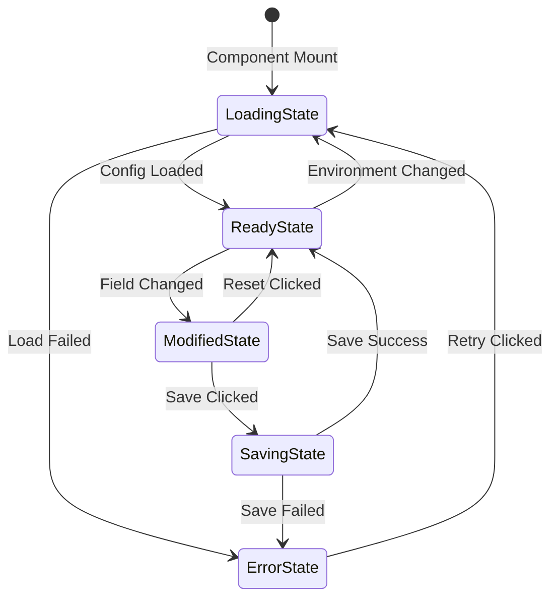

# Design Document: Unified Environment Configuration

## Overview

This design combines the Environment Selection (Step 3) and Infrastructure Configuration (Step 4) wizard screens into a single unified component called `UnifiedEnvironmentConfig`. The new component provides a streamlined user experience where users can select an environment from compact boxes at the top, see the configuration dynamically update below, and override specific settings as needed.

The design maintains backward compatibility with the existing wizard context and API while reducing the number of wizard steps from 11 to 10.

## Architecture

### Component Hierarchy

```
UnifiedEnvironmentConfig
├── EnvironmentSelector
│   └── EnvironmentBox (x4: dev, test, stage, prod)
├── RegionSelector
├── ConfigurationPanel
│   ├── TabNavigation
│   └── TabContent
│       ├── DomainCDNTab
│       ├── ComputeScalingTab
│       ├── NetworkStorageTab
│       ├── MonitoringTab
│       └── TagsTab
└── ActionButtons
```

### State Flow



## Components and Interfaces

### UnifiedEnvironmentConfig Component

The main component that orchestrates the unified screen.

```typescript
interface UnifiedEnvironmentConfigProps {
  // No props needed - uses WizardContext
}

interface UnifiedEnvironmentConfigState {
  selectedEnvironment: EnvironmentType;
  config: EnvironmentConfig | null;
  loading: boolean;
  saving: boolean;
  error: string | null;
  hasChanges: boolean;
  selectedRegion: string;
  activeTab: ConfigTab;
}

type EnvironmentType = 'dev' | 'test' | 'stage' | 'prod';
type ConfigTab = 'domain' | 'compute' | 'network' | 'monitoring' | 'tags';
```

### EnvironmentSelector Component

Displays the four environment options as selectable boxes.

```typescript
interface EnvironmentSelectorProps {
  selectedEnvironment: EnvironmentType;
  onEnvironmentChange: (env: EnvironmentType) => void;
  disabled?: boolean;
}

interface EnvironmentInfo {
  id: EnvironmentType;
  name: string;
  description: string;
  features: string[];
  estimatedCost: string;
  badge: string;
}
```

### EnvironmentBox Component

Individual selectable environment card.

```typescript
interface EnvironmentBoxProps {
  environment: EnvironmentInfo;
  isSelected: boolean;
  onClick: () => void;
  disabled?: boolean;
}
```

### ConfigurationPanel Component

Tabbed panel for infrastructure configuration.

```typescript
interface ConfigurationPanelProps {
  config: EnvironmentConfig;
  onConfigChange: (path: string[], value: any) => void;
  activeTab: ConfigTab;
  onTabChange: (tab: ConfigTab) => void;
  fieldPermissions: FieldPermissions;
}

interface FieldPermissions {
  overridable: string[];  // Paths that can be edited
  readOnly: string[];     // Paths that are display-only
}
```

### Field Permission Configuration

Defines which fields are overridable vs read-only per environment:

```typescript
const FIELD_PERMISSIONS: Record<EnvironmentType, FieldPermissions> = {
  dev: {
    overridable: [
      'infrastructure.domain.*',
      'infrastructure.frontend.cloudfront.*',
      'infrastructure.backend.ecs.task_cpu',
      'infrastructure.backend.ecs.task_memory',
      'infrastructure.backend.ecs.desired_count',
      'infrastructure.backend.autoscaling.*',
      'infrastructure.monitoring.cloudwatch.*',
      'infrastructure.tags.common.*',
    ],
    readOnly: [
      'infrastructure.backend.vpc.*',
      'infrastructure.backend.storage.*',
      'infrastructure.backend.alb.*',
    ],
  },
  // Similar for test, stage, prod with varying permissions
};
```

## Data Models

### Environment Presets

Each environment has default configuration values:

```typescript
const ENVIRONMENT_PRESETS: Record<EnvironmentType, Partial<EnvironmentConfig>> = {
  dev: {
    infrastructure: {
      backend: {
        vpc: { create_new: true, enable_nat_gateway: false, enable_flow_logs: false },
        ecs: { task_cpu: 256, task_memory: 512, desired_count: 1 },
        autoscaling: { enabled: false, min_capacity: 1, max_capacity: 2 },
        storage: { dynamodb_billing_mode: 'PAY_PER_REQUEST', enable_backup: false },
      },
      monitoring: {
        cloudwatch: { log_retention_days: 7, container_insights: false },
      },
    },
  },
  test: {
    // Similar to dev with test-specific defaults
  },
  stage: {
    infrastructure: {
      backend: {
        vpc: { create_new: true, enable_nat_gateway: true, enable_flow_logs: true },
        ecs: { task_cpu: 512, task_memory: 1024, desired_count: 2 },
        autoscaling: { enabled: true, min_capacity: 2, max_capacity: 4 },
        storage: { dynamodb_billing_mode: 'PAY_PER_REQUEST', enable_backup: true },
      },
      monitoring: {
        cloudwatch: { log_retention_days: 30, container_insights: true },
      },
    },
  },
  prod: {
    infrastructure: {
      backend: {
        vpc: { create_new: true, enable_nat_gateway: true, enable_flow_logs: true },
        ecs: { task_cpu: 1024, task_memory: 2048, desired_count: 2 },
        autoscaling: { enabled: true, min_capacity: 2, max_capacity: 10 },
        storage: { dynamodb_billing_mode: 'PAY_PER_REQUEST', enable_backup: true, enable_point_in_time_recovery: true },
      },
      monitoring: {
        cloudwatch: { log_retention_days: 90, container_insights: true },
      },
    },
  },
};
```

### Cost Estimates

```typescript
const ENVIRONMENT_COSTS: Record<EnvironmentType, { min: number; max: number }> = {
  dev: { min: 40, max: 80 },
  test: { min: 40, max: 80 },
  stage: { min: 150, max: 300 },
  prod: { min: 250, max: 500 },
};
```

## Wizard Integration

### Step Enum Update

```typescript
// Updated WizardStep enum - remove ENVIRONMENT_SELECTION, rename INFRASTRUCTURE_CONFIG
export enum WizardStep {
  WELCOME = 'welcome',
  CAPABILITY_SELECTION = 'capability_selection',
  UNIFIED_ENVIRONMENT_CONFIG = 'unified_environment_config',  // Combined step
  AWS_CONFIGURATION = 'aws_configuration',
  PERMISSION_VERIFICATION = 'permission_verification',
  STRATEGY_SELECTION = 'strategy_selection',
  DEPLOYMENT_EXECUTION = 'deployment_execution',
  DELETION_EXECUTION = 'deletion_execution',
  POST_VERIFICATION = 'post_verification',
  RESULTS = 'results',
}
```

### Navigation Flow Update

```typescript
const stepOrder = [
  WizardStep.WELCOME,
  WizardStep.CAPABILITY_SELECTION,
  WizardStep.UNIFIED_ENVIRONMENT_CONFIG,  // Single combined step
  WizardStep.AWS_CONFIGURATION,
  WizardStep.PERMISSION_VERIFICATION,
  WizardStep.STRATEGY_SELECTION,
  WizardStep.DEPLOYMENT_EXECUTION,
  WizardStep.DELETION_EXECUTION,
  WizardStep.POST_VERIFICATION,
  WizardStep.RESULTS,
];
```

### WizardShell Update

The WizardShell component needs to render the new unified component:

```typescript
case WizardStep.UNIFIED_ENVIRONMENT_CONFIG:
  return <UnifiedEnvironmentConfig />;
```

## UI Layout

### Screen Layout (ASCII Wireframe)

```
┌─────────────────────────────────────────────────────────────────────┐
│ Step 3 of 10                                    Call Processing     │
│ ═══════════════════════════════════════════════════════════════════ │
│                                                                     │
│ Environment & Infrastructure Configuration                          │
│ Configure deployment environment and infrastructure settings        │
│                                                                     │
│ ┌─────────────────────────────────────────────────────────────────┐ │
│ │  ┌─────────┐  ┌─────────┐  ┌─────────┐  ┌─────────────────────┐ │ │
│ │  │   Dev   │  │  Test   │  │  Stage  │  │   ★ Production ★    │ │ │
│ │  │  $40-80 │  │  $40-80 │  │$150-300 │  │     $250-500        │ │ │
│ │  └─────────┘  └─────────┘  └─────────┘  └─────────────────────┘ │ │
│ └─────────────────────────────────────────────────────────────────┘ │
│                                                                     │
│ ┌─────────────────────────────────────────────────────────────────┐ │
│ │ AWS Region                                                       │ │
│ │ ┌─────────────────────────────────────────────────────────────┐ │ │
│ │ │ Asia Pacific (Singapore) - ap-southeast-1              ▼    │ │ │
│ │ └─────────────────────────────────────────────────────────────┘ │ │
│ └─────────────────────────────────────────────────────────────────┘ │
│                                                                     │
│ ┌─────────────────────────────────────────────────────────────────┐ │
│ │ [Domain & CDN] [Compute] [Network] [Monitoring] [Tags]          │ │
│ ├─────────────────────────────────────────────────────────────────┤ │
│ │                                                                 │ │
│ │  Domain Configuration                                           │ │
│ │  ┌──────────────────────┐  ┌──────────────────────┐            │ │
│ │  │ Base Domain          │  │ Hosted Zone ID       │            │ │
│ │  │ [totogicore.com    ] │  │ [Z084501638STQ2EK  ] │            │ │
│ │  └──────────────────────┘  └──────────────────────┘            │ │
│ │                                                                 │ │
│ │  CloudFront CDN                                                 │ │
│ │  ☑ Enable CloudFront CDN    ☑ Enable WAF Protection            │ │
│ │                                                                 │ │
│ └─────────────────────────────────────────────────────────────────┘ │
│                                                                     │
│ [Back]                    [Reset] [Save Config] [Continue]          │
└─────────────────────────────────────────────────────────────────────┘
```

### Environment Box Design

```
┌─────────────────────────────┐
│  Production                 │
│  ┌─────┐                    │
│  │prod │  ← badge           │
│  └─────┘                    │
│                             │
│  Full HA, auto-scaling...   │
│                             │
│  Estimated: $250-500/month  │
└─────────────────────────────┘
```

## Correctness Properties

*A property is a characteristic or behavior that should hold true across all valid executions of a system-essentially, a formal statement about what the system should do. Properties serve as the bridge between human-readable specifications and machine-verifiable correctness guarantees.*


### Property 1: Environment Box Display Completeness

*For any* environment type (dev, test, stage, prod), the rendered EnvironmentBox component SHALL contain the environment name, identifier badge, and estimated cost range.

**Validates: Requirements 2.3, 2.4, 2.5**

### Property 2: Environment Selection Visual Feedback

*For any* environment selection, the selected EnvironmentBox SHALL have distinct visual styling (border/background) compared to unselected boxes, and exactly one environment SHALL be selected at any time.

**Validates: Requirements 2.2**

### Property 3: Environment Configuration Loading

*For any* environment selection, the Configuration_Panel SHALL display configuration values that match the environment's preset defaults (when no overrides exist) or the saved overrides (when they exist).

**Validates: Requirements 3.1, 3.5**

### Property 4: Tab Preservation on Environment Switch

*For any* environment switch while a tab is active, the active tab selection SHALL remain unchanged after the configuration loads for the new environment.

**Validates: Requirements 3.4**

### Property 5: Field Editability Consistency

*For any* configuration field, if the field path is in the overridable list, the field input SHALL be enabled; if the field path is in the read-only list, the field input SHALL be disabled.

**Validates: Requirements 4.1, 4.2, 5.1, 5.2, 5.3, 5.4, 5.5, 5.6, 5.7**

### Property 6: Change Tracking Accuracy

*For any* modification to an overridable field, the hasChanges state SHALL be true, and the original value SHALL be preserved for comparison until save or reset.

**Validates: Requirements 4.3**

## Error Handling

### Configuration Load Errors

When configuration fails to load:
1. Display error message with details
2. Provide "Retry" button to attempt reload
3. Allow user to go back to previous step
4. Log error for debugging

```typescript
interface ConfigLoadError {
  message: string;
  code: string;
  retryable: boolean;
}

const handleConfigLoadError = (error: ConfigLoadError) => {
  setError(error.message);
  setLoading(false);
  // Log to console for debugging
  console.error('Config load failed:', error);
};
```

### Save Errors

When configuration save fails:
1. Display error message
2. Keep form data intact (don't reset)
3. Allow retry
4. Provide option to continue without saving (with warning)

### Validation Errors

Before allowing Continue:
1. Validate required fields (region, domain)
2. Validate field formats (CIDR, domain names)
3. Display inline validation errors
4. Disable Continue button until valid

## Testing Strategy

### Unit Tests

Unit tests verify specific examples and edge cases:

1. **Component Rendering Tests**
   - Verify UnifiedEnvironmentConfig renders all child components
   - Verify EnvironmentSelector renders 4 environment boxes
   - Verify ConfigurationPanel renders all 5 tabs

2. **Default State Tests**
   - Verify Production is selected by default on mount
   - Verify default region is set correctly

3. **Navigation Tests**
   - Verify Back button navigates to Capability Selection
   - Verify Continue button navigates to AWS Configuration
   - Verify Continue is disabled when required fields are empty

4. **Error State Tests**
   - Verify error message displays on load failure
   - Verify retry button triggers reload

### Property-Based Tests

Property-based tests verify universal properties across all inputs using fast-check library.

**Test Configuration:**
- Minimum 100 iterations per property test
- Use fast-check for TypeScript/React testing

**Property Test 1: Environment Box Display**
```typescript
// Feature: unified-environment-config, Property 1: Environment Box Display Completeness
fc.assert(
  fc.property(
    fc.constantFrom('dev', 'test', 'stage', 'prod'),
    (envType) => {
      const box = render(<EnvironmentBox environment={ENVIRONMENTS[envType]} />);
      expect(box.getByText(ENVIRONMENTS[envType].name)).toBeInTheDocument();
      expect(box.getByText(ENVIRONMENTS[envType].badge)).toBeInTheDocument();
      expect(box.getByText(ENVIRONMENTS[envType].estimatedCost)).toBeInTheDocument();
    }
  ),
  { numRuns: 100 }
);
```

**Property Test 2: Selection Visual Feedback**
```typescript
// Feature: unified-environment-config, Property 2: Environment Selection Visual Feedback
fc.assert(
  fc.property(
    fc.constantFrom('dev', 'test', 'stage', 'prod'),
    (selectedEnv) => {
      const { container } = render(
        <EnvironmentSelector selectedEnvironment={selectedEnv} onEnvironmentChange={() => {}} />
      );
      const selectedBox = container.querySelector(`[data-env="${selectedEnv}"]`);
      const unselectedBoxes = container.querySelectorAll(`[data-env]:not([data-env="${selectedEnv}"])`);
      
      expect(selectedBox).toHaveClass('ring-2', 'ring-blue-600');
      unselectedBoxes.forEach(box => {
        expect(box).not.toHaveClass('ring-2');
      });
    }
  ),
  { numRuns: 100 }
);
```

**Property Test 3: Field Editability**
```typescript
// Feature: unified-environment-config, Property 5: Field Editability Consistency
fc.assert(
  fc.property(
    fc.constantFrom(...OVERRIDABLE_FIELDS),
    fc.constantFrom(...READ_ONLY_FIELDS),
    (overridableField, readOnlyField) => {
      const { container } = render(<ConfigurationPanel config={mockConfig} />);
      
      const overridableInput = container.querySelector(`[data-field="${overridableField}"]`);
      const readOnlyInput = container.querySelector(`[data-field="${readOnlyField}"]`);
      
      expect(overridableInput).not.toBeDisabled();
      expect(readOnlyInput).toBeDisabled();
    }
  ),
  { numRuns: 100 }
);
```

**Property Test 4: Change Tracking**
```typescript
// Feature: unified-environment-config, Property 6: Change Tracking Accuracy
fc.assert(
  fc.property(
    fc.constantFrom(...OVERRIDABLE_FIELDS),
    fc.string({ minLength: 1 }),
    (fieldPath, newValue) => {
      const { result } = renderHook(() => useConfigState(mockConfig));
      
      act(() => {
        result.current.updateField(fieldPath, newValue);
      });
      
      expect(result.current.hasChanges).toBe(true);
    }
  ),
  { numRuns: 100 }
);
```

### Integration Tests

1. **API Integration**
   - Test config loading from backend
   - Test config saving to backend
   - Test error handling for API failures

2. **Wizard Flow Integration**
   - Test navigation from Capability Selection
   - Test state persistence across steps
   - Test wizard context updates
