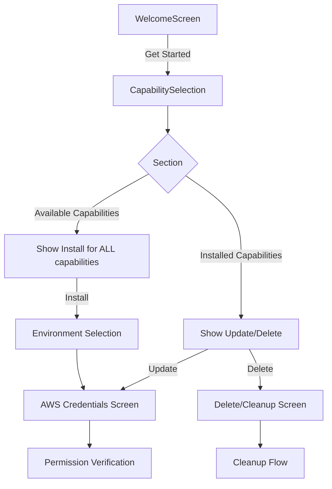

# Design Document: Welcome & Capability UI Redesign

## Overview

This design document outlines the UI redesign for the Welcome Screen and Capability Selection screens in the Totogi Capability Installer. The goal is to simplify the welcome experience with a clean hero graphic representing Telco Business Capability deployment, show supported deployment platforms with visual indicators, and reorganize the capability selection to clearly distinguish between installed and available capabilities with appropriate actions.

## Architecture

The redesign involves modifications to two existing React components:
- `WelcomeScreen.tsx` - Simplified hero-style landing page
- `CapabilitySelection.tsx` - Two-section layout with Install/Update/Delete actions

No backend changes are required as the existing deployment state API already provides the necessary data.



## Components and Interfaces

### WelcomeScreen Component

The redesigned WelcomeScreen will be a minimal hero-style component with platform support indicators:

```typescript
interface WelcomeScreenProps {
  // No props needed - uses WizardContext
}

// Platform support configuration
interface DeploymentPlatform {
  id: string;
  name: string;
  icon: React.ReactNode;
  isSupported: boolean;
  tooltipText: string;
}

const DEPLOYMENT_PLATFORMS: DeploymentPlatform[] = [
  { id: 'aws', name: 'AWS', icon: <AwsIcon />, isSupported: true, tooltipText: 'Supported' },
  { id: 'azure', name: 'Azure', icon: <AzureIcon />, isSupported: false, tooltipText: 'Coming Soon' },
  { id: 'gcp', name: 'GCP', icon: <GcpIcon />, isSupported: false, tooltipText: 'Coming Soon' },
  { id: 'kubernetes', name: 'Kubernetes', icon: <KubernetesIcon />, isSupported: false, tooltipText: 'Coming Soon' },
  { id: 'onpremise', name: 'On-Premise', icon: <ServerIcon />, isSupported: false, tooltipText: 'Coming Soon' },
];

// Component structure:
// - Hero illustration (SVG graphic representing Telco Business Capability)
// - Title: "Totogi Capability Installer"
// - Subtitle: "Deploy Business Capability in your Environment"
// - Platform icons row with support indicators
// - "Get Started" button
```

### PlatformIcon Component

A reusable component for displaying platform icons with support status:

```typescript
interface PlatformIconProps {
  platform: DeploymentPlatform;
}

// Visual design:
// - Platform icon (40x40px)
// - Green checkmark overlay for supported platforms (AWS)
// - Grayscale/muted style for unsupported platforms
// - Tooltip on hover showing support status
```

### WelcomeScreen Layout

```
┌─────────────────────────────────────────────────────────┐
│                                                         │
│              ┌─────────────────────────┐                │
│              │   Hero Illustration     │                │
│              │  (Telco Business Cap)   │                │
│              │      ↓ to Cloud         │                │
│              └─────────────────────────┘                │
│                                                         │
│           Totogi Capability Installer                   │
│                                                         │
│     Deploy Business Capability in your Environment      │
│                                                         │
│     ┌─────┐ ┌─────┐ ┌─────┐ ┌─────┐ ┌─────┐           │
│     │ AWS │ │Azure│ │ GCP │ │ K8s │ │OnPrm│           │
│     │  ✓  │ │     │ │     │ │     │ │     │           │
│     └─────┘ └─────┘ └─────┘ └─────┘ └─────┘           │
│                                                         │
│              ┌──────────────────┐                       │
│              │   Get Started    │                       │
│              └──────────────────┘                       │
│                                                         │
└─────────────────────────────────────────────────────────┘
```

### CapabilitySelection Component

The redesigned component will separate capabilities into two sections, with ALL capabilities appearing in Available section:

```typescript
interface CapabilityCardProps {
  capability: Capability;
  deployments: DeploymentState[];
  isInstalled: boolean;
  onInstall: () => void;
  onUpdate: () => void;
  onDelete: () => void;
}

// Note: DeleteConfirmationModal removed - Delete now navigates directly to cleanup screen
```

### Action Flow

1. **Install Action** (Available section): Sets capability in context → navigates to Environment Selection
2. **Update Action** (Installed section): Sets capability in context → navigates directly to AWS Credentials Screen (skips environment selection)
3. **Delete Action** (Installed section): Sets capability in context → navigates directly to Delete/Cleanup Screen (no confirmation modal)

### Key Design Decision: Available Capabilities Shows ALL

The "Available Capabilities" section displays ALL capabilities from the catalog, including those already installed. This allows users to:
- Install a capability to a new environment even if it's already deployed elsewhere
- See the full catalog of capabilities at a glance
- Easily add the same capability to dev, staging, and production environments

## Data Models

### DeploymentPlatform Model (New)

```typescript
// Platform support configuration for Welcome Screen
interface DeploymentPlatform {
  id: 'aws' | 'azure' | 'gcp' | 'kubernetes' | 'onpremise';
  name: string;
  icon: React.ReactNode;
  isSupported: boolean;
  tooltipText: string;
}
```

### Existing Models Used

No new data models required for capability management. Existing models used:

```typescript
// From types/capability.ts
interface Capability {
  id: string;
  name: string;
  description: string;
  version: string;
  category: string;
  estimated_deployment_time: number;
  requirements: CapabilityRequirements;
  prerequisites: string[];
}

// From api.ts (DeploymentState)
interface DeploymentState {
  capability_name: string;
  environment: string;
  region: string;
  last_deployment: string;
  stacks: Array<{
    stack_name: string;
    stack_type: string;
    region: string;
  }>;
  metadata?: {
    frontend_url?: string;
    backend_url?: string;
  };
}
```

## Correctness Properties

*A property is a characteristic or behavior that should hold true across all valid executions of a system-essentially, a formal statement about what the system should do. Properties serve as the bridge between human-readable specifications and machine-verifiable correctness guarantees.*

### Property 1: Installed capability categorization
*For any* capability with at least one deployment state, that capability should appear in the "Installed Capabilities" section.
**Validates: Requirements 2.2**

### Property 2: Available capability shows all capabilities
*For any* capability in the catalog, that capability should appear in the "Available Capabilities" section regardless of whether it has deployments.
**Validates: Requirements 2.4**

### Property 3: Installed capability actions
*For any* capability displayed in the "Installed Capabilities" section, both "Update" and "Delete" buttons should be present and visible.
**Validates: Requirements 3.1**

### Property 4: Installed capability deployment details
*For any* capability displayed in the "Installed Capabilities" section, the deployment details (environment, region, last deployment date) should be visible.
**Validates: Requirements 3.4**

### Property 5: Available capability actions
*For any* capability displayed in the "Available Capabilities" section, only the "Install" button should be present (no "Update" or "Delete" buttons).
**Validates: Requirements 4.1**

### Property 6: Available capability details
*For any* capability displayed in the "Available Capabilities" section, the capability details (name, description, version, estimated deployment time) should be visible.
**Validates: Requirements 4.3**

### Property 7: Category badge presence
*For any* capability card (installed or available), the category badge should be displayed.
**Validates: Requirements 5.3**

### Property 8: Unsupported platforms have no checkmark
*For any* deployment platform that is not AWS (Azure, GCP, Kubernetes, On-Premise), the platform icon should NOT display a checkmark indicator.
**Validates: Requirements 6.3**

### Property 9: Platform tooltip matches support status
*For any* deployment platform, the tooltip text should be "Supported" if the platform is supported (AWS) and "Coming Soon" if the platform is not yet supported.
**Validates: Requirements 6.5**

## Error Handling

1. **API Errors**: If deployment states fail to load, show all capabilities in Available section only
2. **Delete Navigation**: If cleanup screen is not available, show error message
3. **Empty States**: Show appropriate messages when no installed capabilities exist

## Testing Strategy

### Unit Tests
- Test WelcomeScreen renders hero graphic and "Get Started" button
- Test WelcomeScreen displays tagline "Deploy Business Capability in your Environment"
- Test WelcomeScreen renders all 5 platform icons (AWS, Azure, GCP, K8s, On-Premise)
- Test AWS platform icon displays checkmark indicator
- Test non-AWS platform icons do NOT display checkmark indicator
- Test platform icons are arranged in horizontal row
- Test platform tooltips show correct text based on support status
- Test CapabilitySelection shows ALL capabilities in Available section
- Test CapabilitySelection shows only deployed capabilities in Installed section
- Test action buttons render correctly for each section
- Test Update navigates to AWS credentials screen
- Test Delete navigates to cleanup screen

### Property-Based Tests
Using a property-based testing library (e.g., fast-check), we will verify:
- All capabilities appear in Available section (exhaustive)
- Only deployed capabilities appear in Installed section
- Action buttons match section type
- All required details are displayed for each capability type
- All non-AWS platforms have no checkmark (Property 8)
- All platform tooltips match their support status (Property 9)

### Integration Tests
- Test navigation flow from Welcome → Capability Selection → Environment Selection (for Install)
- Test navigation flow from Capability Selection → AWS Credentials (for Update)
- Test navigation flow from Capability Selection → Cleanup Screen (for Delete)
