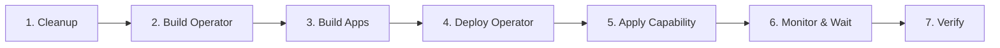
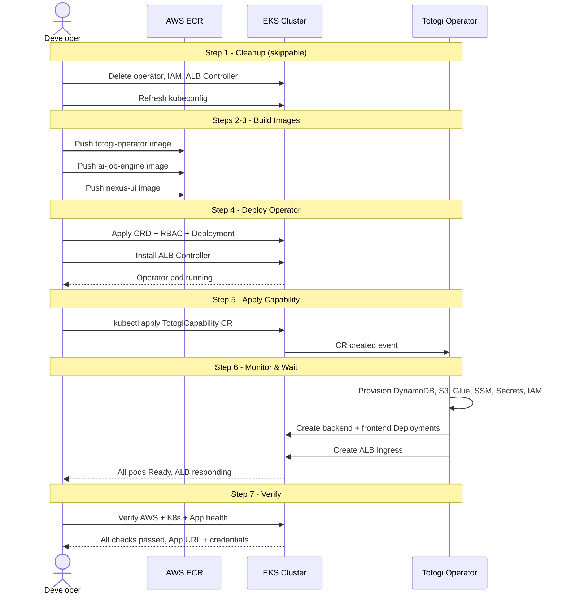

# Totogi Kubernetes Operator

A Kubernetes Operator for managing Totogi Capability deployments on EKS clusters.

## Table of Contents

- [Overview](#overview)
- [Architecture](#architecture)
- [Quick Start](#quick-start)
- [E2E Deployment Pipeline](#e2e-deployment-pipeline)
- [Management Commands](#management-commands)
- [TotogiCapability Custom Resource](#totogicapability-custom-resource)
- [Deployment Flow](#deployment-flow)
- [ALB Ingress](#alb-ingress)
- [BSS Magic Runtime](#bss-magic-runtime)
- [Monitoring and Verification](#monitoring-and-verification)
- [Application Lifecycle](#application-lifecycle)
- [Cognito Authentication](#cognito-authentication)
- [Resource Naming Conventions](#resource-naming-conventions)
- [Troubleshooting](#troubleshooting)
- [Prerequisites](#prerequisites)
- [Environment Variables](#environment-variables)
- [Directory Structure](#directory-structure)

---

## Overview

The Totogi Operator automates the full lifecycle of Totogi capabilities in Kubernetes. When you create a `TotogiCapability` custom resource, the operator:

1. Provisions AWS data services (DynamoDB, S3, Glue)
2. Creates SSM Parameters and Secrets Manager secrets
3. Creates IAM roles with IRSA (IAM Roles for Service Accounts)
4. Deploys frontend and backend containers
5. Optionally deploys BSS Magic runtime with PostgreSQL StatefulSet
6. Creates an ALB Ingress with path-based routing
7. Handles updates and deletions with proper cleanup

---

## Architecture

```
                        ┌───────────────────────────────────────────┐
                        │          ALB (internet-facing)             │
                        │  /         -> frontend:8080                │
                        │  /api      -> backend:8000                 │
                        │  /bssmagic -> bssmagic:8000 (optional)     │
                        └──────┬────────────┬──────────────┬────────┘
                               │            │              │
┌──────────────────────────────┼────────────┼──────────────┼────────┐
│  EKS Cluster                 │            │              │        │
│                              │            │              │        │
│  totogi-system namespace     │            │              │        │
│  ┌────────────────────────┐  │            │              │        │
│  │    Totogi Operator     │  │            │              │        │
│  │  Watches CRs, provisions │            │              │        │
│  │  AWS + K8s resources   │  │            │              │        │
│  └────────────────────────┘  │            │              │        │
│                              │            │              │        │
│  {capability}-{env} namespace│            │              │        │
│  ┌──────────────┐  ┌──────────────┐  ┌──────────────────┐       │
│  │  Frontend    │  │  Backend     │  │  bssmagic-runtime │       │
│  │  Deployment  │  │  Deployment  │  │  Deployment       │       │
│  └──────────────┘  └──────────────┘  │  + init container │       │
│                                      │  (fetch creds.zip)│       │
│                                      └────────┬─────────┘       │
│                                               │                  │
│                                      ┌────────▼─────────┐       │
│                                      │  PostgreSQL       │       │
│                                      │  StatefulSet      │       │
│                                      │  + PVC            │       │
│                                      └──────────────────┘       │
│                                                                  │
│  ┌──────────────┐  ┌──────────────┐  ┌──────────────────┐       │
│  │ frontend-svc │  │ backend-svc  │  │ bssmagic-svc     │       │
│  │ (ClusterIP)  │  │ (ClusterIP)  │  │ (ClusterIP:8000) │       │
│  └──────────────┘  └──────────────┘  └──────────────────┘       │
│  ┌─────────────────────────────────────────────────────────┐     │
│  │  Ingress (ALB)                                          │     │
│  │  / -> frontend   /api -> backend   /bssmagic -> bssmagic│     │
│  └─────────────────────────────────────────────────────────┘     │
└──────────────────────────────────────────────────────────────────┘
                             │
┌────────────────────────────┼──────────────────────────────────┐
│  AWS Services              │                                   │
│  ┌──────────┐ ┌──────────┐ ┌──────────┐ ┌──────────┐         │
│  │ DynamoDB │ │   S3     │ │  Glue    │ │  IAM     │         │
│  └──────────┘ └──────────┘ └──────────┘ └──────────┘         │
│  ┌──────────┐ ┌──────────┐                                    │
│  │   SSM    │ │ Secrets  │  <- credentials.zip stored here    │
│  │ Params   │ │ Manager  │                                    │
│  └──────────┘ └──────────┘                                    │
└───────────────────────────────────────────────────────────────┘
```

---

## Quick Start

```bash
cd /opt/mycode/nexus/nexus-deployer/kube-operator

# 1. Scan cluster readiness
./operator-nexus-test.sh scan

# 2. Build and push operator image
./build-and-push.sh

# 3. Deploy operator (auto-configures IRSA + ALB Controller)
./operator-nexus-test.sh deploy

# 4. Deploy a capability
kubectl create namespace call-processing-prod
kubectl apply -f examples/call-processing-complete.yaml

# 5. Monitor deployment progress
./operator-nexus-test.sh monitor

# 6. Verify everything
./operator-nexus-test.sh verify-capability
```

---

## E2E Deployment Pipeline

The `e2e-deploy.sh` script automates the full deployment lifecycle in 7 sequential steps.
Use `--skip-clean` to skip Step 1 or `--skip-app-build` to skip Step 3.

```bash
./e2e-deploy.sh                          # Full 7-step deployment
./e2e-deploy.sh --skip-clean             # Skip cleanup (steps 2-7)
./e2e-deploy.sh --skip-app-build         # Skip app image builds (steps 1,2,4-7)
./e2e-deploy.sh --skip-clean --skip-app-build  # Operator-only redeploy
```

### Pipeline Overview



| Step | Name | Script / Command | What It Does | Skip Flag |
|:----:|------|------------------|--------------|-----------|
| 1 | **Cleanup** | `operator-nexus-test.sh delete --full` | Remove operator, IAM, ECR, ALB Controller. Refresh kubeconfig. | `--skip-clean` |
| 2 | **Build Operator** | `build-and-push.sh` | Build `totogi-operator` image, push to ECR | -- |
| 3 | **Build Apps** | `nexus-backend/build.sh` + `nexus-ui/build.sh` | Build `ai-job-engine` + `nexus-ui` images, push to ECR | `--skip-app-build` |
| 4 | **Deploy Operator** | `operator-nexus-test.sh deploy` | Create namespace, apply CRD + RBAC + Deployment, install ALB Controller | -- |
| 5 | **Apply Capability** | `kubectl apply -f capability.yaml` | Create namespace, apply TotogiCapability CR, trigger reconciliation | -- |
| 6 | **Monitor & Wait** | `operator-nexus-test.sh monitor` | Watch AWS provisioning, wait for pods Ready, ALB DNS, HTTP response | -- |
| 7 | **Verify** | `operator-nexus-test.sh verify-capability` | Validate AWS resources, K8s workloads, app health, IRSA connectivity | -- |

### Detailed Deployment Sequence



---

## Management Commands

All commands via `./operator-nexus-test.sh`:

| Command | Description |
|---------|-------------|
| `scan` | Cluster readiness scan (IRSA, OIDC, nodes, ECR, access) |
| `deploy` | Deploy operator (auto-fixes IRSA, installs ALB Controller) |
| `delete` | Remove operator (keeps IAM, ECR, and your access) |
| `delete --full` | Complete cleanup (removes IAM, ECR, aws-auth, ALB Controller) |
| `update` | Force-redeploy operator with existing image |
| `status` | Check operator pod health |
| `monitor [ns/name]` | Real-time deployment progress for a capability |
| `verify-capability [ns]` | Verify AWS resources, K8s workloads, app health |
| `install-alb-controller` | Install/verify AWS Load Balancer Controller |
| `delete-alb-controller` | Remove ALB Controller and its IAM role |
| `fix-irsa` | Create OIDC provider in IAM if missing |

---

## TotogiCapability Custom Resource

### Minimal Example

```yaml
apiVersion: totogi.com/v1
kind: TotogiCapability
metadata:
  name: myapp-dev
  namespace: myapp-dev
spec:
  capabilityName: myapp
  version: "1.0.0"
  environment: dev
  region: ap-southeast-1

  frontend:
    replicas: 2
    image: "ACCOUNT.dkr.ecr.REGION.amazonaws.com/myapp-frontend:latest"

  backend:
    replicas: 2
    image: "ACCOUNT.dkr.ecr.REGION.amazonaws.com/myapp-backend:latest"

  dataServices:
    dynamodb: { enabled: true }
    s3: { enabled: true }
    glue: { enabled: true }

  deletionPolicy: Delete
```

### Full Example with ALB Ingress

```yaml
apiVersion: totogi.com/v1
kind: TotogiCapability
metadata:
  name: call-processing-prod
  namespace: call-processing-prod
  labels:
    app.kubernetes.io/name: call-processing
    app.kubernetes.io/version: "2.5.0"
    totogi.com/environment: prod
spec:
  capabilityName: call-processing
  version: "2.5.0"
  environment: prod
  region: ap-southeast-1
  enableCognito: false

  frontend:
    replicas: 3
    image: "764119721991.dkr.ecr.ap-southeast-1.amazonaws.com/nexus-ui:latest"

  backend:
    replicas: 3
    image: "764119721991.dkr.ecr.ap-southeast-1.amazonaws.com/ai-job-engine:latest"

  # BSS Magic runtime (optional)
  bssmagic:
    enabled: true
    image: "008731404932.dkr.ecr.us-east-1.amazonaws.com/prod/bssmagic-runtime:latest"
    replicas: 1
    credentialsSecretName: "call-processing/prod/bssmagic-credentials"
    postgres:
      storageSize: "20Gi"
      password: "admin"
      database: "bssmagic"

  ingress:
    enabled: true
    scheme: internet-facing          # or "internal" for private ALB
    # subnets: []                    # optional: auto-discovers from VPC tags
    # certificateArn: ""             # optional: ACM cert ARN for HTTPS
    healthCheckPath: "/health"

  dataServices:
    dynamodb: { enabled: true }
    s3: { enabled: true }
    glue: { enabled: true }

  deletionPolicy: Delete             # or Retain for production
```

See `examples/call-processing-complete.yaml` for a complete working example.

### Spec Reference

| Field | Type | Required | Default | Description |
|-------|------|----------|---------|-------------|
| `capabilityName` | string | Yes | - | Name of the capability (lowercase, hyphens) |
| `version` | string | Yes | - | Semantic version |
| `environment` | string | Yes | - | Environment (dev, staging, prod) |
| `region` | string | Yes | - | AWS region |
| `enableCognito` | boolean | No | false | Enable Cognito User Pool |
| `frontend.replicas` | int | No | 2 | Frontend replica count |
| `frontend.image` | string | Yes | - | Frontend container image |
| `backend.replicas` | int | No | 2 | Backend replica count |
| `backend.image` | string | Yes | - | Backend container image |
| `bssmagic.enabled` | boolean | No | false | Enable BSS Magic runtime + PostgreSQL |
| `bssmagic.image` | string | Cond. | - | bssmagic-runtime container image (required if enabled) |
| `bssmagic.replicas` | int | No | 1 | bssmagic-runtime replica count |
| `bssmagic.credentialsSecretName` | string | No | - | AWS Secrets Manager secret name for credentials.zip |
| `bssmagic.postgres.storageSize` | string | No | 10Gi | PVC size for PostgreSQL data |
| `bssmagic.postgres.storageClass` | string | No | (default) | Kubernetes StorageClass |
| `bssmagic.postgres.password` | string | No | admin | PostgreSQL password |
| `bssmagic.postgres.database` | string | No | bssmagic | PostgreSQL database name |
| `bssmagic.env` | array | No | [] | Extra env vars for source config overrides |
| `ingress.enabled` | boolean | No | false | Enable ALB Ingress |
| `ingress.scheme` | string | No | internet-facing | ALB scheme |
| `ingress.certificateArn` | string | No | - | ACM cert for HTTPS |
| `ingress.healthCheckPath` | string | No | /health | ALB health check path |
| `dataServices.dynamodb.enabled` | boolean | No | true | Provision DynamoDB tables |
| `dataServices.s3.enabled` | boolean | No | true | Provision S3 buckets |
| `dataServices.glue.enabled` | boolean | No | true | Provision Glue database |
| `deletionPolicy` | string | No | Delete | Delete or Retain AWS resources on CR deletion |

---

## Deployment Flow

When you apply a TotogiCapability, the operator executes these steps (visible via `monitor`):

| Step | Phase | What Happens |
|------|-------|-------------|
| 1. DynamoDB | ProvisioningDataServices | Creates tables: `{cap}-{env}-transformation-system`, `-license`, `-wxcc-task-tracking` |
| 2. S3 | ProvisioningDataServices | Creates buckets: `{cap}-{env}-wxcc-simulator`, `-sfdc-simulator`, `-oracle-erp-simulator`, `-sap-simulator`, `-journey-logs`, `-journey-reports`, `-bssmagic-dumps`, `-mimir-blocks`, `-external-simulator`, `-solution-results` |
| 3. Glue | ProvisioningDataServices | Creates database `{cap}_{env}_db` (the historical `call_records` table was retired with call processing) |
| 4. SSM | ProvisioningSSM | Creates parameters under `/{cap}/{env}/` (region, env, table names, bucket names, etc.) |
| 5. Secrets | ProvisioningSecrets | Creates secrets: `{cap}/{env}/api-keys`, `/wxcc`, `/openai`, `/license`, `/anthropic`, `/github` |
| 6. IAM | ProvisioningIAM | Creates `{cap}-{env}-app-role` with IRSA trust policy |
| 7. Namespace | Deploying | Creates namespace `{cap}-{env}` |
| 8. ServiceAccount | Deploying | Creates SA with IRSA annotation |
| 9. Backend | DeployingBackend | Deploys backend pods + ClusterIP services |
| 10. BSS Magic | DeployingBssMagic | Deploys PostgreSQL StatefulSet + bssmagic-runtime + init container (optional) |
| 11. Frontend | DeployingFrontend | Deploys frontend pods + ClusterIP service |
| 12. Ingress | DeployingFrontend | Creates ALB Ingress with path-based routing (/, /api, /bssmagic) |

Final status: `Running` (success) or `Failed` (with error message).

---

## ALB Ingress

When `ingress.enabled: true`, the operator creates a single ALB with path-based routing:

- `/` -> Frontend service (port 8080)
- `/api/*` -> Backend service (port 8000)
- `/bssmagic/*` -> BSS Magic service (port 8000) -- only when `bssmagic.enabled: true`

### ALB Controller

The AWS Load Balancer Controller is automatically installed and verified during `./operator-nexus-test.sh deploy`. The script:
- Creates an IAM role (`AmazonEKSLoadBalancerControllerRole`) with IRSA trust policy
- Installs the controller via Helm (or verifies an existing installation)
- Always updates IAM policies and restarts controller pods for fresh credentials

To manage it separately:

```bash
# Install/verify (creates IAM role, restarts for fresh credentials)
./operator-nexus-test.sh install-alb-controller

# Check controller status
kubectl get deployment -n kube-system aws-load-balancer-controller

# Check controller logs
kubectl logs -n kube-system -l app.kubernetes.io/name=aws-load-balancer-controller -f

# Remove controller and IAM role
./operator-nexus-test.sh delete-alb-controller
```

### Subnet Tagging

The ALB Controller discovers subnets using VPC tags. If subnets are not tagged, ALB creation will fail.

**Required tags:**

| Subnet Type | Tag Key | Tag Value |
|-------------|---------|-----------|
| Public (internet-facing ALB) | `kubernetes.io/role/elb` | `1` |
| Private (internal ALB) | `kubernetes.io/role/internal-elb` | `1` |
| All EKS subnets | `kubernetes.io/cluster/<cluster-name>` | `shared` |

**Tag subnets via AWS CLI:**

```bash
# Find your subnet IDs
aws ec2 describe-subnets \
  --filters "Name=vpc-id,Values=<VPC_ID>" \
  --query 'Subnets[*].{ID:SubnetId,AZ:AvailabilityZone,CIDR:CidrBlock,Name:Tags[?Key==`Name`].Value|[0]}' \
  --output table

# Tag public subnets for internet-facing ALB
aws ec2 create-tags \
  --resources subnet-aaaa subnet-bbbb \
  --tags Key=kubernetes.io/role/elb,Value=1

# Tag private subnets for internal ALB
aws ec2 create-tags \
  --resources subnet-cccc subnet-dddd \
  --tags Key=kubernetes.io/role/internal-elb,Value=1

# Tag all subnets with cluster name
aws ec2 create-tags \
  --resources subnet-aaaa subnet-bbbb subnet-cccc subnet-dddd \
  --tags Key=kubernetes.io/cluster/<CLUSTER_NAME>,Value=shared
```

**Verify tags:**

```bash
aws ec2 describe-tags \
  --filters "Name=resource-id,Values=subnet-aaaa" \
  --output table
```

### HTTPS with ACM Certificate

To enable HTTPS, create an ACM certificate and reference it:

```bash
# Request a certificate
aws acm request-certificate \
  --domain-name "*.example.com" \
  --validation-method DNS \
  --region ap-southeast-1

# List certificates to get the ARN
aws acm list-certificates --region ap-southeast-1 \
  --query 'CertificateSummaryList[*].{Domain:DomainName,ARN:CertificateArn}' \
  --output table
```

Then add the ARN to your capability:

```yaml
ingress:
  enabled: true
  certificateArn: "arn:aws:acm:ap-southeast-1:123456789:certificate/abc-123"
```

This configures the ALB to listen on both HTTP (80) and HTTPS (443) with automatic SSL redirect.

### Accessing the Application

```bash
# Get ALB DNS name
kubectl get ingress {cap}-{env}-app-ingress -n {namespace} \
  -o jsonpath='{.status.loadBalancer.ingress[0].hostname}'

# Test frontend
curl http://<ALB_DNS>/

# Test backend
curl http://<ALB_DNS>/health
```

Note: DNS propagation for a new ALB takes 1-2 minutes after the ALB becomes active.

---

## BSS Magic Runtime

The operator can optionally deploy BSS Magic runtime alongside the main frontend and backend. When enabled, it creates:

- **PostgreSQL StatefulSet** (1 replica) with a PersistentVolumeClaim for data persistence
- **bssmagic-runtime Deployment** exposing TMF API (port 8000) and health endpoint (port 3000)
- **Init container** that fetches `credentials.zip` from AWS Secrets Manager using IRSA credentials
- **ClusterIP Services** for both PostgreSQL (internal) and bssmagic-runtime
- **ALB Ingress path** at `/bssmagic` for external access

### Enabling BSS Magic

```yaml
spec:
  bssmagic:
    enabled: true
    image: "008731404932.dkr.ecr.us-east-1.amazonaws.com/prod/bssmagic-runtime:latest"
    replicas: 1
    credentialsSecretName: "call-processing/prod/bssmagic-credentials"
    postgres:
      storageSize: "20Gi"
      password: "admin"
      database: "bssmagic"
    resources:
      requests:
        cpu: "500m"
        memory: "1Gi"
      limits:
        cpu: "1000m"
        memory: "2Gi"
    env:                                # Optional source config overrides
      - name: MYSALESFORCE_USERNAME
        value: "myname@mycompany.com"
```

### Uploading Credentials to AWS Secrets Manager

The `credentials.zip` must be uploaded as a binary secret. Store it under `{capabilityName}/{environment}/` to match the existing IAM policy:

```bash
aws secretsmanager create-secret \
  --name "call-processing/prod/bssmagic-credentials" \
  --secret-binary fileb://credentials.zip \
  --region ap-southeast-1
```

To update an existing secret:

```bash
aws secretsmanager put-secret-value \
  --secret-id "call-processing/prod/bssmagic-credentials" \
  --secret-binary fileb://credentials.zip \
  --region ap-southeast-1
```

**Note:** AWS Secrets Manager supports binary secrets up to 64KB. If `credentials.zip` exceeds this limit, consider using S3 instead.

### Accessing BSS Magic via ALB

```bash
# TMF API
curl http://<ALB_DNS>/bssmagic/tmf-api/productCatalogManagement/v5/productCatalog

# Metadata
curl http://<ALB_DNS>/bssmagic/metadata

# API Docs
open http://<ALB_DNS>/bssmagic/docs.html
```

### BSS Magic Resource Naming

| Resource | Pattern | Example |
|----------|---------|---------|
| PostgreSQL StatefulSet | `{cap}-{env}-bssmagic-pg` | `call-processing-prod-bssmagic-pg` |
| PostgreSQL Service | `{cap}-{env}-bssmagic-pg-svc` | `call-processing-prod-bssmagic-pg-svc` |
| bssmagic Deployment | `{cap}-{env}-bssmagic` | `call-processing-prod-bssmagic` |
| bssmagic Service | `{cap}-{env}-bssmagic-svc` | `call-processing-prod-bssmagic-svc` |

---

## Monitoring and Verification

### Real-Time Monitoring

```bash
# Watch deployment step-by-step
./operator-nexus-test.sh monitor

# Watch a specific capability
./operator-nexus-test.sh monitor call-processing-prod/call-processing-prod
```

The monitor shows a live-updating table with each step's status, duration, and resources created.

### Post-Deployment Verification

```bash
./operator-nexus-test.sh verify-capability
```

This runs 4 verification sections:

1. **AWS Resources** - DynamoDB tables (ACTIVE), S3 buckets (accessible), SSM parameters, Secrets, Glue database, IAM role (IRSA check)
2. **Kubernetes Resources** - Pods (Running/Ready), Services, Ingress (ALB address), ServiceAccount (IRSA annotation)
3. **Application Health** - Frontend via ALB (HTTP 200), Backend via ALB, Internal health check from pod
4. **Connectivity** - IRSA token mounted, AWS identity from pod

### Operator Logs

```bash
kubectl -n totogi-system logs -f deployment/totogi-operator
```

### Check Capability Status

```bash
# List all capabilities
kubectl get tc -A

# Detailed status
kubectl describe tc call-processing-prod -n call-processing-prod

# JSON status with provisioned resources
kubectl get tc call-processing-prod -n call-processing-prod -o jsonpath='{.status}' | python3 -m json.tool
```

---

## Application Lifecycle

### Deploy

```bash
kubectl create namespace myapp-dev
kubectl apply -f myapp-dev.yaml
```

### Update

Edit the YAML (e.g., change image tag or replica count) and reapply:

```bash
kubectl apply -f myapp-dev.yaml
```

### Scale

```bash
kubectl patch tc myapp-dev -n myapp-dev --type=merge \
  -p '{"spec":{"frontend":{"replicas":5}}}'
```

### Delete

```bash
kubectl delete tc myapp-dev -n myapp-dev
```

- `deletionPolicy: Delete` - Operator removes all AWS resources (DynamoDB, S3, Glue, SSM, Secrets, IAM)
- `deletionPolicy: Retain` - Operator keeps AWS resources, only removes K8s workloads

---

## Cognito Authentication

The operator can optionally provision AWS Cognito User Pools for application authentication.

### Enabling Cognito

**Option 1: Auto-provision a new User Pool**

```yaml
spec:
  enableCognito: true
  frontendUrl: "https://myapp.example.com"
  cognitoCallbackUrls:
    - "https://myapp.example.com/auth/callback"
```

The operator will:
1. Create a Cognito User Pool (`{cap}-{env}`) with email authentication
2. Create RBAC groups (Admin, Executive, SalesManager, Rep)
3. Create an OAuth App Client with PKCE support
4. Create a Cognito domain (`{cap}-{env}-{account-id}`)
5. Store configuration in SSM under `/{cap}/{env}/cognito/`

**Option 2: Use an existing Cognito User Pool**

```yaml
spec:
  cognito:
    region: "ap-southeast-1"
    user_pool_id: "ap-southeast-1_kDTLlBEdi"
    client_id: "47ubbttu5ccntqlfq077v5mjve"
    domain: "call-processing-dev-764119721991"
    redirect_uri: "https://myapp.example.com/auth/callback"
```

### SSM Parameters Created

When Cognito is enabled, the operator stores 5 parameters:

| Parameter | Example Value |
|-----------|---------------|
| `/{cap}/{env}/cognito/region` | `ap-southeast-1` |
| `/{cap}/{env}/cognito/user-pool-id` | `ap-southeast-1_kDTLlBEdi` |
| `/{cap}/{env}/cognito/client-id` | `47ubbttu5ccntqlfq077v5mjve` |
| `/{cap}/{env}/cognito/domain` | `call-processing-dev-764119721991` |
| `/{cap}/{env}/cognito/redirect-uri` | `https://myapp.example.com/auth/callback` |

The backend reads these from SSM at startup with the following priority:
1. **SSM Parameter Store** (when running on AWS with IRSA)
2. **Environment variables** (fallback: `COGNITO_USER_POOL_ID`, `COGNITO_CLIENT_ID`, etc.)
3. **Defaults**

**Manual SSM creation** (if not using the operator):

```bash
CAP="call-processing"; ENV="prod"; REGION="ap-southeast-1"
for P in "region:$REGION" "user-pool-id:YOUR_POOL_ID" "client-id:YOUR_CLIENT_ID" \
         "domain:YOUR_DOMAIN" "redirect-uri:https://YOUR_URL/auth/callback"; do
  KEY="${P%%:*}"; VAL="${P#*:}"
  aws ssm put-parameter --name "/$CAP/$ENV/cognito/$KEY" --value "$VAL" --type String --overwrite
done
```

### Authentication Flow

```
User clicks Sign In
  -> Frontend calls /api/v1/auth/login/init
  -> Backend returns Cognito OAuth URL (with PKCE challenge)
  -> Browser redirects to Cognito Hosted UI
  -> User authenticates (email/password or ADFS SSO)
  -> Cognito redirects to /auth/callback?code=xxx&state=yyy
  -> Frontend calls /api/v1/auth/login/callback with code
  -> Backend exchanges code for tokens, creates session
  -> Session cookie set (HttpOnly, Secure, SameSite=Lax)
```

### Auth API Endpoints

| Endpoint | Method | Description |
|----------|--------|-------------|
| `/api/v1/auth/health` | GET | Auth service health check |
| `/api/v1/auth/login/init` | GET | Get OAuth authorization URL |
| `/api/v1/auth/login/callback` | POST | Exchange auth code for session |
| `/api/v1/auth/sso/adfs` | GET | ADFS SSO redirect (302) |
| `/api/v1/auth/me` | GET | Get current user profile |
| `/api/v1/auth/logout` | POST | Clear session, get logout URL |

### Verification

```bash
# Check Cognito User Pool was created
aws cognito-idp list-user-pools --max-results 10 --region ap-southeast-1

# Check SSM parameters
aws ssm get-parameters-by-path --path "/{cap}/{env}/cognito/" --region ap-southeast-1

# Check backend loaded Cognito config
kubectl logs -n {namespace} deployment/{cap}-{env}-backend | grep -i cognito

# Test auth health
curl http://<ALB_DNS>/api/v1/auth/health
```

### Cognito Troubleshooting

**"Cognito configuration incomplete"** - SSM parameters not set or backend can't read them. Check that `enableCognito: true` is in the spec and the operator provisioned without errors.

**"Invalid or expired state parameter"** - The PKCE state is valid for 10 minutes. Get a fresh authorization URL and complete the flow promptly.

**"Token exchange failed"** - Authorization codes expire in ~1 minute. Ensure `redirect_uri` in SSM matches the Cognito App Client callback URL settings.

**"Not authenticated" on protected endpoints** - Ensure `credentials: 'include'` in fetch calls. Check that the session cookie exists and hasn't expired (default 12 hours).

### IAM Permissions for Cognito

The operator IAM role needs these additional permissions when Cognito is enabled:

```json
{
  "Effect": "Allow",
  "Action": [
    "cognito-idp:CreateUserPool", "cognito-idp:DeleteUserPool",
    "cognito-idp:DescribeUserPool", "cognito-idp:ListUserPools",
    "cognito-idp:CreateGroup",
    "cognito-idp:CreateUserPoolClient", "cognito-idp:DeleteUserPoolClient",
    "cognito-idp:DescribeUserPoolClient", "cognito-idp:ListUserPoolClients",
    "cognito-idp:CreateUserPoolDomain", "cognito-idp:DeleteUserPoolDomain",
    "cognito-idp:DescribeUserPoolDomain"
  ],
  "Resource": "*"
}
```

---

## Resource Naming Conventions

All resources follow consistent naming patterns:

| Resource | Pattern | Example |
|----------|---------|---------|
| DynamoDB Table | `{cap}-{env}-{purpose}` | `call-processing-prod-license` |
| S3 Bucket | `{cap}-{env}-{purpose}` | `call-processing-prod-journey-logs` |
| SSM Parameter | `/{cap}/{env}/{category}/{key}` | `/call-processing/prod/aws/region` |
| Secret | `{cap}/{env}/{type}` | `call-processing/prod/api-keys` |
| Glue Database | `{cap}_{env}_db` | `call_processing_prod_db` |
| IAM Role | `{cap}-{env}-app-role` | `call-processing-prod-app-role` |
| K8s Namespace | `{cap}-{env}` | `call-processing-prod` |
| K8s Deployment | `{cap}-{env}-{component}` | `call-processing-prod-backend` |
| K8s Service | `{cap}-{env}-{component}-svc` | `call-processing-prod-frontend-svc` |
| K8s Ingress | `{cap}-{env}-app-ingress` | `call-processing-prod-app-ingress` |
| K8s ServiceAccount | `{cap}-{env}-app-sa` | `call-processing-prod-app-sa` |

---

## Troubleshooting

### Backend pods CrashLoopBackOff

**Check logs:**
```bash
kubectl logs -n {namespace} -l app={cap}-{env}-backend --tail=30
```

**Common causes:**
- `AssumeRole AccessDenied` - The backend image needs IRSA detection. Ensure `aws_client_utils.py` has the `_is_running_under_irsa()` check and rebuild the image.
- `Failed to create dynamodb resource` - IAM role missing permissions or IRSA trust policy not set.

### ALB Ingress not getting an address

**Check ingress events:**
```bash
kubectl describe ingress {cap}-{env}-app-ingress -n {namespace}
```

**Common causes:**
- `InvalidClientTokenId` - ALB Controller IAM role missing or stale credentials. Run `./operator-nexus-test.sh install-alb-controller` (this restarts controller pods for fresh tokens).
- `InvalidSubnetID` - Remove explicit subnet IDs, let ALB Controller auto-discover.
- No subnets tagged - Tag your VPC subnets (see ALB Ingress section above).

### IAM role missing IRSA trust policy

**Check:**
```bash
aws iam get-role --role-name {cap}-{env}-app-role --query 'Role.AssumeRolePolicyDocument'
```

**Cause:** Operator couldn't discover the OIDC provider (missing `eks:DescribeCluster` permission).

**Fix:** This is now included in the operator role policy. Redeploy with `./operator-nexus-test.sh deploy`.

### ImagePullBackOff

**Cause:** Container image doesn't exist in ECR.

**Fix:**
```bash
# For operator image
./build-and-push.sh

# For backend/frontend
cd /opt/mycode/nexus/nexus-backend && ./build.sh
cd /opt/mycode/nexus/nexus-ui && ./build.sh
```

### No cluster access (401 Unauthorized)

**Fix:** Refresh kubeconfig:
```bash
aws eks update-kubeconfig --name nexus-test --region ap-southeast-1 --profile external-access
```

---

## Prerequisites

- **EKS cluster** (1.23+)
- **AWS credentials** configured (via profile or environment)
- **Python 3.9+** with packages: `kubernetes`, `boto3`, `pyyaml`
- **Docker** (for building images)
- **Helm** (recommended, for ALB Controller installation)

---

## Environment Variables

| Variable | Description | Default |
|----------|-------------|---------|
| `AWS_REGION` | AWS region for resources | `ap-southeast-1` |
| `EKS_CLUSTER_NAME` | Cluster name for OIDC discovery | (auto-detected) |
| `OPERATOR_NAMESPACE` | Namespace for operator | `totogi-system` |
| `LOG_LEVEL` | Logging verbosity | `INFO` |

---

## Directory Structure

```
kube-operator/
  manifests/
    crd.yaml                        # TotogiCapability CRD
    deployment.yaml                 # Operator deployment manifest
    rbac.yaml                       # ClusterRole and bindings
  src/totogi_operator/
    main.py                         # Kopf handlers (create/update/delete)
    resources/
      dynamodb.py                   # DynamoDB provisioner
      s3.py                         # S3 provisioner
      glue.py                       # Glue provisioner
      ssm.py                        # SSM parameter provisioner
      secrets.py                    # Secrets Manager provisioner
      iam.py                        # IAM role provisioner (IRSA)
      kubernetes.py                 # K8s resource creator (deployments, statefulsets, services, ingress)
      cognito.py                    # Cognito provisioner (optional)
    utils/
      naming.py                     # Resource naming conventions
      eks_utils.py                  # OIDC provider discovery
  examples/
    call-processing-complete.yaml   # Full working example (frontend + backend + bssmagic)
    capability-with-cognito.yaml    # Example with Cognito authentication
    dual-service-backend.yaml       # Dual-service backend pattern
    test-capability.yaml            # Minimal test capability
    README.md                       # Examples documentation
  bss-magic/
    docker-compose.yml              # Local dev: bssmagic-runtime + PostgreSQL
    docker-login.sh                 # ECR authentication helper
    load-mapping.sh                 # Load SQL mappings into PostgreSQL
  tests/
    test_irsa.py                    # IRSA integration tests
    test_naming.py                  # Resource naming tests
  e2e-deploy.sh                     # Full 7-step E2E deployment pipeline
  e2e-smoke-test.sh                 # Post-deployment smoke tests
  operator-nexus-test.sh          # Management script (scan, deploy, monitor, verify)
  build-and-push.sh                 # Build and push operator image
  build-and-deploy.sh               # Build + deploy in one command
  deploy-app-changes.sh             # Redeploy app images only (no operator rebuild)
  fix-kubectl-access.sh             # Fix kubectl auth / kubeconfig issues
  Dockerfile                        # Operator container image
  pyproject.toml                    # Python project configuration
  requirements.txt                  # Python dependencies
  iam_policy.json                   # IAM policy template for operator role
```
